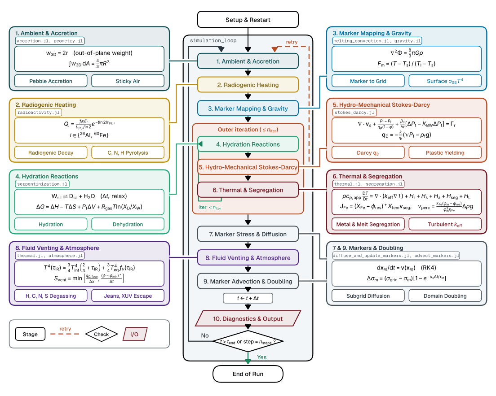
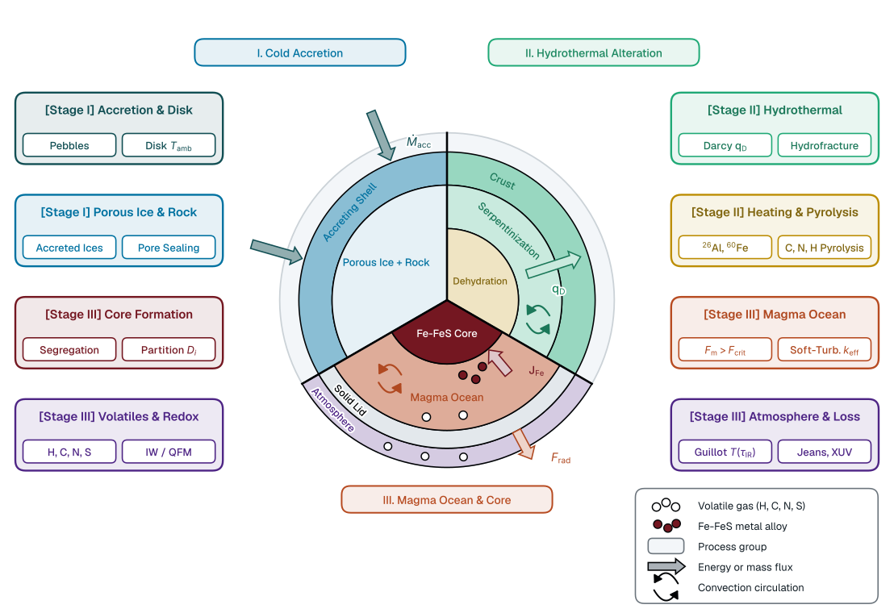

# Scientific Context: Early Planetesimal Evolution

`Erebus.jl` models the internal physical and geochemical evolution of icy and rocky planetesimals during the first tens of millions of years of Solar System history.

---

## The Physical Scenario

Planetesimals formed in the solar protoplanetary disk through the gravitational collapse of pebble swarms or streaming instabilities.
Bodies that accreted during the first 2 to 3 million years after the formation of Calcium-Aluminum-rich Inclusions (CAIs) incorporated substantial quantities of short-lived radioactive isotopes, predominantly $^{26}\text{Al}$ (half-life $t_{1/2} \approx 0.717\text{ Ma}$) and $^{60}\text{Fe}$ ($t_{1/2} \approx 2.62\text{ Ma}$).

As these radionuclides decayed, they generated intense internal volumetric heating:

### 1. Ice Melting
Initial temperatures of $\approx 170\text{ K}$ rose rapidly.
Once internal temperatures reached $273\text{ K}$, primordial water ice melted, absorbing latent heat ($L^f \approx 333\text{ kJ/kg}$) and generating mobile pore water in the porous silicate matrix.

### 2. Hydrothermal Circulation
Liquid water percolated through the interconnected pore network under Darcy flow, driven by thermal buoyancy and compaction-induced fluid pressure gradients.

### 3. Clay Dehydration and Gas Generation
At elevated temperatures ($T \approx 500\text{--}900\text{ K}$), hydrous phyllosilicates, such as serpentine, underwent thermal dehydration reactions, releasing bound hydroxyl groups as free supercritical fluid.

### 4. Matrix Compaction and Pore Overpressure
Viscous, elastic, and plastic deformation of the silicate matrix reduced porosity ($\phi$).
When the compaction rate exceeded the rate of fluid escape via Darcy percolation, pore fluid pressure ($P_f$) rose to match or exceed the lithostatic solid pressure ($P_t$).

### 5. Failure and Hydrofracture
When the Terzaghi effective stress became tensile ($\sigma_{\text{eff}} \le -\sigma_{\text{tensile}}$), the silicate matrix experienced hydrofracturing, creating high-permeability pathways that vented fluids to the planetesimal surface.

### 6. Silicate Rock Melting, Magma Ascent, and Magma Ocean Formation
In planetesimals that accreted early, decay heating drove temperatures past the silicate solidus ($T_{\text{sol}} \approx 1400\text{ K}$).
Rock melted into a crystal-liquid mush and transitioned into a vigorously convecting magma ocean above the rheological disaggregation threshold ($\phi_{\text{crit}} \approx 0.40$).
Buoyant silicate melt segregates outward via porous Darcy percolation and hindered Stokes crystal settling, releasing gravitational shear dissipation and latent heat of crystallization.
Sub-grid soft turbulence convection transported heat outward to the surface, buffering interior temperatures and governing core segregation.

### 7. Iron Core Formation and Metal Segregation
At temperatures exceeding the Fe-FeS eutectic ($T_{\text{eut}} \approx 1213\text{ K}$), dense metallic liquid melts and segregates inward toward the center.
In partially molten rock, metal trickles downward by porous Darcy percolation.
In magma oceans, metal droplets rain downward via Stokes settling, releasing gravitational potential energy that accelerates core formation.

---

## Global Architecture & Execution Flow

How does the simulation loop advance physical time, and which governing equations does it solve?
The simulation loop couples Eulerian staggered grids with Lagrangian markers.
In each time step, the solver evaluates 10 sequential stages to model thermal, mechanical, chemical, and atmospheric processes.

### Execution Pipeline and Governing Equations

Figure 1 shows the discrete execution spine and governing equations of the 10-stage simulation loop:

*Figure 1: Class D (Schematic Diagram): Erebus execution pipeline and governing equations. The center spine shows 1 time step in simulation call order. Side cards show governing equations and physical modules for each step. Module activation depends on configuration switches; all modules are shown active. Outer iterations solve coupled hydration, Stokes-Darcy fluid-matrix mechanics, and thermal energy equations. The non-convergence path restores state and halves the time step.*

Every symbol in the Figure 1 equation cards is defined as follows:
- **Accretion & Ambient**: Out-of-plane cylindrical integration width $w_\mathrm{3D} = 2r$ [$\text{m}$] at radius $r$ [`src/geometry.jl`] projects the 2D Cartesian domain into a 3D spherical planetesimal with exact volume $\int w_\mathrm{3D}\,\mathrm{d}A = \frac{4}{3}\pi R^3$ [$\text{m}^3$] over a planar disk of radius $R$ for mass accretion deposition [`src/accretion.jl`].
- **Heating & Pyrolysis**: $Q_i = \frac{f_i r_i E_i}{\tau_i} e^{-t/\tau_i}$ is the specific radiogenic heat production rate [$\text{W/kg}$] for radionuclide $i \in \{^{26}\mathrm{Al},\, ^{60}\mathrm{Fe}\}$, with reference isotope abundance $f_i$ [$\text{atoms/kg}$], initial isotopic ratio $r_i$ [-], decay energy $E_i$ [$\text{J}$], and mean lifetime $\tau_i$ [$\text{s}$] (`src/physics/radioactivity.jl:28`). Volumetric radiogenic heating rate $H_\mathrm{r}$ [$\text{W/m}^3$] is formed by weighting isotopic decay power by phase mass fractions and phase densities: $H_\mathrm{r} = (1 - \phi) [(1 - X_\mathrm{Fe}) \rho_\mathrm{sil} Q_{^{26}\mathrm{Al}} + X_\mathrm{Fe} \rho_\mathrm{Fe} Q_{^{60}\mathrm{Fe}}]$, where $\phi$ is matrix porosity [-], $X_\mathrm{Fe}$ is iron mass fraction [-], $\rho_\mathrm{sil}$ is silicate density [$\text{kg/m}^3$], and $\rho_\mathrm{Fe}$ is iron density [$\text{kg/m}^3$] (`src/physics/radioactivity.jl:70-98`, `src/simulation/steps/radiogenic_heating.jl:74-75`).
- **Hydration Reaction**: $\mathrm{W_{sil}} \rightleftharpoons \mathrm{D_{sil}} + \mathrm{H_2O}$ is the reversible reaction between hydrous silicate $\mathrm{W_{sil}}$, dry silicate $\mathrm{D_{sil}}$, and pore fluid $\mathrm{H_2O}$. $\Delta G = \Delta H - T\Delta S + P_\mathrm{f}\Delta V + RT\ln(X_\mathrm{D}/X_\mathrm{W})$ is the molar Gibbs free energy change [$\text{J/mol}$], with reaction enthalpy $\Delta H$ [$\text{J/mol}$], temperature $T$ [$\text{K}$], reaction entropy $\Delta S$ [$\text{J/(mol}\cdot\text{K)}$], pore fluid pressure $P_\mathrm{f}$ [$\text{Pa}$], reaction volume change $\Delta V$ [$\text{m}^3/\text{mol}$], universal gas constant $R$ [$\text{J/(mol}\cdot\text{K)}$], and solid molar fractions $X_\mathrm{D}, X_\mathrm{W}$ [-].
- **Venting & Atmosphere**: Semi-grey radiative equilibrium determines the atmospheric temperature profile $T(\tau)$ [$\text{K}$] via $T^4(\tau) = \frac{3}{4}T_\mathrm{int}^4\left(\frac{2}{3}+\tau\right) + \frac{3}{4}T_\mathrm{eq}^4\,f_\gamma(\tau)$, where $\tau$ is thermal optical depth [-], $T_\mathrm{int}$ is interior effective temperature [$\text{K}$], and $T_\mathrm{eq}$ is planetary equilibrium temperature [$\text{K}$]. $f_\gamma(\tau) = \frac{2}{3} + \frac{1}{\gamma\sqrt{3}} + \left(\frac{\gamma}{\sqrt{3}} - \frac{1}{\gamma\sqrt{3}}\right) e^{-\gamma\tau\sqrt{3}}$ is the analytical greenhouse profile [-] with visible-to-thermal opacity ratio $\gamma$ [-].
- **P2M, Melt & Gravity**: $\nabla^2\Phi = \frac{8}{3}\pi G\rho$ is the 2D Cartesian Poisson equation proxy for gravitational potential $\Phi$ [$\text{m}^2/\text{s}^2$] (calibrated with factor $\frac{2}{3} \cdot 4\pi G = \frac{8}{3}\pi G$ to recover exact radial interior gravity $g(r) = \frac{4}{3}\pi G\rho r$ of a uniform 3D sphere; see `telescoping_domain.md:118`), with gravitational constant $G$ [$\text{m}^3/(\text{kg}\cdot\text{s}^2)$] and bulk density $\rho$ [$\text{kg/m}^3$]. $F_\mathrm{m} = (T - T_\mathrm{s})\,/\,(T_\mathrm{l} - T_\mathrm{s})$ is the equilibrium melt fraction [-] between solidus $T_\mathrm{s}$ [$\text{K}$] and liquidus $T_\mathrm{l}$ [$\text{K}$].
- **Stokes-Darcy**: $\nabla\cdot\boldsymbol{\sigma}' - \nabla P + \rho\mathbf{g} = 0$ is solid momentum conservation with deviatoric stress tensor $\boldsymbol{\sigma}'$ [$\text{Pa}$], total mixture pressure $P$ [$\text{Pa}$], mixture density $\rho$ [$\text{kg/m}^3$], and gravitational acceleration $\mathbf{g}$ [$\text{m/s}^2$]. $\nabla\cdot\mathbf{v}_\mathrm{s} = -D\ln(1-\phi)/Dt$ is solid mass conservation with matrix velocity $\mathbf{v}_\mathrm{s}$ [$\text{m/s}$] and matrix porosity $\phi$ [-].
- **Thermal & Segregation**: $\rho c_p\, \partial T/\partial t = \nabla\cdot(k_\mathrm{eff}\nabla T) + H_\mathrm{r} + H_\mathrm{s} + H_\mathrm{a} + Q_\mathrm{seg} + H_\mathrm{L}$ is thermal energy conservation with volumetric heat capacity $\rho c_p$ [$\text{J/(m}^3\cdot\text{K)}$], effective thermal conductivity $k_\mathrm{eff}$ [$\text{W/(m}\cdot\text{K)}$], radiogenic heat $H_\mathrm{r}$ [$\text{W/m}^3$], shear heating $H_\mathrm{s}$ [$\text{W/m}^3$], adiabatic heating $H_\mathrm{a}$ [$\text{W/m}^3$], segregation dissipation heating $Q_\mathrm{seg}$ [$\text{W/m}^3$] (`thermal.jl:137`, `solve_thermal_energy.jl:305`), and reaction/phase-change latent heat $H_\mathrm{L}$ [$\text{W/m}^3$].
- **Markers & Domain**: $\mathrm{d}\mathbf{x}_m/\mathrm{d}t = \mathbf{v}(\mathbf{x}_m)$ is marker advection for marker position $\mathbf{x}_m$ [$\text{m}$] evaluated with a fourth-order Runge-Kutta scheme in velocity field $\mathbf{v}$ [$\text{m/s}$].

### Numerical Execution Pipeline

The simulation loop advances physical time via a 10-stage operator sequence:

1. **Accretion & Ambient (`prepare_step_ambient!`, `accrete!`)**:
   Computes disk ambient temperature and pressure, deposits accreted pebbles or embryos onto the body, advances planetary radius $R(t)$, injects impact kinetic energy into the outer shell, and updates sticky air boundaries.

2. **Heating & Pyrolysis (`radiogenic_heating!`, `update_pyrolysis!`)**:
   Computes analytical decay rates of short-lived radionuclides ($^{26}\text{Al}$, $^{60}\text{Fe}$), adds volumetric heat sources to markers, and updates volatile release from organic macromolecular carbon (pyrolysis).

3. **Marker-in-Cell Mapping & Gravity (`interpolate_markers_to_grid!`, `solve_gravity!`, `apply_surface_radiation!`)**:
   Interpolates marker properties (density $\rho$, viscosity $\eta$, thermal conductivity $k$, heat capacity $\rho c_p$, and porosity $\phi$) to staggered grid nodes using bilinear distance weights or tiled thread-local workspaces; solves the Poisson equation for gravitational potential $\Phi$ and gravity acceleration $\mathbf{g}$; and applies radiative surface boundary conditions.

4. **Hydration Reaction (`solve_hydration_iteration!`)**:
   Solves reversible serpentinization and dehydration reactions ($\mathrm{W_{sil}} \rightleftharpoons \mathrm{D_{sil}} + \mathrm{H_2O}$) based on Gibbs free energy minimization, updating mineral hydration states, fluid production, and chemical latent heat.

5. **Hydro-Mechanical Stokes-Darcy Solve (`assemble_hydromechanical_lse!`)**:
   Assembles and solves the monolithic linear system for solid matrix velocities $(v_x, v_y)$, total pressure $P_t$, fluid Darcy flux $(q_x, q_y)$, fluid pressure $P_\mathrm{f}$, matrix compaction, and Terzaghi effective stress plasticity.

6. **Thermal Energy & Metal Segregation (`solve_thermal_energy!`, `run_metal_segregation!`)**:
   Solves the thermal energy equation incorporating conduction, advection, latent heats of dehydration and melting, radiogenic sources, sub-grid soft turbulence convection, and gravitational segregation dissipation heating $Q_\mathrm{seg}$ from conservative iron metal drift-flux transport.

7. **Marker Viscoelasticity & Subgrid Diffusion (`diffuse_and_update_markers!`)**:
   Evaluates viscoelastic stress relaxation and performs subgrid thermal diffusion between grid nodes and markers following convergence of the thermomechanical outer iteration loop.

8. **Fluid Venting & Coupled Atmosphere (`vent_and_degas!`, `evolve_atmosphere!`)**:
   Evaluates matrix compaction, hydrofracture tensile failure venting, volatile drainage, and dynamic/equilibrium volatile exsolution across magma ocean zones; couples vented volatile inventories into surface atmospheric pressure and equilibrium temperature; and computes multi-species hydrodynamic and kinetic escape losses.

9. **Marker Advection & Replenishment (`advect_markers!`, `replenish!`, `telescope_domain!`)**:
   Advects Lagrangian marker coordinates $(x_m, y_m)$ using a fourth-order Runge-Kutta scheme, backtracks nodal total and fluid pressures, updates porosity state, replenishes under-populated grid cells, and executes telescoping domain doubling ($x_{\text{size}} \to 2 x_{\text{size}}$) when the body exceeds 70% of domain half-width.

10. **Diagnostics & Telemetry (`advance_step_diagnostics!`)**:
    Advances simulation physical time $t \leftarrow t + \Delta t$, logs conservation metrics and solver convergence, exports JLD2 checkpoint snapshots, and streams telemetry records.

**Where this is checked.** The execution pipeline and solver convergence loops are tested in `test/test_integration.jl`, `test/test_simulation.jl`, and `test/test_conservation_closure.jl`.

---

## Planetesimal Evolution Across Physical Stages

How does a planetesimal evolve from a cold dust aggregate into a differentiated body?
Planetesimals undergo 3 successive physical stages as radiogenic decay heats their interiors.
Figure 2 summarizes these stages and links them to the physical processes in Erebus.

*Figure 2: Class D (Schematic Diagram): Planetesimal evolution across 3 physical stages. Sectors show successive stages of 1 body; sector widths do not scale with time. Left and right cards show physical processes that Erebus solves. Active modules depend on configuration switches; all modules are shown active. Flux arrows are schematic.*

In Figure 2:
- **Stage I (Cold Accretion)**: Low temperatures preserve porous ice and pristine rock. Accretion flux $\dot{M}_\mathrm{acc}$ delivers pebbles and volatile ices to the surface.
- **Stage II (Hydrothermal Alteration)**: Radiogenic decay warms the interior. Ice melts into pore water. Darcy percolation $\mathbf{q}_\mathrm{D}$ drives hydrothermal circulation, serpentinization, and dehydration reactions through permeable crust.
- **Stage III (Magma Ocean & Core Formation)**: Deep heating drives silicate melting above the critical rheological transition ($F_\mathrm{m} > \phi_\mathrm{crit} \approx 0.40$). Molten iron metal drift-flux $\mathbf{J}_\mathrm{Fe}$ descends to form a metallic core, releasing segregation dissipation heating $Q_\mathrm{seg}$ (`segregation.jl:897, 1839`, `thermal.jl:137`). Surface radiative heat flux $F_\mathrm{rad}$ radiates into space and drives atmospheric escape.

**Where this is checked.** Benchmark comparisons and analytical solutions for these physical regimes are documented in the [Benchmark Reference Suite](../reference/benchmarks/index.md) and verified in `test/test_hydrothermal_convection.jl`, `test/test_core_formation.jl`, and `test/test_magma_transport.jl`.

## Thermo-Hydro-Mechanical Coupling

`Erebus.jl` resolves these interacting regimes through a fully coupled numerical framework:
- Thermal solver calculates conduction, radioactive decay, latent heat buffering, fluid advective heat transport, and segregation dissipation heating.
- Hydromechanical solver simultaneously solves coupled Stokes solid deformation, Darcy fluid flux, and poroelastic volume changes in a monolithic linear system.
- Marker-in-Cell advects material phases, temperature, composition, and porosity without numerical diffusion across moving boundaries.
- Melting and soft turbulence routines evaluate pressure-dependent silicate melting, apparent heat capacity latent heat buffering, suspension rheology, and regularized sub-grid convective conductivity.
- Magma transport drift-flux solver tracks conservative outward buoyant migration of silicate melt, couples Darcy percolation and hindered Stokes crystal settling, models subsolidus crystallization and dissipation heating, and tracks mantle depletion.
- Metal segregation drift-flux solver tracks conservative downward migration of molten iron, couples percolation and Stokes droplet settling through the rheological transition, and computes gravitational dissipation heating.

---

## Geometry Convention

Erebus.jl models the planetesimal as a 2D Cartesian cross-section passing through the planetary center $(x_{\text{center}}, y_{\text{center}})$.

### Two-Dimensional Form and Three-Dimensional Mapping

The computational domain represents a planar slice through a spherical body. To evaluate three-dimensional integral quantities (such as total mass, component inventories, and integrated volatile degassing) from planar marker positions, each Lagrangian marker $m$ at distance $r_m = \sqrt{(x_m - x_{\text{center}})^2 + (y_m - y_{\text{center}})^2}$ carries an effective out-of-plane spherical integration length $L(r_m)$:

\[
L(r_m) = 2 r_m
\]

Under the assumption of spherical symmetry, this geometric mapping reinterprets each concentric ring at radius $r_m$ as a spherical shell of radius $r_m$. Integrating over a circular disk of radius $R$ in the 2D Cartesian cross-section with differential marker area $A_m = \Delta x_m \Delta y_m$ recovers the exact volume of a sphere:

\[
V_{\text{3D}} = \int_{\text{disk}} L(r) \, dA = \int_0^{2\pi} d\theta \int_0^R (2r) \, r \, dr = 4\pi \int_0^R r^2 \, dr = \frac{4}{3} \pi R^3
\]

For spherically symmetric or radially averaged distributions, mass increments and volatile transfers map between 2D planar sums and 3D spherical inventories via:

\[
\Delta M = \sum_m \rho_m A_m L(r_m) \Delta C_m, \quad L(r_m) = 2 r_m, \quad A_m = \Delta x_m \cdot \Delta y_m
\]

where $\rho_m$ is the marker density, $A_m$ is the marker differential area, and $\Delta C_m$ is the dimensionless mass fraction or phase change increment.

### Weighting Limits

The out-of-plane weighting function $L(r) = 2r$ exhibits three characteristic limits in planetary structures:
1. **Planetary surface limit ($r \to R$)**: Near the outer planetary radius, $L(R) = 2R$. Surface flux and atmospheric exchange calculations scale with out-of-plane diameter $2R$.
2. **Finite shell mean ($r \in [r_{\text{inner}}, R]$)**: For an outer spherical shell, the ratio of integrated 3D shell mass to 2D planar shell mass equals $\frac{4}{3} \frac{R^3 - r_{\text{inner}}^3}{R^2 - r_{\text{inner}}^2}$. For a near-surface shell spanning $0.9R \le r \le R$, this ratio evaluates to approximately $1.902 R$.
3. **Full spherical volume mean**: Integrating over the entire circular section yields the full spherical volume $\frac{4}{3} \pi R^3$, corresponding to an area-weighted mean out-of-plane thickness of $\frac{4}{3} R$.

### Dynamic Flow and Conservation

Hydromechanical Stokes flow, Darcy filtration, and marker transport operate in the 2D Cartesian cross-section. Because 2D Cartesian divergence-free velocity fields ($\nabla \cdot \mathbf{v} = 0$) do not preserve the axisymmetric volume element $r \, dr$, planar advection does not automatically conserve the 3D-weighted inventory $\sum_m \rho_m A_m (2 r_m)$. The helper functions `marker_out_of_plane_length` and `marker_area` provide the geometric primitives to evaluate 3D spherical projections alongside 2D cross-sectional quantities.

Thermal conduction incorporates an optional radial geometric metric term to account for spherical divergence in conductive heat flow in the cross-section.

### Gravitational Source Term

The Poisson solver evaluates gravitational potential from the 2D density field using an effective source term $(8/3) \pi G \rho$. This source coefficient reproduces the exact radial gravitational acceleration at the surface of a uniform-density sphere of radius $R$.

