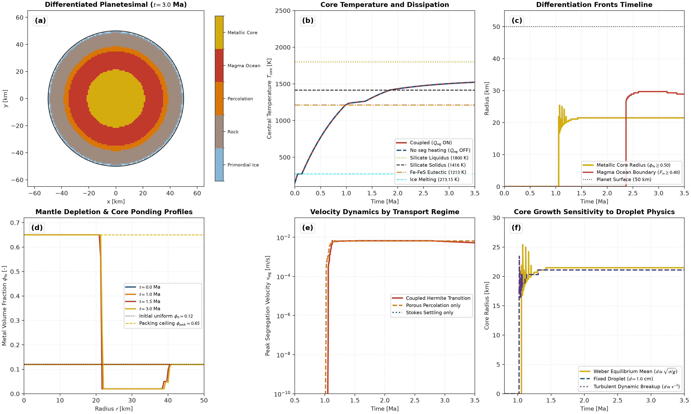
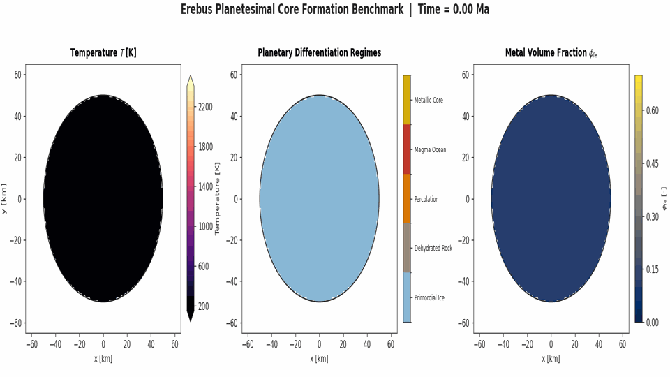
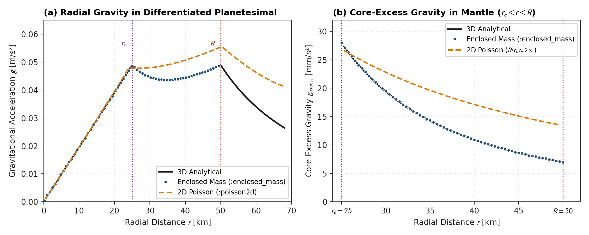

# Iron Core Formation and Metal-Silicate Segregation

This page documents the physical formulation, mathematical limits, and numerical implementation of iron core formation in `Erebus.jl`. The model couples porous Fe-FeS percolation through solid silicate matrices, Stokes droplet settling through silicate magma oceans, segregation dissipation heating, and mass-conservative transport.

---

## 1. Physical Motivation

Early planetary differentiation separates dense metallic iron from lighter silicate rock to form a central metallic core and an overlying silicate mantle. In early Solar System planetesimals, this differentiation is driven by internal decay heating from short-lived radionuclides ($^{26}\text{Al}$ and $^{60}\text{Fe}$).

Iron-nickel-sulfur metal starts melting at $T_{\text{eutectic}} \approx 1213\text{ K}$ (lowered below the $\sim 1261\text{ K}$ pure Fe-FeS eutectic by Ni, P, and C), below the silicate solidus ($T_{\text{solidus}} \approx 1400\text{ K}$).
Metal-silicate segregation spans three transport intervals:

1. **Porous Percolation Regime ($F_m < 0.40$)**: In crystalline silicate rock, liquid Fe-FeS melt percolates along mineral grain boundaries under gravity once the liquid metal fraction exceeds the percolation threshold ($\phi_{\text{crit,perc}} \approx 0.05$).
   Porous Darcy dynamics with Kozeny-Carman permeability govern the flow.
2. **Transition Mush Zone ($0.40 \le F_m \le 0.50$)**: Segregation velocity blends porous percolation with droplet settling between `F_settle_start` ($0.40$) and `F_perc_end` ($0.50$).
   Separately, above `[melting] phi_crit` (default $0.40$), silicate viscosity transitions smoothly into a crystal-suspension regime.
3. **Magma Ocean Stokes Settling Regime ($F_m > 0.50$)**: Above $F_{\text{perc\_end}}$, metal moves by droplet settling alone.
   Dense liquid metal emulsifies into droplets whose diameter follows capillary-hydrodynamic balance, and droplets sink through the magma suspension following Stokes drag with hindered-settling corrections.

Segregation also updates thermal energy and bulk cell properties:
- **Dissipation Energetics**: Sinking metal releases gravitational potential energy as frictional heat, though in a 50 km body this heat is small relative to $^{26}\text{Al}$ heating.
- **Property Blending**: Bulk density, thermal conductivity, and volumetric heat capacity update dynamically in space as metal migrates toward the planetary center.

---

## 2. Theoretical Formulation

The physical theory, chemical equation of state models ([Sanloup et al., 2000](../bibliography.md#Core-Formation-and-Metal-Silicate-Segregation); [Morard et al., 2014](../bibliography.md#Core-Formation-and-Metal-Silicate-Segregation)), permeability relations, and droplet breakup mechanics are derived in detail in [Iron Core Formation and Metal Segregation](../../explanations/core_formation.md).

Key constitutive formulations validated on this page include:

- **Mobile Metal Volume Fraction ($\phi_m$):**
  $$\phi_m = F_{\text{fe}}(T) \cdot X_{\text{fe,bulk}}, \quad F_{\text{fe}}(T) = \text{clamp}\left(\frac{T - T_{\text{eutectic}}}{\Delta T_{\text{metal}}}, 0, 1\right)$$
- **Porous Darcy Percolation Velocity ($v_{\text{perc}}$):**
  $$v_{\text{perc}} = \frac{k_{\text{metal}}(\phi_m)}{\phi_m \, \eta_{\text{metal}}} \Delta\rho \, g$$
- **Magma Ocean Stokes Settling Velocity ($v_{\text{settle}}$):**
  $$v_{\text{settle}} = v_{\text{stokes}} \, h(\phi_m), \quad v_{\text{stokes}} = \frac{2}{9} \frac{\Delta\rho \, g \, r_{\text{drop}}^2}{\eta_{\text{susp}}} C_{\text{HR}}$$
  where $\eta_{\text{susp}}$ blends exponential melt weakening below $\phi_{\text{crit}}$ smoothly into the crystal-suspension law ([Roscoe, 1952](../bibliography.md#Silicate-Melting-and-Magma-Rheology); [Solomatov, 2015](../bibliography.md#Silicate-Melting-and-Magma-Rheology)) and $\Delta\rho = \rho_{\text{metal}} - \rho_{\text{sil,eff}}$.
- **Continuous Hermite Handover ($v_{\text{seg}}$):** Smooth $C^1$ transition over the interval $F_m \in [F_{\text{settle\_start}}, F_{\text{perc\_end}}]$:
  $$v_{\text{seg}} = (1 - \xi) v_{\text{perc}} + \xi v_{\text{settle}}, \quad \xi = 3s^2 - 2s^3$$
  where $s = (F_m - F_{\text{settle\_start}}) / (F_{\text{perc\_end}} - F_{\text{settle\_start}})$.
- **Gravitational Dissipation and Counterflow Sensible Heat ($Q_{\text{seg}}$):**
  $$Q_{\text{seg}} = \Delta\rho \, g \, J_{\text{realized}} + Q_{\text{sens}}$$

  where $J_{\text{realized}}$ is the realized face volume flux density over active substeps and $Q_{\text{sens}}$ balances subcycle two-phase enthalpy counterflow between settling metal and rising silicate.
- **Volume-Weighted Material Property Blending:**
  $$\rho = (1 - X_{\text{fe}}) \rho_{\text{silicate}} + X_{\text{fe}} \rho_{\text{metal}}$$
  $$\rho c_p = (1 - X_{\text{fe}}) (\rho c_p)_{\text{silicate}} + X_{\text{fe}} (\rho c_p)_{\text{metal}}$$
  $$k = (1 - X_{\text{fe}}) k_{\text{silicate}} + X_{\text{fe}} k_{\text{metal}}$$

---

## 3. Discretization and Mass Conservation

Metal segregation is solved on the Eulerian grid using a finite-volume drift-flux formulation.

### Local CFL Subcycling

The Stokes-Darcy hydrodynamic timestep $\Delta t_{\text{hydro}}$ is governed by silicate convection and thermal diffusion ($\sim 10^3\text{ yr}$).
Explicit stability uses the characteristic speed $v_{\text{char}} = \max(v_{\text{seg}}, |\partial q/\partial \phi_m|)$ at each active face, where $q$ is the metal flux.
Each adaptive substep satisfies $\Delta t_{\text{sub}} \le \Delta t_{\text{CFL}}$, and at most `max_subcycles` substeps execute per outer step:

$$\Delta t_{\text{CFL}} = \text{cfl\_settling} \cdot \frac{\min(\Delta x, \Delta y)}{\max_{\text{active faces}} v_{\text{char}}}$$

### Multi-Dimensional Flux Limiters and Marker Capacity Redistribution

To guarantee strict non-negativity and prevent exceeding maximum packing fraction $\phi_{\text{pack}}$ on 2D staggered grids:

1. **Outflow Limiter**: For cell $(i, j)$ donating metal through horizontal and vertical faces, total face outflow $Out_{\text{total}} = \sum \Phi_{\text{out}} \Delta t_{\text{sub}}$ must not exceed available metal mass $m_{\text{avail}}$.
   All outward fluxes are scaled by $\alpha_{\text{out}} = \min(1.0, m_{\text{avail}} / Out_{\text{total}})$.
2. **Inflow Limiter**: Total incoming flux $In_{\text{total}} = \sum \Phi_{\text{in}} \Delta t_{\text{sub}}$ must not exceed available 3D volume-weighted metal capacity $m_{\text{cap}} = \sum_{m \in \text{cell}} \max(0, \phi_{\text{pack}} - X_{\text{fe,bulk}}[m]) w_{3\text{D},m}$.
   All inward fluxes are scaled by $\alpha_{\text{in}} = \min(1.0, m_{\text{cap}} / In_{\text{total}})$.
3. **Capacity-Weighted Marker Update**: When net cell mass changes are distributed back to markers, markers in cells gaining metal receive increments proportional to their remaining room below $\phi_{\text{pack}}$.
   Markers in cells losing metal scale proportionally to their molten metal fraction $X_{\text{fem}}$, keeping solid metal fixed.
   This guarantees that individual markers never violate $[0, \phi_{\text{pack}}]$, even with non-uniform initial distributions.

### Machine-Precision Conservation

Provided all initial marker bulk metal fractions satisfy $0 \le X_{\text{fe,bulk}} \le \phi_{\text{pack}}$, after subcycled finite-volume transport, any floating-point truncation residual is corrected via a uniform, bounded mass correction over eligible interior planet markers below the packing ceiling $\phi_{\text{pack}}$. The global relative mass error satisfies:

$$\frac{|M_{\text{metal}}(t) - M_{\text{metal}}(0)|}{M_{\text{metal}}(0)} < 10^{-12}$$

in the drift-flux solver, and $< 10^{-10}$ in coupled multi-physics simulation loops.

---

## 4. Planetesimal Core Formation Benchmark Suite

The core formation benchmark configuration (`configs/core_formation_benchmark.toml`) simulates a 50 km radius planetesimal initialized at $2.25\text{ Ma}$ with preheated interior rock at $1350\text{ K}$ and bulk metal volume fraction $X_{\text{fe,bulk}} = 0.20$. The benchmark runs 5 timesteps ($\sim 16\text{ kyr}$) to verify dynamic metal segregation, local CFL subcycling, and conservative marker updates under coupled thermo-hydro-mechanical evolution.

### Physical Differentiation Timeline

The planetesimal differentiates in four sequential stages driven by $^{26}\text{Al}$ radioactive decay in the rock component:

1. **Primordial Homogeneous Accretion ($t = 0\text{ Ma}$)**: The body starts completely cold ($T = 150\text{ K}$) and uniformly icy throughout its entire volume.
2. **Pore Ice Melting and Rock Desiccation ($t \approx 0.3 - 0.8\text{ Ma}$)**: Radioactive decay warms the interior above 273.15 K. Pore ice melts in the interior and dehydrates the rock, while surface conductive cooling maintains a cold outer lid ($T < 273.15\text{ K}$) where primordial ice is preserved dynamically.
3. **Porous Fe-FeS Percolation ($t \approx 1.0 - 1.4\text{ Ma}$)**: Interior temperatures reach the Fe-FeS eutectic ($T_{\text{eutectic}} = 1213\text{ K}$). Molten metallic alloy exceeds the percolation threshold ($\phi_{\text{crit,perc}} = 0.05$) and drains inward through crystalline silicate pores.
4. **Magma Ocean Stokes Settling and Core Ponding ($t \approx 1.5 - 3.5\text{ Ma}$)**: Silicate melting crosses the solidus ($1400\text{ K}$) and reaches the settling onset ($F_{\text{settle\_start}} = 0.40$).
   Dense liquid metal droplets settle rapidly through the low-viscosity magma suspension.
   Droplets pond at the planetary center to form a segregated metallic core of radius $\approx 27\text{ km}$ at maximum packing ($\phi_{\text{pack}} = 0.65$), capped by an iron-depleted silicate mantle ($\phi_{\text{fe}} = 0.02$) and an outer primordial icy crust.

### Benchmark Results

The multi-panel summary figure illustrates the critical physical mechanisms:

*Figure 1: Class B (1D Finite-Difference Benchmark Solver): Multi-panel verification benchmark for iron core formation and metal-silicate segregation. The model executes a 1D spherical finite-difference solver in Julia (`generate_core_formation_benchmarks.jl`) mapped radially onto a 2D mesh in Python (`generate_core_formation_benchmark.py`). Automated 2D solver verification is executed in `test/test_core_formation.jl`. (a) Revolved differentiated body map ($t = 3.0\text{ Ma}$) showing the segregated central iron core (gold), surrounded by an iron-depleted silicate mantle (red), and preserved cold primordial crust (blue). (b) Core temperature: central temperature evolution $T_{\text{core}}(t)$ comparing cases with and without gravitational dissipation heating ($Q_{\text{seg}}$). (c) Differentiation fronts timeline: radial expansion of the metallic core boundary and the magma ocean boundary. (d) Radial metal concentration profiles $\phi_{\text{fe}}(r)$ across evolution epochs. (e) Transport regime comparison: segregation velocities for percolation only, Stokes settling only, and the coupled Hermite transition model. (f) Droplet size physics sensitivity: core radius growth for constant diameter, Weber balance, and turbulent breakup.*

### Revolved Simulation Animation

The animation below displays the 1D spherical core formation benchmark revolved into 2D Cartesian frames over 3.5 Ma starting from a completely uniform icy mixture. The panels display internal temperature with phase boundaries (left), compositional differentiation regimes (center), and bulk metal volume fraction $\phi_{\text{fe}}$ (right).

*Figure 2: Class B (1D Finite-Difference Benchmark Solver): Revolved 1D spherical finite-difference simulation frames over 3.5 Ma of planetesimal evolution, displaying temperature, differentiation regimes, and metal volume fraction.*

A high-framerate MP4 video is available at `../../assets/core_formation_differentiation.mp4`.

### Self-Gravity in Differentiated Bodies (`:poisson2d` vs `:enclosed_mass`)

To validate self-gravitational acceleration in differentiated planetesimals, `Erebus.jl` compares the 2D Cartesian Poisson solver against the 3D enclosed-mass formulation on a two-layer planetesimal ($R = 50\text{ km}$, $r_c = 25\text{ km}$, $\rho_c = 7000\text{ kg/m}^3$, $\rho_m = 3000\text{ kg/m}^3$):

*Figure 3: Class B (Julia Library Exporter): Self-gravity acceleration and core-excess comparisons for a differentiated planetesimal ($R = 50\text{ km}$, $r_c = 25\text{ km}$, $\rho_c = 7000\text{ kg/m}^3$, $\rho_m = 3000\text{ kg/m}^3$) evaluated by `benchmarks/export_gravity_two_layer_benchmark.jl`. (a) Total radial acceleration $g(r)$ comparing the 3D analytical solution, the discrete marker enclosed-mass mode (`:enclosed_mass`), and the 2D Cartesian Poisson mode (`:poisson2d`). (b) Core-excess gravity anomaly $g_{\text{excess}}(r)$ outside the core ($r_c \le r \le R$).*

1. **Analytical 3D Spherical Profile:**
   Outside the central core ($r \ge r_c$), true 3D spherical gravity follows:
   $$g_{3D}(r) = \frac{4}{3} \pi G \left[ \rho_m r + (\rho_c - \rho_m) \frac{r_c^3}{r^2} \right]$$
   The 3D enclosed-mass mode (`geometry.gravity_mode = :enclosed_mass`) reproduces the analytical profile to within 0.21% across the mantle, with a surface relative error of 0.036%.
2. **2D Poisson Distortion:**
   Under `:poisson2d`, the cylindrical Green's function causes the core-excess gravity $g_{\text{excess}}(r) = g(r) - (4/3) \pi G \rho_m r$ to fall off as $1/r$ instead of $1/r^2$. At the planet surface $r = R$, the continuum analytical limit overpredicts the core-excess anomaly by a factor of:
   $$\frac{g_{\text{excess, poisson2d}}(R)}{g_{\text{excess, 3D}}(R)} \approx \frac{R}{r_c} = 2.0$$
   (1.92 on the discrete $65 \times 65$ grid due to domain boundary Dirichlet grounding) and increases total surface gravity by 14.3% (13.2% on grid). The enclosed-mass formulation removes this cylindrical artifact.

---

## 5. Validation and Provenance Summary

| Attribute | Specification |
|:---|:---|
| **Target Physics / Diagnostic** | Porous Fe-FeS percolation, Stokes droplet settling, mush transition handover, dissipation heating, and self-gravity in differentiated bodies |
| **Reference Standard** | [Rubie et al. (2015)](../bibliography.md#Core-Formation-and-Metal-Silicate-Segregation); [Monteux et al. (2009)](../bibliography.md#Core-Formation-and-Metal-Silicate-Segregation); [Lichtenberg et al. (2019)](../bibliography.md#Primary-References) |
| **Figure Provenance** | Class B (1D Finite-Difference Benchmark Solver / Julia Library Exporter) |
| **Generating Script** | `benchmarks/generate_core_formation_benchmarks.jl`, `benchmarks/render_core_formation_movie.py`, `benchmarks/export_gravity_two_layer_benchmark.jl` |
| **Automated Verification Test** | `test/test_core_formation.jl`, `test/test_reference_runs.jl` |
| **Quantitative Tolerance** | Analytical 1D gravity $L_2 < 1.0\times 10^{-4}$; core metal conservation closed to machine precision $< 10^{-12}$ |

---

## 6. Literature Anchors

Full citation details and DOI links for the core-formation and suspension-rheology studies referenced on this page are listed in the [Bibliography and Citations](../bibliography.md):

- Permeable percolation and magma-ocean core formation physics: [Yoshino et al. (2003)](../bibliography.md#Core-Formation-and-Metal-Silicate-Segregation), [Rubie et al. (2003)](../bibliography.md#Core-Formation-and-Metal-Silicate-Segregation), [Rubie et al. (2015)](../bibliography.md#Core-Formation-and-Metal-Silicate-Segregation), and [Lichtenberg et al. (2019)](../bibliography.md#Primary-References).
- Gravitational heating and turbulent droplet emulsification: [Monteux et al. (2009)](../bibliography.md#Core-Formation-and-Metal-Silicate-Segregation), [Deguen et al. (2011)](../bibliography.md#Core-Formation-and-Metal-Silicate-Segregation), [Deguen et al. (2014)](../bibliography.md#Core-Formation-and-Metal-Silicate-Segregation), and [Taylor (1934)](../bibliography.md#Core-Formation-and-Metal-Silicate-Segregation).
- Suspension viscosity, hindered settling, and Fe-S alloy equations of state: [Roscoe (1952)](../bibliography.md#Silicate-Melting-and-Magma-Rheology), [Richardson and Zaki (1954)](../bibliography.md#Silicate-Melting-and-Magma-Rheology), [Solomatov (2015)](../bibliography.md#Silicate-Melting-and-Magma-Rheology), [Sanloup et al. (2000)](../bibliography.md#Core-Formation-and-Metal-Silicate-Segregation), and [Morard et al. (2014)](../bibliography.md#Core-Formation-and-Metal-Silicate-Segregation).
