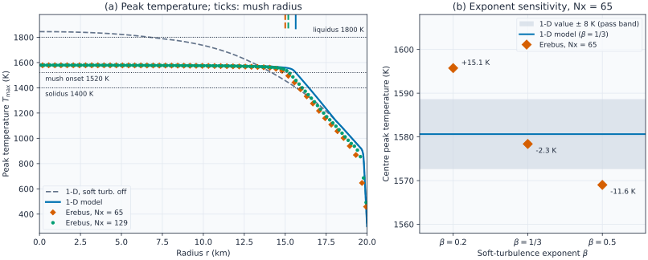
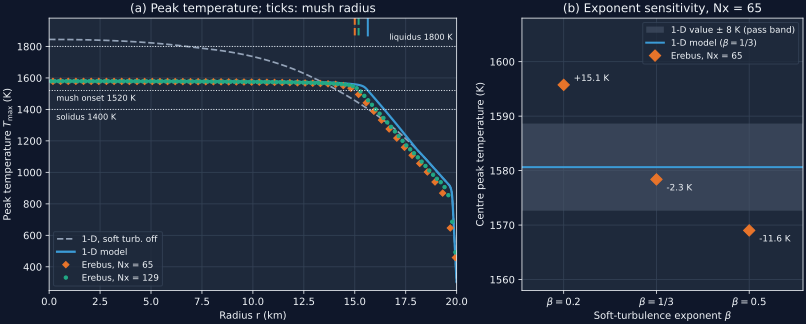

# Magma Ocean Conductivity

## What this page checks

This page checks how `Erebus.jl` carries heat out of molten, convecting silicate rock in the complete time loop.
Convection in a molten planetesimal runs in boundary layers far thinner than a grid cell, so the grid cannot resolve it (see [the sub-grid soft turbulence model](../explanations/rock_melting.md)).
`Erebus.jl` therefore raises the thermal conductivity of rock whose melt fraction passes a threshold (`melting.soft_turbulence = true`); this larger effective conductivity stands for the heat that small-scale convection carries.
It buffers the interior temperature: the centre stops heating inside the ramp window, between 1520 K and 1600 K, far below the liquidus of 1800 K.
The case is the [melting shell case](melting_shell.md) with this law on.
Validation here means that we run the code on a case where we know the right answer from another source: an independent 1-D finite-volume model of a sphere with the same porosity, latent heat and soft-turbulence conductivity laws.
If this part of the code were wrong, molten planetesimal interiors would overheat past the liquidus, or a planetesimal would lose its outer shell of unmelted rock at the wrong formation time.

**Terms on this page.**

- Melt fraction $F$: the mass fraction of molten silicate rock, rising linearly from 0 at the solidus to 1 at the liquidus.
- Peak temperature $T_{max}$: the highest temperature that a rock marker reaches during the run.
- Mush: on this page, rock whose peak melt fraction exceeds $F_{start} = 0.30$ ($T_{mush} = 1520$ K), where the soft-turbulence conductivity begins to rise.
- Ramp window: the melt fraction range $F_{start} = 0.30$ to $F_{end} = 0.50$ (1520 K to 1600 K) over which the effective conductivity transitions smoothly toward its turbulent value.
- Effective conductivity $k_{eff}$, in W/(m K): the conductivity of a rock marker with the soft-turbulence law on; it equals the porous rock conductivity $k_{cond}$ below the ramp window and rises to the turbulent value $k_{turb}$ above it.
- Dry porosity $\phi_d$: the pore fraction of a rock marker; rock above the solidus has sintered to $\phi_d \approx 0$.
- Lid: the outer shell of rock that stays below $T_{mush}$ and carries heat by conduction alone.
- Plateau: the nearly flat radial profile of $T_{max}$ inside the convecting core.
- Bin: a radial shell of width $\Delta x / 2$; the page compares the median $T_{max}$ of rock markers in each bin.

The page has 7 parts:

- a case that CI runs on every pull request, with recorded values;
- the same case on a finer grid, run by hand, with recorded values;
- runs without soft turbulence and with wrong convective exponents that fail the pass limits;
- a single-step check of a sharp hot start with the explicit spherical radial term;
- a single-step check of marker conductivity, grid faces and subgrid relaxation at four melt fractions;
- the numerical error from the time step and from cell-face conductivity averaging;
- centre peak temperatures of the 1-D model over planetesimal radius and formation time.

Each validation case says why the check exists, what it tests, how we know the right answer and why it matters.
The box "Test details" at the end of each case gives the reference, the tolerance, the test ids and the command.

**The test set-up.**

- A planetesimal of radius $R_p = 20$ km sits at the centre of a square box of 48 km, with air markers outside the body.
- Grid nodes outside $R_p$ hold the disk temperature of 290 K (`thermodynamics.surface_temperature = :fixed`).
- `Nx` is the number of basic grid nodes on each side of the box.
  The cell size $\Delta x$ is 750 m at `Nx = 65` and 375 m at `Nx = 129`.
- The rock starts at 290 K with initial porosity $\phi_{init} = 0.25$, cold pressed under self-gravity with `porosity.model = "henke2012"` ([Henke et al., 2012](../reference/bibliography.md#Porosity,-Cold-Pressing,-and-Sintering); [Lichtenberg et al., 2016a](../reference/bibliography.md#Porosity,-Cold-Pressing,-and-Sintering)).
- Decay of $^{26}$Al heats the body from a formation time $t_{form} = 0.85$ Myr after the first solids, the calcium-aluminium-rich inclusions.
- The run takes 140 steps of 10 kyr, 1.40 Myr in total.
- Silicate rock melts linearly between the solidus $T_s = 1400$ K and the liquidus $T_l = 1800$ K with latent heat $L = 4 \times 10^5$ J/kg.
- Melt and solid share the density 3300 kg/m$^3$ (`magma_transport.active = false`), and thermal expansion and Stokes thermal buoyancy are zero (`alphasolidm = 0`, `thermal_buoyancy = false`), so neither melt percolation nor resolved Stokes convection acts.
- Effective conductivity $k_{eff}$ rises smoothly over the ramp window $F_{start} = 0.30$ ($T_{mush} = 1520$ K) to $F_{end} = 0.50$ ($1600$ K), with convective exponent $\beta = 1/3$, viscosity of molten silicate rock $\eta_{fluid,sil} = 100$ Pa s, and lowest viscosity that the flow solver accepts $\eta_{min} = 10^{12}$ Pa s ([Kraichnan, 1962](../reference/bibliography.md#Hydrothermal-Convection-and-Fluid-Transport); [Solomatov and Stevenson, 1993](../reference/bibliography.md#Silicate-Melting-and-Magma-Rheology); [Siggia, 1994](../reference/bibliography.md#Silicate-Melting-and-Magma-Rheology); [Solomatov, 2007](../reference/bibliography.md#Silicate-Melting-and-Magma-Rheology); [Solomatov, 2015](../reference/bibliography.md#Silicate-Melting-and-Magma-Rheology)).

---

## The buffered centre temperature, the plateau and the mush radius against a 1-D model

**Why this check exists.**
The time loop could leave out the soft-turbulence conductivity on markers, use an exponent far from $\beta = 1/3$, or fail to carry marker conductivity onto the grid faces.
The molten interior would then overheat by hundreds of kelvin, or form a steep conductive temperature profile instead of a flat convective plateau.
The section on wrong exponents below shows which exponent shifts fail these limits; smaller viscosity shifts inside the 8.0 K window are caught by the single-step marker check and the record regression bands.

**What it tests.**
The case runs at `Nx = 65`.
Each rock marker records its peak temperature $T_{max}$ over the 1.40 Myr evolution.
We check 5 diagnostics:

- the centre peak temperature: the median $T_{max}$ of rock markers in the innermost bin of width $\Delta x / 2$, compared against the 1-D model;
- the plateau temperature drop: the drop in binned $T_{max}$ from the centre bin to the radial bin containing $0.5 R_p$ ($10$ km, deep inside the convecting core), bounded between 0 and 8.0 K;
- the mush radius $r_{mush}$: the outer radius where $T_{max}$ exceeds $T_{mush} = 1520$ K ($F_{max} > 0.30$), compared against the 1-D model;
- the melt radius $r_F$: the outer radius where $T_{max}$ exceeds $T_s = 1400$ K ($F_{max} > 0$, the base of the unmelted chondritic shell), compared against the 1-D model;
- the relative L2 error of $T_{max} - 290$ K against the 1-D model over radial bins where the 1-D peak temperature is at least 1100 K.

We also check 2 solver residuals: the discrete linear-system residual of the final 2-D thermal step, and the cumulative enthalpy residual of the 1-D reference run.

**How we know the right answer.**
The 1-D model is `solve_porous_sphere` in `benchmarks/validation_porous_shell.jl`, with 2000 radial cells and the latent heat as an apparent heat capacity.
Its conductivity function `k_soft_turb_ref` evaluates the law in the box below from fixed parameter constants rather than reading the run configuration.
Unit tests check that it matches the marker routine `compute_marker_properties!` to machine precision below the solidus, inside the ramp window and above $F_{end}$, and gives identical outputs to the unbuffered 1-D solver when disabled.
In this case the 1-D centre peaks at 1580.64 K at 0.91 Myr after formation, where the cell conductivity reaches 705.0 W/(m K).
The 1-D plateau drop over the inner 10 km is 3.33 K, the mush radius is 15640 m (leaving a 4360 m conductive lid, 5.8 cells wide at `Nx = 65`), and the melt radius is 16440 m.
Without soft turbulence, the same 1-D setup reaches 1844.6 K at 1.40 Myr (264.0 K hotter, with a 106.8 K drop over the inner 10 km) and continues heating to a global peak of 1984.4 K at 1.98 Myr (403.8 K above the buffered peak).

!!! details "The 1-D model with soft-turbulence conductivity"
    Above the solidus, the solver-clamped melt-weakened rock viscosity $\eta_{num}(F)$ weakens exponentially as $\eta_{solid} \exp(-\alpha_\eta F)$ with $\eta_{solid} = 10^{19}$ Pa s and $\alpha_\eta = 28$ below $\phi_{crit} = 0.40$ ([Costa et al., 2009](../reference/bibliography.md#Silicate-Melting-and-Magma-Rheology)), interpolates log-linearly toward $\eta_{melt} = 10$ Pa s above $\phi_{crit}$, and is clamped to $[\eta_{min}, \eta_{max}] = [10^{12}, 10^{23}]$ Pa s.
    In the ramp window $F \in (F_{start}, F_{end}] = (0.30, 0.50]$, the reference fluid viscosity $\eta_{fluid}(F)$ blends log-linearly from $\eta_{num}(F)$ to $\eta_{fluid,sil} = 100$ Pa s with $\xi_F = \mathrm{clamp}((F - F_{start}) / (F_{end} - F_{start}), 0, 1)$, so $\eta_{num} / \eta_{fluid} \ge 1$ everywhere.
    With porous lattice conductivity $k_{cond} = k_{porous}(k_{solid}, \phi_d)$, the asymptotic turbulent conductivity is
    $$k_{turb} = \max\left( k_{cond}, \, \mathrm{clamp}\left( k_{cond} \left( \frac{\eta_{num}}{\eta_{fluid}} \right)^\beta, \, k_{floor}, \, k_{cutoff} \right) \right)$$
    with $k_{floor} = 10^{-3}$ W/(m K) and $k_{cutoff} = 10^6$ W/(m K).
    Cubic Hermite weight $w_F = 3 \xi_F^2 - 2 \xi_F^3$ and surface contrast weight $w_T = \mathrm{clamp}(\max(0, T - T_{surf,ref}) / \Delta T_{min}, 0, 1)^2$ ($T_{surf,ref} = 300$ K, $\Delta T_{min} = 10$ K) combine into $w_{tot} = w_F w_T$ for geometric interpolation in $\log_{10} k$.

**Why it matters.**
The convective buffer sets the thermal fate of an early planetesimal.
Either its interior stays partly molten under an unmelted chondritic shell, or it heats past the liquidus and separates into layers ([Lichtenberg et al., 2016a](../reference/bibliography.md#Porosity,-Cold-Pressing,-and-Sintering); [Lichtenberg et al., 2019](../reference/bibliography.md#Primary-References)).

```@raw html
<div class="validation-fig-light">
```

```@raw html
</div>
<div class="validation-fig-dark">
```

```@raw html
</div>
```

**How to read the plot.**
Panel (a) plots peak temperature $T_{max}$ in K against radius $r$ in km.
The solid blue curve is the buffered 1-D model.
The dashed grey curve is the 1-D run without soft turbulence at 1.40 Myr.
The orange diamonds and the green circles are the `Erebus.jl` bin medians at `Nx = 65` and `Nx = 129`.
Horizontal dotted lines mark the solidus (1400 K), mush onset (1520 K) and liquidus (1800 K), and top vertical ticks mark the mush radius $r_{mush}$.
A pass at `Nx = 65` means the innermost diamond lies within 8.0 K of the solid blue curve and the drop from $r = 0$ to $r = 10$ km stays between 0 and 8.0 K.
Panel (b) belongs to the section on wrong exponents below.

**Known limit.**
At `Nx = 65` the `Erebus.jl` centre peak is 1578.38 K, 2.26 K below the 1-D value, and the plateau drop is 4.74 K against 3.33 K in 1-D.
The mush radius is 15000 m (`640` m or `0.85` cells inside `15640` m) and the melt radius is 15750 m (`690` m or `0.92` cells inside `16440` m), with 1.5-cell regression limits (`1125` m at `Nx = 65`).
As on the [melting shell page](melting_shell.md), spatial discretization over the cold outer lid and arithmetic face averaging across the lid base account for the slight cold offset, and the mush and melt radius rows serve as 1.5-cell regression bands.

The core conducts heat much better than the cold outer lid, so the lid limits the heat loss and the core acts as a thermostat near the ramp window $[F_{start}, F_{end}]$.
In the 1-D model, a ramp window of $[0.20, 0.40]$ or $[0.40, 0.60]$ moves the centre peak by `-41.34` K or `+41.46` K, whereas changing $\beta$ from $1/3$ to $2/7$ moves it by `+4.17` K (inside the 8.0 K tolerance).
Two other checks guard parameters inside the 8.0 K window: the physics regression bands of the record (`0.00906` K on the centre temperature and `0.0237` K on the plateau drop, each 3 times the spread over marker seeds, verified to reject a 5.0 K shift) and the single-step marker check below.

!!! details "Test details"
    - Reference: `solve_porous_sphere` with `k_soft_turb_ref` in `benchmarks/validation_porous_shell.jl`, evaluated through `run_magma_ocean_case` in `benchmarks/validation_magma_ocean_conductivity.jl`.
    - Tolerance:
        - centre peak temperature at `Nx = 65`: within 8.0 K of the 1-D value;
        - inner plateau drop ($0$ to $0.5 R_p$) at `Nx = 65`: between 0 and 8.0 K;
        - mush radius ($T_{max} > 1520$ K) and melt radius ($T_{max} > 1400$ K) at `Nx = 65`: within 1.5 cells of the 1-D radii;
        - relative L2 error of $T_{max} - 290$ K where 1-D $T_{max} \ge 1100$ K: at most 0.04;
        - thermal step linear-system residual: at most $10^{-9}$;
        - 1-D enthalpy residual: at most 0.01.
    - Test id: `centre_tmax_nx65`, `plateau_drop_nx65`, `mush_radius_nx65`, `melt_radius_nx65`, `tmax_rel_l2_hot_nx65`, `energy_lse_residual_nx65`, `enthalpy_residual_1d`; testsets "CI run at Nx = 65 against the 1-D reference" and "CI record: reproducibility, tampering and export round trip" in `test/test_magma_ocean_conductivity.jl`.
    - Command: `julia --project=. tools/check_validation.jl --check`.

---

## The same case at Nx = 129

**Why this check exists.**
The CI case runs on one grid.
An error that failed to fall when the cell size halved could pass it.
This record runs the case at half the cell size (`Nx = 129`, $\Delta x = 375$ m), which takes about 6 minutes.
CI checks the stored values without rerunning the simulation, so this check catches a new fault when someone runs the suite again.

**What it tests.**
The recorded case runs at `Nx = 129` and checks the centre peak temperature, plateau drop, mush radius, melt radius and hot-bin relative L2 error under tighter limits.

**How we know the right answer.**
The run uses the same 1-D model as the CI check.
Sampled at the `Nx = 129` radial bin centres, the 1-D plateau drop is `3.42` K.

**Why it matters.**
The temperature errors and the radius offsets in metres decrease between `Nx = 65` and `Nx = 129`, confirming consistent spatial behaviour on both grids.

**How to read the plot.**
Panel (a) of the figure above shows the `Nx = 129` green circles alongside the `Nx = 65` diamonds.
A pass means that the innermost green circle lies within 5.0 K of the 1-D curve and that the plateau drop is at most 6.0 K.

**Known limit.**
From `Nx = 65` to `Nx = 129` the centre offset shrinks from `-2.26` K to `-1.63` K, the plateau drop falls from `4.74` K to `4.29` K, and the hot-bin relative L2 error drops from `0.0283` to `0.0188`.
The mush and melt radii move closer in metres to `15187.5` m and `16031.25` m, which lie `1.21` and `1.09` cells inside the 1-D radii, so those two rows remain 1.5-cell regression bands (`562.5` m at `Nx = 129`).

```@raw html
<!-- VALIDATION_RECORD_START: magma_ocean_conductivity_suite -->
```

**Validation record**: `benchmarks/records/magma_ocean_conductivity_suite.toml` (Source commit `a6bab096`, config SHA-256 `7df3ec029a40`)

| Case | Metric | Grid `Nx` | Measured | Reference | Tolerance | Units | Status |
| :--- | :--- | :---: | :---: | :---: | :---: | :---: | :---: |
| `magma_ocean_t0.85_phi0.25` | Median peak temperature of rock markers in the centre bin against the 1-D peak temperature (Nx=129) | 129 | `1.5790e+03` | `1.5806e+03` | `atol=5.00e+00, rtol=0.00e+00` | K | **PASS** |
| `magma_ocean_t0.85_phi0.25` | Inner plateau temperature drop from the centre bin to 0.5 R_p (Nx=129) | 129 | `4.2854e+00` | `0.0000e+00` | `<= 6.00e+00` | K | **PASS** |
| `magma_ocean_t0.85_phi0.25` | Mush radius (F_max > 0.30) against the 1-D mush radius, limit 1.5 cells, a regression band (Nx=129) | 129 | `1.5188e+04` | `1.5640e+04` | `atol=5.62e+02, rtol=0.00e+00` | m | **PASS** |
| `magma_ocean_t0.85_phi0.25` | Melt radius (F_max > 0) against the 1-D melt radius, limit 1.5 cells, a regression band (Nx=129) | 129 | `1.6031e+04` | `1.6440e+04` | `atol=5.62e+02, rtol=0.00e+00` | m | **PASS** |
| `magma_ocean_t0.85_phi0.25` | Relative L2 error of the binned peak temperature rise where the 1-D peak temperature is at least 1100 K (Nx=129) | 129 | `1.8761e-02` | `0.0000e+00` | `<= 2.50e-02` | dimensionless | **PASS** |

```@raw html
<!-- VALIDATION_RECORD_END: magma_ocean_conductivity_suite -->
```

!!! details "Test details"
    - Reference: `solve_porous_sphere` through `run_magma_ocean_case` in `benchmarks/validation_magma_ocean_conductivity.jl`.
    - Tolerance: centre peak temperature within 5.0 K; plateau drop at most 6.0 K; mush and melt radii within 1.5 cells (`562.5` m); relative L2 error of hot bins at most 0.025.
    - Test id: `centre_tmax_nx129`, `plateau_drop_nx129`, `mush_radius_nx129`, `melt_radius_nx129`, `tmax_rel_l2_hot_nx129` in `benchmarks/records/magma_ocean_conductivity_suite.toml`.
    - Command: `julia --project=. scripts/run_validation_magma_ocean_conductivity.jl <run_dir>`, then `julia --project=. tools/export_validation_magma_ocean_conductivity.jl --suite <run_dir>` and `python3 scripts/generate_validation_magma_ocean_conductivity_figures.py <run_dir>`.

---

## Runs without soft turbulence and with wrong exponents

**Why this check exists.**
A validation tolerance that passed when soft turbulence was disabled or when the convective scaling exponent was far off would not test the soft-turbulence code path.
This check verifies two-sided rejection around $\beta = 1/3$.

**What it tests.**
At `Nx = 41` (and at `Nx = 65` in the figure), `Erebus.jl` runs the case under 4 settings against the nominal 1-D model ($\beta = 1/3$):

- nominal soft turbulence (`soft_turbulence = true`, $\beta = 1/3$);
- soft turbulence disabled (`soft_turbulence = false`);
- weak convective exponent ($\beta = 0.2$);
- square-root viscosity exponent ($\beta = 0.5$, as used in `i2elvis`; [Gerya, 2019](../reference/bibliography.md#Primary-References)).

**How we know the right answer.**
Disabling turbulent heat transport traps radiogenic heat in the core, raising both the centre peak and the radial temperature drop by more than 100 K.
Lowering $\beta$ to 0.2 reduces $k_{eff}$ at a given melt fraction and leaves the core hotter with a steeper interior drop, whereas raising $\beta$ to 0.5 strengthens $k_{eff}$ and cools the buffered core below the $\beta = 1/3$ plateau.

**Why it matters.**
The 8.0 K centre limit separates the [Solomatov (2007)](../reference/bibliography.md#Silicate-Melting-and-Magma-Rheology) and [Solomatov (2015)](../reference/bibliography.md#Silicate-Melting-and-Magma-Rheology) soft-turbulence scaling ($\beta = 1/3$) from pure conduction and from the tested exponents $\beta = 0.2$ and $\beta = 0.5$.
The 8.0 K plateau-drop limit catches pure conduction and $\beta = 0.2$, whereas $\beta = 0.5$ flattens the plateau (`3.89` K) and is caught by the centre limit alone.

**How to read the plot.**
Panel (b) of the figure above plots the `Nx = 65` centre peak temperature for $\beta = 0.2$, $\beta = 1/3$ and $\beta = 0.5$ against the 1-D reference line and its grey $\pm 8.0$ K pass band.
Each diamond carries its offset in kelvin from the 1-D line, and the run with `soft_turbulence = false` is omitted from the axis because its centre exceeds 1800 K.
Only $\beta = 1/3$ falls inside the pass band.

**Known limit.**
In the automated test at `Nx = 41`, the nominal run sits `2.82` K below the 1-D centre (`5.28` K plateau drop, relative L2 `0.0314`) and passes both limits.
Disabling soft turbulence shifts the `Nx = 41` centre to `+255.64` K (`121.54` K plateau drop, relative L2 `0.1422`), $\beta = 0.2$ shifts it to `+14.22` K (`9.11` K plateau drop), and $\beta = 0.5$ shifts it to `-12.07` K (`3.89` K plateau drop).
Intermediate exponents near $\beta = 2/7$ (`+4.17` K in 1-D) stay inside the 8.0 K reference band and are guarded instead by the `0.00906` K record regression band and the marker check below.

!!! details "Test details"
    - Reference: nominal 1-D spherical reference (`soft_turbulence = true`, $\beta = 1/3$).
    - Tolerance: the limits of `centre_tmax_nx65` (`8.0` K) and `plateau_drop_nx65` (`8.0` K), applied at `Nx = 41`.
    - Test id: testset "Soft turbulence off and wrong exponents fail at Nx = 41" in `test/test_magma_ocean_conductivity.jl`.
    - Command: `julia --project=. -e 'using Test; include("test/test_magma_ocean_conductivity.jl")'`.

---

## A sharp hot start with the explicit spherical term

**Why this check exists.**
`Erebus.jl` solves the 2-D Cartesian conduction operator implicitly, while the spherical radial metric term $Q_{metric} = (1 / r) k \, \partial T / \partial r$ uses the temperature at the start of the step (`solve_thermal_energy.jl`).
An explicit radial source can over-cool in a single large step when a simulation initializes a sharp super-liquidus temperature jump where $k_{eff}$ is already several thousand W/(m K).
This check records the exact one-step behaviour on such a jump so any change to how the explicit spherical metric term acts under high $k_{eff}$ is detected immediately.

**What it tests.**
On an `Nx = 41` grid, rock inside 12 km starts at $T = 1850$ K with $k_{eff} = 6463.30$ W/(m K), and temperature ramps linearly down to 290 K at 20 km.
The run takes one step of 2.5 kyr without radiogenic heating, both with and without $Q_{metric}$.

**How we know the right answer.**
An implicit spherical finite-volume step on the same initial profile gives a centre temperature of `1769.53` K.

**Why it matters.**
During smooth radiogenic heating from 290 K in the benchmark runs at `Nx = 41` and `Nx = 65`, radial gradients inside the high-$k_{eff}$ core stay small, explicit $Q_{metric}$ stays stable, and the final grid temperature stays at or above 290 K.
A simulation that initializes an unrelaxed jump above the liquidus instead of heating up from cold start must use small initial time steps.

**How to read the plot.**
There is nothing to plot here because the test checks scalar node temperatures after a single step.

**Known limit.**
In this 2.5 kyr step, explicit $Q_{metric}$ produces a step-1 metric temperature increment down to `-1053.38` K on the flank and cools the pressure node nearest the 2-D centre to `1489.57` K (`279.96` K below `1769.53` K; with $Q_{metric} = 0$ that node reaches `1738.54` K).

!!! details "Test details"
    - Reference: implicit spherical 1-D step in `hot_core_metric_step_check`.
    - Tolerance: `atol = 0.1` K on the node temperature change and the centre temperatures, `atol = 0.05` W/(m K) on $k_{eff}$.
    - Test id: testset "Explicit spherical metric step on an unrelaxed molten core jump" in `test/test_magma_ocean_conductivity.jl`.
    - Command: `julia --project=. -e 'using Test; include("test/test_magma_ocean_conductivity.jl")'`.

---

## Marker conductivity, grid faces and subgrid relaxation at four melt fractions

**Why this check exists.**
Because lid-limited cooling in the time loop is insensitive to moderate changes in $\eta_{min}$ or $\eta_{fluid,sil}$ once $k_{eff}$ is large, a defect in the suspension formula, face interpolation or subgrid marker relaxation could hide inside the 8.0 K time-loop tolerance.

**What it tests.**
On an `Nx = 17` sphere, rock markers are set to uniform temperatures spanning `1500` K ($F = 0.25$, below $F_{start}$), `1560` K ($F = 0.40$, midpoint of the ramp window), `1580` K ($F = 0.45$, disaggregated suspension below the $\eta_{min}$ clamp), and `1650` K ($F = 0.625$, above $F_{end}$).
The test checks 4 parts of the update:

- the marker conductivity `ktotalm` against `k_soft_turb_ref` for dry porosities $\phi_d \in \{0, 0.25\}$;
- the staggered grid-face conductivities `KX`, `KY`, `KXu` and `KYu`;
- the parameter scalings with $\eta_{min} = 10^{13}$ Pa s, $\eta_{fluid,sil} = 1000$ Pa s (which gives `3000.0` W/(m K) at $F = 0.625$), and the molten solid viscosity `etasolidmm`;
- the temperature decay of a perturbed marker during `apply_subgrid_temperature_diffusion!`.

**How we know the right answer.**
Closed-form evaluation of the conductivity law gives porous rock conductivity unchanged at $F = 0.25$, `30.792603` W/(m K) at $F = 0.40$ with $\phi_d = 0$, and $3.0 \times (10^{12} / 100)^{1/3} = 6463.304070$ W/(m K) at $F = 0.625$ with $\phi_d = 0$.

**Why it matters.**
Every molten cell in `Erebus.jl` receives its face conductances and subgrid marker relaxation rate through these exact arrays.

**How to read the plot.**
There is nothing to plot here because the test checks exact algebraic identities at fixed marker states.

!!! details "Test details"
    - Reference: closed-form soft-turbulence equations and `k_soft_turb_ref`.
    - Tolerance: relative tolerance $10^{-12}$ on marker and grid-face conductivities, and $10^{-11}$ on subgrid marker relaxation.
    - Test id: testset "Marker conductivity, grid faces and subgrid relaxation across melt regimes" and testset "1-D soft-turbulence reference law and bitwise fallback" in `test/test_magma_ocean_conductivity.jl`.
    - Command: `julia --project=. -e 'using Test; include("test/test_magma_ocean_conductivity.jl")'`.

---

## The error from the time step and from face averaging

**Why this check exists.**
Both `Erebus.jl` and the 1-D model evaluate apparent heat capacity and $k_{eff}$ from the temperature at the start of each step rather than iterating inside the step.
In the 1-D finite-volume model, whole radial shells cross the solidus and ramp window at once, producing a first-order time-step bias in the reference values.
In addition, `Erebus.jl` averages marker conductivities arithmetically onto staggered cell faces, whereas the 1-D finite-volume model uses harmonic face conductances.

**What it tests.**
The 1-D model runs the recorded case at $\Delta t = 10$ kyr and $\Delta t = 1$ kyr over 1.40 Myr, and compares arithmetic against harmonic internal face conductances at $\Delta t = 10$ kyr on both the resolved reference grid (`Nr = 2000`, cell width 10 m) and a coarse radial grid (`Nr = 54`, cell width 370 m, matching $\Delta x$ at `Nx = 129`).

**How we know the right answer.**
Refining $\Delta t$ by a factor of 10 isolates the first-order time-lag error of the 1-D reference, and the cumulative enthalpy residual decreases by a factor of about 10.
Comparing harmonic and arithmetic face averages on fine and coarse 1-D grids separates the converged reference value from coarse-cell averaging sensitivity across the mush boundary.

**Why it matters.**
The 1-D step-size bias must stay well below the 8.0 K (`Nx = 65`) and 5.0 K (`Nx = 129`) centre limits so a pass reflects spatial agreement rather than reference step drift.

**How to read the plot.**
There is nothing to plot here because the test checks scalar step-size and face-averaging shifts of the 1-D model.

**Known limit.**
At $\Delta t = 10$ kyr the 1-D centre peak is `1.24` K warmer and the mush and melt radii are `20` m larger than at $\Delta t = 1$ kyr, below one third of both the `8.0` K and `5.0` K centre tolerances.
The 1-D enthalpy residual is `0.00251` at $\Delta t = 10$ kyr and drops by an order of magnitude at $\Delta t = 1$ kyr; this automated check refines $\Delta t$ in the 1-D model only.
On the resolved reference grid (`Nr = 2000`), replacing harmonic by arithmetic face conductances shifts the 1-D centre peak by `-0.0105` K because the cubic smoothstep spans dozens of cells; on a coarse radial grid (`Nr = 54`, 370 m cells), arithmetic minus harmonic shifts the 1-D centre by `-2.95` K across the steep conductivity rise at the lid base.

!!! details "Test details"
    - Reference: 1-D reference at $\Delta t = 1$ kyr and with harmonic face conductances.
    - Tolerance: centre lag shift at most one third of the `Nx = 65` and `Nx = 129` centre limits; enthalpy residual at most `0.01`; `Nr = 2000` face shift within `0.002` K of `-0.0105` K.
    - Test id: testset "Time-step lag, face averaging and unbuffered contrast in 1-D" in `test/test_magma_ocean_conductivity.jl`.
    - Command: `julia --project=. -e 'using Test; include("test/test_magma_ocean_conductivity.jl")'`.

---

## Centre peak temperatures over planetesimal radius and formation time

**Why this check exists.**
The cases above use one radius and one formation time.
This check pins the centre peak temperature of the 1-D model over 4 radii and 4 formation times, so a change in the conductivity law or radiogenic heating that shifts any entry by more than 0.2 K fails.

**What it tests.**
The table below gives the centre-cell peak temperature $T_{c,max}$ of the 1-D reference model (`Nr = 200`, $\phi_{init} = 0.25$, $\Delta t = 10$ kyr, `soft_turbulence = true`) up to 3.5 Myr after formation (`stop_cold = true`) for $R_p \in \{10, 20, 50, 100\}$ km and $t_{form} \in \{0.5, 1.0, 1.5, 2.5\}$ Myr.

**How we know the right answer.**
These 16 entries are regression values of `solve_porous_sphere` rather than an external benchmark, because published 2-D and 3-D planetesimal suites use distinct viscosity cutoffs and radiative or disk-evolving boundary conditions.

**Why it matters.**
Planetesimal thermal evolution studies map interior melting regimes over body radius $R_p$ and formation time $t_{form}$ after the first solids ([Lichtenberg et al., 2016a](../reference/bibliography.md#Porosity,-Cold-Pressing,-and-Sintering); [Lichtenberg et al., 2019](../reference/bibliography.md#Primary-References); [Lichtenberg et al., 2021](../reference/bibliography.md#Primary-References)).
Small or late-accreted planetesimals conduct $^{26}$Al heat to the surface fast enough to stay below the silicate solidus ($1400$ K).
Intermediate bodies melt inside while retaining cold, unmelted chondritic outer shells, and convecting melt buffers their peak core temperatures inside the ramp window.
Bodies that form early pass $F_{end} = 0.50$ ($1600$ K) at the centre and enter the suspension regime: $R_p \ge 20$ km at $t_{form} = 0.5$ Myr, and $R_p = 100$ km at $1.0$ Myr.

**How to read the plot.**
There is no separate figure here because all 16 scalar peak temperatures are listed directly in the 4-by-4 table below.

| Radius $R_p$ (km) | $t_{form} = 0.5$ Myr $T_{c,max}$ (K) | $t_{form} = 1.0$ Myr $T_{c,max}$ (K) | $t_{form} = 1.5$ Myr $T_{c,max}$ (K) | $t_{form} = 2.5$ Myr $T_{c,max}$ (K) |
| :---: | :---: | :---: | :---: | :---: |
| 10 | 1570.9 | 1398.8 | 1097.5 | 757.6 |
| 20 | 1603.6 | 1575.5 | 1399.7 | 801.3 |
| 50 | 1679.1 | 1599.6 | 1530.2 | 810.2 |
| 100 | 1721.7 | 1647.8 | 1530.3 | 810.2 |

At $R_p = 10$ km, the centre melts only for $t_{form} = 0.5$ Myr (`1570.9` K) and stays below the solidus from $1.0$ Myr (`1398.8` K).
At $R_p = 20$ km, the centre passes $F = 0.50$ at $0.5$ Myr (`1603.6` K), buffers inside the ramp window at $1.0$ Myr (`1575.5` K), and stays unmelted at $1.5$ Myr (`1399.7` K).
At $R_p = 50$ and $100$ km, the centre passes $F = 0.50$ at $0.5$ Myr (`1679.1` and `1721.7` K) and at $1.0$ Myr for 100 km (`1647.8` K), whereas at $1.0$ Myr for 50 km it buffers at `1599.6` K ($F = 0.499$, right below $F_{end} = 0.50$).
At $1.5$ Myr both radii form buffered mush cores (`1530.2` and `1530.3` K), and at $2.5$ Myr both reach `810.2` K at the end of the 3.5 Myr integration window while remaining well below the solidus.

!!! details "Test details"
    - Reference: regression values of `solve_porous_sphere` (`Nr = 200`, `t_end_yr = 3.5e6`, `stop_cold = true`).
    - Tolerance: each table value inside `0.2` K (`atol = 0.2`).
    - Test id: testset "1-D planetesimal regime comparison across radius and formation time" in `test/test_magma_ocean_conductivity.jl`.
    - Command: `julia --project=. -e 'using Test; include("test/test_magma_ocean_conductivity.jl")'`.

---

## What the model leaves out

These simplifications hold in both `Erebus.jl` and the 1-D reference, so the benchmark above does not test them:

- Melt buoyancy (`melting.rho_melt = 3300` kg/m$^3$), two-phase silicate melt percolation (`magma_transport.active = false`) and iron-sulfide core segregation (`coreformation` off) are disabled, as required by `porosity.model = "henke2012"`.
- Thermal expansion and Stokes thermal buoyancy are zero (`alphasolidm = 0`, `thermal_buoyancy = false`), so no resolved Stokes convection occurs at the floor viscosity $\eta_{min}$; the benchmark therefore verifies implementation consistency of the parameterized $k_{eff}(F, T)$ law rather than resolved plume transport.
- Radiogenic $^{26}$Al stays uniformly distributed in the silicate rock rather than partitioning into segregated crust or melt layers.
- The planet radius stays fixed at $20$ km during pore sintering, and no volatile degassing or hydrothermal circulation acts.

---

## All recorded values

```@raw html
<!-- VALIDATION_RECORD_START: magma_ocean_conductivity -->
```

**Validation record**: `benchmarks/records/magma_ocean_conductivity.toml` (Source commit `a6bab096`, config SHA-256 `27bc838eb4e3`)

| Case | Metric | Grid `Nx` | Measured | Reference | Tolerance | Units | Status |
| :--- | :--- | :---: | :---: | :---: | :---: | :---: | :---: |
| `magma_ocean_t0.85_phi0.25` | Median peak temperature of rock markers in the centre bin against the 1-D peak temperature (Nx=65) | 65 | `1.5784e+03` | `1.5806e+03` | `atol=8.00e+00, rtol=0.00e+00` | K | **PASS** |
| `magma_ocean_t0.85_phi0.25` | Inner plateau temperature drop from the centre bin to 0.5 R_p (Nx=65) | 65 | `4.7376e+00` | `0.0000e+00` | `<= 8.00e+00` | K | **PASS** |
| `magma_ocean_t0.85_phi0.25` | Mush radius (F_max > 0.30) against the 1-D mush radius, limit 1.5 cells, a regression band (Nx=65) | 65 | `1.5000e+04` | `1.5640e+04` | `atol=1.12e+03, rtol=0.00e+00` | m | **PASS** |
| `magma_ocean_t0.85_phi0.25` | Melt radius (F_max > 0) against the 1-D melt radius, limit 1.5 cells, a regression band (Nx=65) | 65 | `1.5750e+04` | `1.6440e+04` | `atol=1.12e+03, rtol=0.00e+00` | m | **PASS** |
| `magma_ocean_t0.85_phi0.25` | Relative L2 error of the binned peak temperature rise where the 1-D peak temperature is at least 1100 K (Nx=65) | 65 | `2.8283e-02` | `0.0000e+00` | `<= 4.00e-02` | dimensionless | **PASS** |
| `magma_ocean_t0.85_phi0.25` | Scaled energy residual of the last thermal step (Nx=65) | 65 | `6.6026e-15` | `0.0000e+00` | `<= 1.00e-09` | dimensionless | **PASS** |
| `magma_ocean_t0.85_phi0.25` | Relative enthalpy residual of the 1-D reference over the run | 1D | `2.5131e-03` | `0.0000e+00` | `<= 1.00e-02` | dimensionless | **PASS** |

```@raw html
<!-- VALIDATION_RECORD_END: magma_ocean_conductivity -->
```
