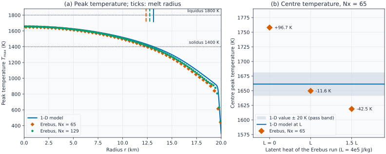
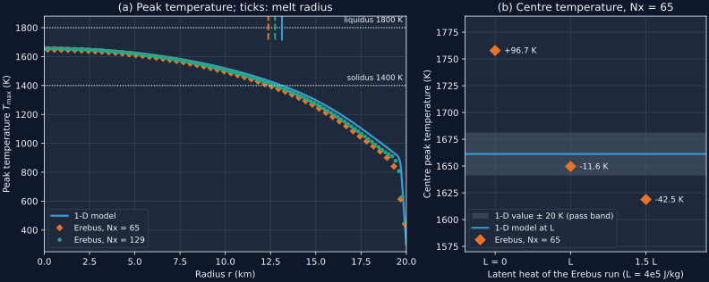

# Melting Shell

## What this page checks

This page checks silicate melting with latent heat in the complete time loop of `Erebus.jl`.
The case is the porous shell case of the [porous shell page](porous_shell.md) with melting on (`melting.active = true`).
The latent heat is the heat that rock takes up when it melts, at a fixed temperature range.
Validation here means that we run the code on a case where we know the right answer from another source.
The other source is an independent 1-D model of a sphere with the same laws and the same latent heat.
If this part of the code were wrong, the peak temperature of the molten centre and the size of the molten region would be wrong.

The page has 4 parts:

- a case that CI runs on every pull request, with recorded values;
- the same case on a finer grid, run by hand, with recorded values;
- runs with a wrong latent heat, which must fail the check;
- the error that comes from the time step alone.

Each case says why the check exists, what it tests, how we know the right answer and why it matters.
The box "Test details" at the end of each case gives the reference, the tolerance, the test ids and the command.

**The test set-up.**

- A planetesimal of radius $R_p = 20$ km is in a square box of 48 km, with air markers outside the planet.
- The grid nodes outside $R_p$ hold the disk temperature of 290 K (`thermodynamics.surface_temperature = :fixed`), as in the porous shell case.
- `Nx` is the number of grid nodes on each side of the box.
  The cell size $\Delta x$ is 750 m at `Nx = 65` and 375 m at `Nx = 129`.
- The rock starts at 290 K with the initial porosity $\phi_{init} = 0.25$ and is cold pressed by its own weight.
- The isotope $^{26}$Al heats the rock.
  The body forms at the time $t_{form} = 1.15$ Myr after the first solids.
- The run takes 140 steps of 25 kyr, 3.5 Myr in total.
- The rock melts between the solidus $T_s = 1400$ K and the liquidus $T_l = 1800$ K.
  The melt fraction $F$ rises linearly from 0 at $T_s$ to 1 at $T_l$.
- The latent heat is $L = 4 \times 10^5$ J/kg.
  With the specific heat of 1000 J/(kg K) the latent heat equals the heat that warms the rock by 400 K, the width of the melting range.
- The melt has the density of the solid rock, 3300 kg/m$^3$, so the melt does not rise.
  The melt does not stir the rock either: `melting.soft_turbulence = false`.
- Heat conduction, radiogenic heat, cold pressing, sintering and the latent heat are the only processes.

---

## The centre temperature and the melt radius against a 1-D model

**Why this check exists.**
The time loop could give the wrong heat capacity to a marker inside the melting range, or none.
It could also take the latent heat at the wrong temperature or with the wrong porosity factor.
The molten centre would then reach the wrong peak temperature.

**What it tests.**
The case runs at `Nx = 65`.
Each marker keeps its peak temperature $T_{max}$, the highest temperature it reached during the run.
We compare 3 results with the 1-D model at the same time step:

- the centre temperature: the median $T_{max}$ of the markers within half a cell of the centre;
- the melt radius $r_F$: the radius of the molten centre, where $T_{max}$ rose above $T_s$;
- the profile of $T_{max}$ against radius, where the 1-D peak temperature is at least 1100 K.

We also check 2 energy budgets: the energy balance of the last heat solve of Erebus, and the enthalpy balance of the 1-D model over the run.

**How we know the right answer.**
The 1-D model is `solve_porous_sphere` in `benchmarks/validation_porous_shell.jl`, with 2000 radial cells.
It adds the latent heat as an apparent heat capacity, a larger heat capacity inside the melting range.
Its own tests check it against the run without melting, the enthalpy of an interior that loses no heat, and the decrease of its enthalpy error with the time step.
In this case its centre peaks at 1661.3 K, inside the melting range, and its melt radius is 13130 m.

!!! details "The 1-D model with latent heat"
    The heat capacity per volume of rock with dry porosity $\phi$ at temperature $T$ is
    $$C(T) = (1 - \phi) \left( \rho c_p + \rho_s \frac{L}{T_l - T_s} \right)$$
    for $T_s < T < T_l$, and $(1 - \phi) \rho c_p$ outside that range.
    Here $\rho c_p = 3.3 \times 10^6$ J/(m$^3$ K) is the heat capacity of dense rock and $\rho_s$ its density.
    The model takes $C$ at the temperature of the start of each step, as Erebus does.
    The enthalpy per volume of dense rock is
    $$h_s(T) = \rho c_p (T - T_0) + \rho_s L F(T)$$
    with $T_0 = 290$ K.
    The enthalpy residual adds $V (1 - \phi) [h_s(T^{n+1}) - h_s(T^n)]$ over the cells and the steps, with the porosity of the step.
    It compares this sum with the deposited heat minus the heat lost at the surface.
    The melt radius of the 1-D model is the outer face of the last cell, counted from the centre, with $T_{max} > T_s$.

**Why it matters.**
The case runs the complete `simulation_loop`: the heat capacity of each marker with the latent heat, the heat solve and the geometry term of the sphere.
The peak temperature of a molten interior depends on all 3.

```@raw html
<div class="validation-fig-light">
```

```@raw html
</div>
<div class="validation-fig-dark">
```

```@raw html
</div>
```

**How to read the plot.**
Panel (a) shows the peak temperature $T_{max}$, in K, against the radius $r$ in km.
The line is the 1-D model, and the points are the medians of the Erebus markers in bins of half a cell.
The dotted lines are the solidus and the liquidus.
The short vertical marks at the top show the melt radius of each run.
A pass means that the first point of Erebus at `Nx = 65` lies within 20 K of the 1-D line.
Panel (b) belongs to the part on a wrong latent heat below.

**Known limit.**
The centre temperature of Erebus is 11.6 K below the 1-D value at `Nx = 65` and 5.9 K below it at `Nx = 129`.
The error halves when the cell size halves, so it is of first order in $\Delta x$.
The melt radius of Erebus is about 1 cell inside the 1-D value on both grids: 755 m (1.01 cells) at `Nx = 65` and 380 m at `Nx = 129`.
Erebus measures the melt radius in radial bins of half a cell, so it moves in steps of 375 m at `Nx = 65`.
The row of the melt radius is a regression band: it catches a large change, but the runs with a wrong latent heat below stay inside it.

!!! details "Test details"
    - Reference: `solve_porous_sphere` in `benchmarks/validation_porous_shell.jl`, with the same time step and number of steps, through `run_melting_shell_case` in `benchmarks/validation_melting_shell.jl`.
    - Tolerance:
        - the centre temperature at `Nx = 65`: within 20 K of the 1-D value;
        - the melt radius at `Nx = 65`: within 1.5 cells of the 1-D value;
        - the relative L2 error of $T_{max} - 290$ K over the bins where the 1-D peak temperature is at least 1100 K: at most 0.04;
        - the energy residual of the last heat solve: at most $10^{-9}$ of the stored and released heat;
        - the enthalpy residual of the 1-D model: at most 0.01 of the deposited heat.
    - Test id: `centre_tmax_nx65`, `melt_radius_nx65`, `tmax_rel_l2_hot_nx65`, `energy_lse_residual_nx65`, `enthalpy_residual_1d`.
    - Command: `julia --project=. tools/check_validation.jl --check`.

---

## The same case at Nx = 129

**Why this check exists.**
The CI case runs on one grid.
A fault that grows on a finer grid, or an error that does not fall with the cell size, could pass it.
This run catches such a fault only when it runs again: CI checks its stored values, not a new run.

**What it tests.**
The case of the CI check runs at `Nx = 129`, with the same 3 results and tighter limits.

**How we know the right answer.**
The run has the same 1-D model as the CI case.
At the centre of the first bin of `Nx = 129` its peak temperature is 1661.3 K.

**Why it matters.**
The errors fall when the cell size halves, so the agreement is a property of the method and not of one grid.

The plot is panel (a) of the figure above, with the points of `Nx = 129`.

```@raw html
<!-- VALIDATION_RECORD_START: melting_shell_suite -->
```

**Validation record**: `benchmarks/records/melting_shell_suite.toml` (Source commit `a6bab096`, config SHA-256 `a8dadbaf022e`)

| Case | Metric | Grid `Nx` | Measured | Reference | Tolerance | Units | Status |
| :--- | :--- | :---: | :---: | :---: | :---: | :---: | :---: |
| `melting_shell_t1.15_phi0.25` | Median peak temperature of the rock markers in the centre bin against the 1-D peak temperature (Nx=129) | 129 | `1.6554e+03` | `1.6613e+03` | `atol=1.00e+01, rtol=0.00e+00` | K | **PASS** |
| `melting_shell_t1.15_phi0.25` | Melt radius against the 1-D melt radius, limit 1.5 cells, a regression band (Nx=129) | 129 | `1.2750e+04` | `1.3130e+04` | `atol=5.62e+02, rtol=0.00e+00` | m | **PASS** |
| `melting_shell_t1.15_phi0.25` | Relative L2 error of the binned peak temperature rise where the 1-D peak temperature is at least 1100 K (Nx=129) | 129 | `1.3613e-02` | `0.0000e+00` | `<= 2.50e-02` | dimensionless | **PASS** |

```@raw html
<!-- VALIDATION_RECORD_END: melting_shell_suite -->
```

!!! details "Test details"
    - Reference: `solve_porous_sphere`, through `run_melting_shell_case` in `benchmarks/validation_melting_shell.jl`.
    - Tolerance: the centre temperature within 10 K of the 1-D value; the melt radius within 1.5 cells; the relative L2 error of the hot bins at most 0.025.
    - Test id: `centre_tmax_nx129`, `melt_radius_nx129`, `tmax_rel_l2_hot_nx129` in `benchmarks/records/melting_shell_suite.toml`.
    - CI does not run this case.
      `tools/check_validation.jl --check` checks the record without a run: the configuration, the pinned 1-D values, the tolerances and that each value passes.
    - Command: `julia --project=. scripts/run_validation_melting_shell.jl <run_dir>` (about 7 min at `Nx = 129` on one core), then `julia --project=. tools/export_validation_melting_shell.jl --suite <run_dir>` for the record, and `python3 scripts/generate_validation_melting_shell_figures.py <run_dir>` for the figure.

---

## Runs with a wrong latent heat fail the check

**Why this check exists.**
A check that passes for every latent heat would not test the latent heat.
This part shows that the limit of the centre temperature fails when the latent heat is wrong.

**What it tests.**
Erebus runs the case with no latent heat ($L = 0$) and with 1.5 times the latent heat.
Both runs are compared with the 1-D model at the correct latent heat.
The test uses `Nx = 41`, the coarsest grid on which the run with the correct latent heat passes the limit of 20 K.

**How we know the right answer.**
Without latent heat the rock warms faster and the centre gets hotter.
With more latent heat the centre stays cooler.

**Why it matters.**
The 20 K limit separates the correct latent heat from the 2 wrong ones.
The melt radius does not separate them, so its row is a regression band only.

**How to read the plot.**
Panel (b) of the figure above shows the centre temperature of Erebus at `Nx = 65` for the 3 latent heats.
The line is the 1-D model at the correct latent heat, and the grey band is the pass band of 20 K around it.
A run passes when its point lies inside the band.

**Known limit.**
At `Nx = 41` the centre temperature is 16.0 K below the 1-D value with the correct latent heat.
It is 89.5 K above it without latent heat and 46.2 K below it with 1.5 times the latent heat.
The run with the correct latent heat passes the limit by 4.0 K only, because the grid is coarse.
The relative L2 error of the hot bins is 0.0289 with the correct latent heat, 0.0481 without latent heat and 0.0391 with 1.5 times the latent heat.
So the L2 row alone does not catch 1.5 times the latent heat on this grid.

!!! details "Test details"
    - Reference: the 1-D model at the correct latent heat.
    - Tolerance: the limit of `centre_tmax_nx65`, 20 K.
    - Test id: testset "Runs with L = 0 and 1.5 L fail the centre temperature limit at Nx = 41" in `test/test_melting_shell.jl`.
    - Command: `julia --project=. -e 'using Test; include("test/test_melting_shell.jl")'`.

---

## The error from the time step

**Why this check exists.**
The latent heat enters the heat solve as a heat capacity from the temperature at the start of each step.
A cell that enters the melting range during a step takes no latent heat in that step, so it ends the step too hot.
A cell that cools out of the melting range during a step still takes the large heat capacity, so it releases too much heat.
Both halves add enthalpy, and both are of first order in the time step.
This error is the same in Erebus and in the 1-D model, so the comparison above does not see it.

**What it tests.**
The 1-D model runs the case with steps of 25 kyr and of 2.5 kyr over the same 3.5 Myr.

**How we know the right answer.**
The step of 2.5 kyr is close to the limit of small steps for this error.
The enthalpy residual of the 1-D model falls by a factor of about 10 with the step, as a first-order error does.

**Why it matters.**
The time step must keep this error small against the limit of the centre temperature.
Otherwise a pass could hide an error of the time step.

**Known limit.**
The step of 25 kyr makes the centre 1.42 K hotter and the melt radius 50 m larger than the step of 2.5 kyr.
The shift of the centre is less than a third of the limit of 20 K at `Nx = 65` and of 10 K at `Nx = 129`.
The enthalpy residual of the 1-D model is 0.0061 of the deposited heat at the case step.
There is nothing to plot here: the result is 2 numbers.

!!! details "Test details"
    - Reference: the 1-D model at a step 10 times smaller.
    - Tolerance: the shift of the centre temperature at most a third of the limit of the centre temperature.
    - Test id: testset "Time lag of the apparent heat capacity in the 1-D reference" in `test/test_melting_shell.jl`.
    - Command: `julia --project=. -e 'using Test; include("test/test_melting_shell.jl")'`.

---

## What the model leaves out

These limits hold in Erebus and in the 1-D model alike, so the comparison above does not test them.

- Without metal markers, the rock heats as chondritic rock with its metal fraction, but the latent heat uses the density of silicate rock for the whole marker.
- The grid temperature at the start of a step is the mean of the marker temperatures, weighted by their heat capacity.
  Where markers on both sides of the solidus share a node, the mean leans toward the markers inside the melting range, whose heat capacity is about twice as large.
- The dry porosity of a marker does not change when it melts.
  In this case the rock above the solidus has sintered to almost no porosity, so this hardly matters here.
- The planet radius stays fixed while the rock sinters, so the body does not shrink.
- Only the silicate melting law acts: `porosity.model = "henke2012"` turns off core formation (metal percolation and settling) and magma transport, so neither metal nor melt moves.
- The melt does not raise the conductivity of the rock: there is no effective conductivity of convecting melt.
- The melt has the density of the solid, so it does not rise.

---

## All recorded values

```@raw html
<!-- VALIDATION_RECORD_START: melting_shell -->
```

**Validation record**: `benchmarks/records/melting_shell.toml` (Source commit `a6bab096`, config SHA-256 `bcf254530e18`)

| Case | Metric | Grid `Nx` | Measured | Reference | Tolerance | Units | Status |
| :--- | :--- | :---: | :---: | :---: | :---: | :---: | :---: |
| `melting_shell_t1.15_phi0.25` | Median peak temperature of the rock markers in the centre bin against the 1-D peak temperature (Nx=65) | 65 | `1.6497e+03` | `1.6613e+03` | `atol=2.00e+01, rtol=0.00e+00` | K | **PASS** |
| `melting_shell_t1.15_phi0.25` | Melt radius against the 1-D melt radius, limit 1.5 cells, a regression band (Nx=65) | 65 | `1.2375e+04` | `1.3130e+04` | `atol=1.12e+03, rtol=0.00e+00` | m | **PASS** |
| `melting_shell_t1.15_phi0.25` | Relative L2 error of the binned peak temperature rise where the 1-D peak temperature is at least 1100 K (Nx=65) | 65 | `2.3695e-02` | `0.0000e+00` | `<= 4.00e-02` | dimensionless | **PASS** |
| `melting_shell_t1.15_phi0.25` | Scaled energy residual of the last thermal step (Nx=65) | 65 | `1.4379e-14` | `0.0000e+00` | `<= 1.00e-09` | dimensionless | **PASS** |
| `melting_shell_t1.15_phi0.25` | Relative enthalpy residual of the 1-D reference over the run, the lag of the apparent heat capacity | 1D | `6.0901e-03` | `0.0000e+00` | `<= 1.00e-02` | dimensionless | **PASS** |

```@raw html
<!-- VALIDATION_RECORD_END: melting_shell -->
```
