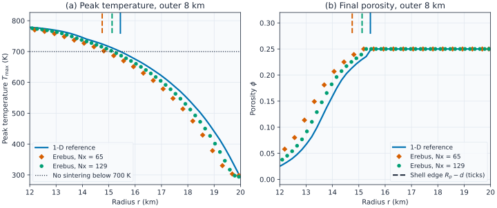
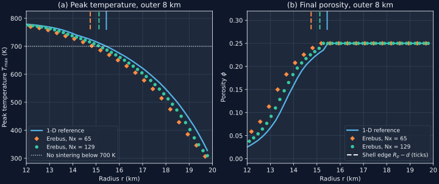
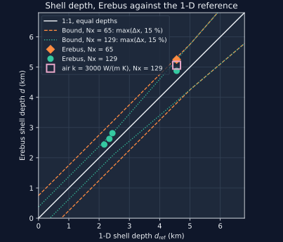
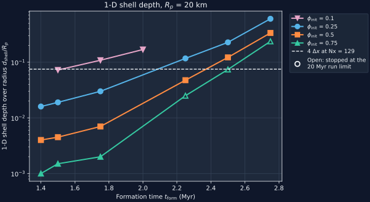

# Porous Shell

## What this page checks

This page checks the porous shell of a planetesimal in the complete time loop of `Erebus.jl`, with the dry porosity model `porosity.model = "henke2012"`.
The porous shell is the outer layer where the rock never sintered, because it did not stay hot enough for long enough.
The [porosity page](../explanations/porosity_sintering.md) explains the laws and how `porous_shell_depth` measures the shell.
Validation here means that we run the code on a case where we know the right answer from another source.
The other source is an independent 1-D model of a sphere with the same laws.
If this part of the code were wrong, the depth of the shell, the peak temperatures below it and the heat loss of the body would be wrong.

The page has 3 parts:

- a short case that CI runs on every pull request, with recorded values;
- 6 longer runs to the end of sintering, run by hand and shown in figures;
- the shell at the inputs of Lichtenberg et al. (2016a), from the 1-D model only.

Each case says why the check exists, what it tests, how we know the right answer and why it matters.
The box "Test details" at the end of each case gives the reference, the tolerance, the test ids and the command.

**The test set-up.**

- A planetesimal of radius $R_p = 20$ km is in a square box of 48 km, filled with sticky air at 290 K.
- `Nx` is the number of grid nodes on each side of the box.
  The cell size $\Delta x$ is 1500 m at `Nx = 33`, 750 m at `Nx = 65` and 375 m at `Nx = 129`.
- The rock starts at 290 K with the initial porosity $\phi_{init}$ and is cold pressed by its own weight.
- The isotope $^{26}$Al heats the rock, with the ratio $^{26}$Al/$^{27}$Al $= 5.85 \times 10^{-5}$ at the formation of the first solids.
  The body forms at the time $t_{form}$ after them.
- Melting, reactions, pore water and thermal buoyancy are off.
  Heat conduction, radiogenic heat, cold pressing and sintering are the only processes.
- The sticky air has the conductivity of the porous surface rock (see the known limit below) and no thermal expansion.
  Its heat capacity of $3 \times 10^{10}$ J/(m³ K) holds it at 290 K.

---

## The shell depth against a 1-D model

**Why this check exists.**
The time loop could give the wrong conductivity, heat capacity or heat to porous rock, or pass the wrong temperature to the sintering step.
The shell would then have the wrong depth, also where each law passes its own unit test.
For example, suppose the code heated porous rock as much as solid rock of the same volume.
The shell at `Nx = 65` would then be 2625 m deep in place of 5250 m, and the test fails.

**What it tests.**
A body with $\phi_{init} = 0.25$ forms at $t_{form} = 2.5$ Myr.
It runs for 80 steps of 50 kyr, 4 Myr in total, at `Nx = 65`.
We compare 3 results with the 1-D model at the same time step:

- the depth of the shell, the median over 16 sectors;
- the profile of the peak temperature $T_{max}$ that each marker reached, binned by radius;
- the energy balance of the last heat solve.

**How we know the right answer.**
The 1-D model in `benchmarks/validation_porous_shell.jl` solves heat conduction in a sphere on 2000 radial cells.
It codes the laws of cold pressing, sintering and porous conductivity again from the raw constants, and it does not call the Erebus porosity code.
Its own tests compare it with a backward-Euler eigenmode series of a sphere without pores, a fine Runge-Kutta integration of the sintering law, and the hydrostatic pressure of a uniform sphere.
In this case its shell is 4590 m deep.

**Why it matters.**
The case runs the complete `simulation_loop`: the heat solve, the geometry term of the sphere and the sintering step of each marker.
The shell depth of a planetesimal run depends on all 3.

```@raw html
<div class="validation-fig-light">
```

```@raw html
</div>
<div class="validation-fig-dark">
```

```@raw html
</div>
```

**How to read the plot.**
The plot shows the same body as the test, run to the end of sintering (750 steps of 10 kyr).
Panel (a) shows the peak temperature $T_{max}$, in K, against the radius $r$ in km.
The line is the 1-D model, and the points are the medians of the Erebus markers in bins of half a cell.
The dotted line is 700 K: below it the rock does not sinter.
Panel (b) shows the final porosity $\phi$ against the radius.
The short vertical marks at the top show the inner edge of the shell, $R_p$ minus its depth.
A pass means that the mark of Erebus at `Nx = 65` lies within 1 cell of the mark of the 1-D model.
The mark at `Nx = 129` shows the difference on a finer grid; the next case records it.

**Known limit.**
With the matched air, Erebus gives a shell that is deeper than in the 1-D model by 0.7 to 1.0 cells, in every case on this page.
At $\phi_{init} = 0.5$ the error is 0.99 cells, so this run passes its tolerance of 375 m by only 2.5 m.
The error in metres halves when the cell size halves, so the difference comes from the grid.
Near the surface the Erebus rock stays colder than in the 1-D model (panel a).
The cause is the large heat capacity of the sticky air in this case.
It holds the grid nodes that mix rock and air at 290 K, so the cold surface lies inside $R_p$.
With an air heat capacity equal to that of rock, the shell at `Nx = 65` is 0.62 cells too thin instead of 0.88 cells too deep.

At the edge of the shell the 1-D model has a peak temperature of 700.4 K in the last sintered cell and 699.998 K in the next one.
The depth of the shell is therefore the depth where the peak temperature reached 700 K.
It depends on the heat, the conductivity and the surface, but hardly on the pressure: a pressure 10 times too low moves it by 30 m in the 1-D model.

!!! details "Test details"
    - Reference: `solve_porous_sphere` in `benchmarks/validation_porous_shell.jl`, with the same time step and number of steps.
    - Tolerance:
        - the shell depth at `Nx = 65`: the 1-D depth within 1 cell or 15 %, whichever is larger;
        - the relative L2 error of $T_{max} - 290$ K: at most 0.10 at `Nx = 65`;
        - the energy residual of the last heat solve: at most $10^{-9}$ of the stored and released heat.
    - Test id: `shell_depth_nx65`, `tmax_rel_l2_nx65`, `energy_lse_residual_nx65`.
    - Command: `julia --project=. tools/check_validation.jl --check`.

---

## Shell depths of 6 runs to the end of sintering

**Why this check exists.**
The short case stops 4 Myr after formation, and it uses one formation time and one porosity.
A fault that grows late in the run, or that depends on the porosity or on the heating, could pass it.
These runs catch such a fault only when they run again: CI checks their stored values, not new runs.

**What it tests.**
We run 6 bodies of 20 km to the time when the 1-D model stops sintering, with steps of 10 kyr.
5 runs use `Nx = 129`, and the main case also runs at `Nx = 65`.
The cases cover 3 formation times and 3 initial porosities.
They have a shell of at least 4 cells at `Nx = 129` in the 1-D model.
One run uses the conductivity of the sticky air that a configuration file gives, 3000 W/(m K).

**How we know the right answer.**
Each run has its own 1-D model run with the same steps.

**Why it matters.**
These runs show that the agreement holds over the range of a study, not only at one point.

```@raw html
<div class="validation-fig-light">
```

```@raw html
</div>
<div class="validation-fig-dark">
```

```@raw html
</div>
```

**How to read the plot.**
The plot shows the shell depth of Erebus, in km, against the depth of the 1-D model.
Each point is one run.
The solid line is equal depth, and the dashed and dotted lines show the tolerance at `Nx = 65` and `Nx = 129`.
The open square is the run with the air conductivity of 3000 W/(m K).
A pass means that a point lies between the lines of its grid.

```@raw html
<!-- VALIDATION_RECORD_START: porous_shell_suite -->
```

**Validation record**: `benchmarks/records/porous_shell_suite.toml` (Source commit `f0cec3dd`, config SHA-256 `bbebaa4bea8b`)

| Case | Metric | Grid `Nx` | Measured | Reference | Tolerance | Units | Status |
| :--- | :--- | :---: | :---: | :---: | :---: | :---: | :---: |
| `s65_25_025` | Median shell depth against the 1-D shell depth, t_form 2.5 Myr, phi_init 0.25, matched air, 750 steps of 10 kyr | 65 | `5.2500e+03` | `4.5600e+03` | `atol=7.50e+02, rtol=0.00e+00` | m | **PASS** |
| `s65_25_025` | Relative L2 error of the binned peak temperature rise, t_form 2.5 Myr, phi_init 0.25, matched air, 750 steps of 10 kyr | 65 | `4.9800e-02` | `0.0000e+00` | `<= 1.00e-01` | dimensionless | **PASS** |
| `s129_25_025` | Median shell depth against the 1-D shell depth, t_form 2.5 Myr, phi_init 0.25, matched air, 750 steps of 10 kyr | 129 | `4.8750e+03` | `4.5600e+03` | `atol=6.84e+02, rtol=0.00e+00` | m | **PASS** |
| `s129_25_025` | Relative L2 error of the binned peak temperature rise, t_form 2.5 Myr, phi_init 0.25, matched air, 750 steps of 10 kyr | 129 | `2.6500e-02` | `0.0000e+00` | `<= 1.00e-01` | dimensionless | **PASS** |
| `s129_225_025` | Median shell depth against the 1-D shell depth, t_form 2.25 Myr, phi_init 0.25, matched air, 700 steps of 10 kyr | 129 | `2.6250e+03` | `2.3400e+03` | `atol=3.75e+02, rtol=0.00e+00` | m | **PASS** |
| `s129_225_025` | Relative L2 error of the binned peak temperature rise, t_form 2.25 Myr, phi_init 0.25, matched air, 700 steps of 10 kyr | 129 | `2.8500e-02` | `0.0000e+00` | `<= 1.00e-01` | dimensionless | **PASS** |
| `s129_175_010` | Median shell depth against the 1-D shell depth, t_form 1.75 Myr, phi_init 0.1, matched air, 490 steps of 10 kyr | 129 | `2.4375e+03` | `2.1700e+03` | `atol=3.75e+02, rtol=0.00e+00` | m | **PASS** |
| `s129_175_010` | Relative L2 error of the binned peak temperature rise, t_form 1.75 Myr, phi_init 0.1, matched air, 490 steps of 10 kyr | 129 | `2.5600e-02` | `0.0000e+00` | `<= 1.00e-01` | dimensionless | **PASS** |
| `s129_25_050` | Median shell depth against the 1-D shell depth, t_form 2.5 Myr, phi_init 0.5, matched air, 1580 steps of 10 kyr | 129 | `2.8125e+03` | `2.4400e+03` | `atol=3.75e+02, rtol=0.00e+00` | m | **PASS** |
| `s129_25_050` | Relative L2 error of the binned peak temperature rise, t_form 2.5 Myr, phi_init 0.5, matched air, 1580 steps of 10 kyr | 129 | `3.2500e-02` | `0.0000e+00` | `<= 1.00e-01` | dimensionless | **PASS** |
| `s129_25_025_k` | Median shell depth against the 1-D shell depth, t_form 2.5 Myr, phi_init 0.25, air k = 3000 W/(m K), 750 steps of 10 kyr | 129 | `5.0625e+03` | `4.5600e+03` | `atol=6.84e+02, rtol=0.00e+00` | m | **PASS** |
| `s129_25_025_k` | Relative L2 error of the binned peak temperature rise, t_form 2.5 Myr, phi_init 0.25, air k = 3000 W/(m K), 750 steps of 10 kyr | 129 | `4.4900e-02` | `0.0000e+00` | `<= 1.00e-01` | dimensionless | **PASS** |

```@raw html
<!-- VALIDATION_RECORD_END: porous_shell_suite -->
```

**Known limit.**
A configuration file gives the sticky air a conductivity of 3000 W/(m K), and it cannot change it.
The air then draws heat out of the outer cells of the rock.
In the main case the outermost 3 bins, from 19.5 to 20 km, reached only 290.0 to 291.6 K.
With the matched air they reached 295.0 to 327.3 K, and in the 1-D model 301.7 to 358.3 K.
With this value the shell of the main case is 5062.5 m deep, 1.34 cells deeper than in the 1-D model, against 0.84 cells with the matched air.
The CI case and 5 of the 6 runs therefore give the air the conductivity of the porous surface rock.
By default a configuration file gives the air a heat capacity of $3 \times 10^{6}$ J/(m³ K), less than that of solid rock; we have not measured the shell with that default.

!!! details "Test details"
    - Reference: `solve_porous_sphere`, through `run_porous_shell_case` in `benchmarks/validation_porous_shell.jl`.
    - Tolerance: the shell depth within 1 cell or 15 % of the 1-D depth, as in the short case; the relative L2 error of $T_{max} - 290$ K at most 0.10.
    - Test id: `shell_depth_<run>` and `tmax_rel_l2_<run>` in `benchmarks/records/porous_shell_suite.toml`, one pair per run.
    - CI does not run these cases.
      `tools/check_validation.jl --check` checks the record without a run: the case list, the 1-D references, the tolerances and that each value passes.
    - Command: `julia --project=. scripts/run_validation_porous_shell_suite.jl <out_dir>` (8 to 71 min per case at `Nx = 129` on one core), then `tools/export_validation_porous_shell_suite.jl <out_dir>` for the record, and `julia --project=. scripts/export_validation_porous_shell_data.jl <data_dir> <out_dir> <table_dir>` and `python3 scripts/generate_validation_porous_shell_figures.py <data_dir>` for the figures.

---

## The shell at the inputs of Lichtenberg et al. (2016a)

**Why this check exists.**
Lichtenberg et al. (2016a) computed the porous shells of planetesimals with the laws of Henke et al. (2012), in their Fig. 10.
A user can compare an Erebus run with that figure.
This part has no test.
It shows how deep the shell is at those inputs, and why `Erebus.jl` does not compare with Fig. 10 in a test.

**What it tests.**
The 1-D model runs a body of 20 km in 21 cases.
For the initial porosities 0.25, 0.5 and 0.75 it uses 6 formation times from 1.4 to 2.75 Myr.
For 0.1 it uses 3 formation times from 1.5 to 2.0 Myr.
It uses the heating of `Erebus.jl`.

**How we know the right answer.**
This part has no reference of its own: it shows the 1-D model, which the other parts check against Erebus.

**Why it matters.**
At $t_{form}$ = 1.4 and 1.75 Myr, 2 of the formation times of Fig. 10, the shell is 20 to 600 m deep for $\phi_{init}$ = 0.25 to 0.75.
That is 0.001 to 0.03 of $R_p$, and less than 4 cells at `Nx = 129`.
An Erebus run at these inputs therefore needs a much finer grid to resolve the shell.
The shell is thinner at a higher initial porosity: at 1.4 Myr it is 320 m for $\phi_{init} = 0.25$ and 20 m for $\phi_{init} = 0.75$.
A likely reason is the low conductivity of porous rock: a thin layer can hold the drop from 700 K to the surface temperature.
Lichtenberg et al. (2016a) found that the initial porosity did not change the final shell depth much.
Their paper does not give the formula of their shell measure, so the 2 results can measure different things.

```@raw html
<div class="validation-fig-light">
```

```@raw html
</div>
<div class="validation-fig-dark">
```

```@raw html
</div>
```

**How to read the plot.**
The plot shows the shell depth divided by the radius, on a log scale, against the formation time in Myr.
Each line is one initial porosity.
The dashed line is the depth of 4 cells at `Nx = 129`: a test needs a shell above it.
Open symbols mark runs that reached the limit of 20 Myr while part of the body was still above 700 K; their depth is the value at 20 Myr.

**Known limit.**

- Lichtenberg et al. (2016a) report the shell as a mean over the initial porosities, from 2-D runs.
  The 1-D model is a sphere.
  No test compares with their Fig. 10.
- The 1-D model has no melting.
  At $t_{form}$ = 1.4 and 1.5 Myr and $\phi_{init}$ = 0.25 to 0.75, its peak temperature reaches 1400 to 1590 K.
  The interior of these runs is therefore not a prediction for a real body.
- Without metal markers, `Erebus.jl` heats the rock as chondritic rock with its metal fraction.
  This gives about 8 % more heat than pure silicate rock.
  The 1-D model uses the same heating, so the comparison with Erebus does not depend on it.

!!! details "Test details"
    - Reference: none; this part shows the 1-D model only.
    - Command: `julia --project=. scripts/run_validation_porous_shell_table.jl <out.csv> 1.4:0.25 1.5:0.25 ...` ($t_{form}$ in Myr and $\phi_{init}$ per case; 3 to 110 min per case).

---

## All recorded values

```@raw html
<!-- VALIDATION_RECORD_START: porous_shell -->
```

**Validation record**: `benchmarks/records/porous_shell.toml` (Source commit `f0cec3dd`, config SHA-256 `fcf41aa4e790`)

| Case | Metric | Grid `Nx` | Measured | Reference | Tolerance | Units | Status |
| :--- | :--- | :---: | :---: | :---: | :---: | :---: | :---: |
| `porous_shell_t2.5_phi0.25` | Median shell depth of the rock markers against the 1-D shell depth (Nx=65) | 65 | `5.2500e+03` | `4.5900e+03` | `atol=7.50e+02, rtol=0.00e+00` | m | **PASS** |
| `porous_shell_t2.5_phi0.25` | Relative L2 error of the binned peak temperature rise against the 1-D reference (Nx=65) | 65 | `4.9912e-02` | `0.0000e+00` | `<= 1.00e-01` | dimensionless | **PASS** |
| `porous_shell_t2.5_phi0.25` | Scaled energy residual of the last thermal step (Nx=65) | 65 | `2.2975e-10` | `0.0000e+00` | `<= 1.00e-09` | dimensionless | **PASS** |

```@raw html
<!-- VALIDATION_RECORD_END: porous_shell -->
```
