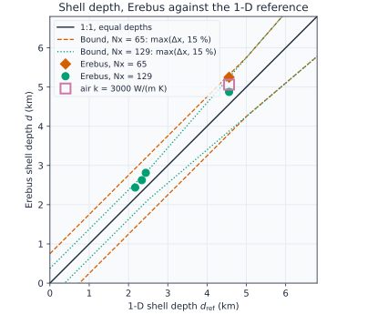
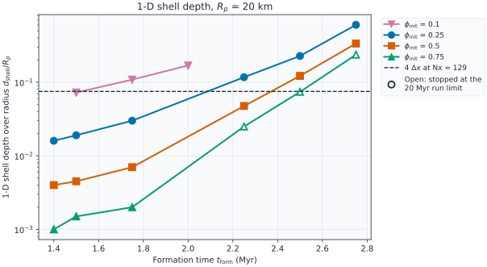

# Porous Shell

## What this page checks

This page checks the porous shell of a planetesimal in the complete time loop of `Erebus.jl`, with the dry porosity model `porosity.model = "henke2012"`.
The porous shell is the outer layer where the rock never sintered, because it did not stay hot enough for long enough.
The [porosity page](../explanations/porosity_sintering.md) explains the laws and how `porous_shell_depth` measures the shell.
Validation here means that we run the code on a case where we know the right answer from another source.
The other source is an independent 1-D model of a sphere with the same laws.
If this part of the code were wrong, the depth of the shell, the peak temperatures below it and the heat loss of the body would be wrong.

The page has 3 parts:

- a short case that CI runs on every pull request, with recorded values;
- 6 longer runs to the end of sintering, run by hand and shown in figures;
- the shell at the inputs of Lichtenberg et al. (2016a), from the 1-D model only.

Each case says why the check exists, what it tests, how we know the right answer and why it matters.
The box "Test details" at the end of each case gives the reference, the tolerance, the test ids and the command.

**The test set-up.**

- A planetesimal of radius $R_p = 20$ km is in a square box of 48 km, filled with sticky air at 290 K.
- `Nx` is the number of grid nodes on each side of the box. The cell size $\Delta x$ is 1500 m at `Nx = 33`, 750 m at `Nx = 65` and 375 m at `Nx = 129`.
- The rock starts at 290 K with the initial porosity $\phi_{init}$ and is cold pressed by its own weight.
- The isotope $^{26}$Al heats the rock, with the ratio $^{26}$Al/$^{27}$Al $= 5.85 \times 10^{-5}$ at the formation of the first solids.
  The body forms at the time $t_{form}$ after them.
- Melting, reactions, pore water and thermal buoyancy are off. Heat conduction, radiogenic heat, cold pressing and sintering are the only processes.
- The sticky air has the conductivity of the porous surface rock (see the known limit below).

---

## The shell depth against a 1-D model

**Why this check exists.**
The time loop could pass the wrong pressure or temperature to the sintering step.
It could also give the wrong conductivity or heat to porous rock.
The shell would then have the wrong depth, also where each law passes its own unit test.
For example, if the code heated porous rock as much as solid rock of the same volume, the shell at `Nx = 65` would be 2625 m deep in place of 5250 m, and the test fails.

**What it tests.**
A body with $\phi_{init} = 0.25$ forms at $t_{form} = 2.5$ Myr.
It runs for 80 steps of 50 kyr, 4 Myr in total, at `Nx = 33` and `Nx = 65`.
We compare 4 results with the 1-D model at the same time step:

- the depth of the shell, the median over 16 sectors;
- how the error of the depth changes from `Nx = 33` to `Nx = 65`;
- the profile of the peak temperature $T_{max}$ that each marker reached, binned by radius;
- the energy balance of the last heat solve.

**How we know the right answer.**
The 1-D model in `benchmarks/validation_porous_shell.jl` solves heat conduction in a sphere on 2000 radial cells.
It codes the laws of cold pressing, sintering and porous conductivity again from the raw constants, and it does not call the Erebus porosity code.
Its own tests compare it with an exact series of a sphere without pores, a fine Runge-Kutta integration of the sintering law, and the hydrostatic pressure of a uniform sphere.
In this case its shell is 4590 m deep.

**Why it matters.**
The case runs the complete `simulation_loop`: the heat solve, the geometry term of the sphere, the pressure from the Stokes solve, and the sintering step of each marker.
A shell depth from a planetesimal run depends on all of them.

```@raw html
<div class="validation-fig-light">
```

```@raw html
</div>
<div class="validation-fig-dark">
```

```@raw html
</div>
```

**How to read the plot.**
The plot shows the same body as the test, run to the end of sintering (750 steps of 10 kyr).
Panel (a) shows the peak temperature $T_{max}$, in K, against the radius $r$ in km.
The line is the 1-D model, and the points are the medians of the Erebus markers in bins of half a cell.
The dotted line is 700 K: below it the rock does not sinter.
Panel (b) shows the final porosity $\phi$ against the radius.
The short vertical marks at the top show the inner edge of the shell, $R_p$ minus its depth.
A pass means that the marks of Erebus lie within 1 cell of the mark of the 1-D model, and that they move closer as the grid gets finer.

**Known limit.**
With the matched air, Erebus gives a shell that is deeper than in the 1-D model by 0.7 to 1.0 cells, in every case on this page.
At $\phi_{init} = 0.5$ the error is 0.99 cells, so this run passes its tolerance of 375 m by only 2.5 m.
The error in metres halves when the cell size halves, so the difference comes from the grid.
Near the surface the Erebus rock stays colder than in the 1-D model (panel a).
We have not tested the cause.

!!! details "Test details"
    - Reference: `solve_porous_sphere` in `benchmarks/validation_porous_shell.jl`, with the same time step and number of steps.
    - Tolerance:
        - the shell depth at `Nx = 33` and `Nx = 65`: the 1-D depth within 1 cell or 15 %, whichever is larger;
        - the ratio of the depth errors at `Nx = 33` and `Nx = 65`: 2 within 0.5 (first order in the cell size);
        - the relative L2 error of $T_{max} - 290$ K: at most 0.10 at `Nx = 65`;
        - the energy residual of the last heat solve: at most $10^{-9}$ of the stored and released heat.
    - Test id: `shell_depth_nx33`, `shell_depth_nx65`, `shell_error_convergence_ratio_33_65`, `tmax_rel_l2_nx65`, `energy_lse_residual_nx65`.
    - Command: `julia --project=. tools/check_validation.jl --check`.

---

## Shell depths of 6 runs to the end of sintering

**Why this check exists.**
The short case stops 4 Myr after formation, and it uses one formation time and one porosity.
A fault that grows late in the run, or that depends on the porosity or on the heating, could pass it.

**What it tests.**
We run 6 bodies of 20 km to the time when the 1-D model stops sintering, with steps of 10 kyr.
4 runs use `Nx = 129`, and the main case also runs at `Nx = 65`.
The cases cover 3 formation times and 3 initial porosities.
They have a shell of at least 4 cells at `Nx = 129` in the 1-D model.
One run uses the conductivity of the sticky air that a configuration file gives, 3000 W/(m K).

**How we know the right answer.**
Each run has its own 1-D model run with the same steps.

**Why it matters.**
These runs show that the agreement holds over the range of a study, not only at one point.

```@raw html
<div class="validation-fig-light">
```

```@raw html
</div>
<div class="validation-fig-dark">
```

```@raw html
</div>
```

**How to read the plot.**
The plot shows the shell depth of Erebus, in km, against the depth of the 1-D model.
Each point is one run.
The solid line is equal depth, and the dashed and dotted lines show the tolerance at `Nx = 65` and `Nx = 129`.
The open square is the run with the air conductivity of 3000 W/(m K).
A pass means that a point lies between the lines of its grid.

| $t_{form}$ (Myr) | $\phi_{init}$ | `Nx` | Erebus (m) | 1-D (m) | Error (cells) | L2 of $T_{max}$ |
|---|---|---|---|---|---|---|
| 2.5 | 0.25 | 65 | 5250 | 4560 | 0.92 | 0.050 |
| 2.5 | 0.25 | 129 | 4875 | 4560 | 0.84 | 0.027 |
| 2.25 | 0.25 | 129 | 2625 | 2340 | 0.76 | 0.029 |
| 1.75 | 0.1 | 129 | 2437.5 | 2170 | 0.71 | 0.026 |
| 2.5 | 0.5 | 129 | 2812.5 | 2440 | 0.99 | 0.032 |
| 2.5 | 0.25, air 3000 W/(m K) | 129 | 5062.5 | 4560 | 1.34 | 0.045 |

**Known limit.**
A configuration file gives the sticky air a conductivity of 3000 W/(m K), and it cannot change it.
The air then draws heat out of the outer cells of the rock.
In a run at $t_{form} = 2.25$ Myr the outermost bins reached only 290 to 308 K, against 338 to 413 K in the 1-D model.
With this value the shell of the main case is 5062.5 m deep, 1.34 cells deeper than in the 1-D model, against 0.84 cells with the matched air.
This run still passes the tolerance of 15 %, but a shorter run at $t_{form} = 2.25$ Myr gave 1.26 cells and 20 %, outside it.
The pass rows of this page therefore give the air the conductivity of the porous surface rock.
In a run from a configuration file, expect the shell to be about 1 cell deeper than the physics gives.

!!! details "Test details"
    - Reference: `solve_porous_sphere`, through `run_porous_shell_case` in `benchmarks/validation_porous_shell.jl`.
    - Tolerance: the shell depth within 1 cell or 15 % of the 1-D depth, as in the short case. CI does not run these cases; the table holds the values of one run of each.
    - Command: `julia --project=. scripts/run_validation_porous_shell_suite.jl <out_dir>` (13 to 45 min per case at `Nx = 129` on one core), then `scripts/export_validation_porous_shell_data.jl` and `scripts/generate_validation_porous_shell_figures.py` for the figures.

---

## The shell at the inputs of Lichtenberg et al. (2016a)

**Why this check exists.**
Lichtenberg et al. (2016a) computed the porous shells of planetesimals with the laws of Henke et al. (2012), in their Fig. 10.
A user can compare an Erebus run with that figure.
This part shows how deep the shell is at those inputs, and why `Erebus.jl` does not compare with Fig. 10 in a test.

**What it tests.**
The 1-D model runs a body of 20 km for 7 formation times from 1.4 to 2.75 Myr and for initial porosities of 0.1, 0.25, 0.5 and 0.75.
It uses the heating of `Erebus.jl`.

**How we know the right answer.**
This part has no reference of its own: it shows the 1-D model, which the other parts check against Erebus.

**Why it matters.**
At $t_{form}$ = 1.4 to 1.75 Myr, the cases of Fig. 10 for 20 km, the shell is 20 to 600 m deep for $\phi_{init}$ = 0.25 to 0.75.
That is 0.001 to 0.03 of $R_p$, and less than 4 cells at `Nx = 129`.
An Erebus run at these inputs therefore needs a much finer grid to resolve the shell.
The shell is thinner at a higher initial porosity.
A likely reason is the low conductivity of porous rock: a thin layer can hold the drop to the surface temperature.

```@raw html
<div class="validation-fig-light">
```

```@raw html
</div>
<div class="validation-fig-dark">
```

```@raw html
</div>
```

**How to read the plot.**
The plot shows the shell depth divided by the radius, on a log scale, against the formation time in Myr.
Each line is one initial porosity.
The dashed line is the depth of 4 cells at `Nx = 129`: a test needs a shell above it.
Open symbols mark runs that reached the limit of 20 Myr while part of the body was still above 700 K; their depth is the value at 20 Myr.

**Known limit.**

- Lichtenberg et al. (2016a) report the shell as a mean over the initial porosities, from 2-D runs on a grid of 1 km. The 1-D model is a sphere. We show Fig. 10 for context only, and no test compares with it.
- The 1-D model has no melting. At $t_{form}$ = 1.4 and 1.5 Myr and $\phi_{init}$ = 0.25 to 0.75, its peak temperature reaches 1400 to 1590 K. The interior of these runs is therefore not a prediction for a real body.
- Without metal markers, `Erebus.jl` heats the rock as chondritic rock with its metal fraction. This gives about 8 % more heat than pure silicate rock. The 1-D model uses the same heating, so the comparison with Erebus does not depend on it.

!!! details "Test details"
    - Reference: none; this part shows the 1-D model only.
    - Command: `julia --project=. scripts/run_validation_porous_shell_table.jl <out.csv> 1.4:0.25 1.5:0.25 ...` ($t_{form}$ in Myr and $\phi_{init}$ per case; 3 to 110 min per case).

---

## All recorded values

```@raw html
<!-- VALIDATION_RECORD_START: porous_shell -->
```

**Validation record**: `benchmarks/records/porous_shell.toml` (Source commit `f6c7f29a`, config SHA-256 `d3d57425a447`)

| Case | Metric | Grid `Nx` | Measured | Reference | Tolerance | Units | Status |
| :--- | :--- | :---: | :---: | :---: | :---: | :---: | :---: |
| `porous_shell_t2.5_phi0.25` | Median shell depth of the rock markers against the 1-D shell depth (Nx=33) | 33 | `6.0000e+03` | `4.5900e+03` | `atol=1.50e+03, rtol=0.00e+00` | m | **PASS** |
| `porous_shell_t2.5_phi0.25` | Median shell depth of the rock markers against the 1-D shell depth (Nx=65) | 65 | `5.2500e+03` | `4.5900e+03` | `atol=7.50e+02, rtol=0.00e+00` | m | **PASS** |
| `porous_shell_t2.5_phi0.25` | Shell depth error ratio abs(d33 - d_ref) / abs(d65 - d_ref), first order in dx | 65 | `2.1364e+00` | `2.0000e+00` | `atol=5.00e-01, rtol=0.00e+00` | dimensionless | **PASS** |
| `porous_shell_t2.5_phi0.25` | Relative L2 error of the binned peak temperature rise against the 1-D reference (Nx=65) | 65 | `4.9815e-02` | `0.0000e+00` | `<= 1.00e-01` | dimensionless | **PASS** |
| `porous_shell_t2.5_phi0.25` | Scaled energy residual of the last thermal step (Nx=65) | 65 | `2.2975e-10` | `0.0000e+00` | `<= 1.00e-09` | dimensionless | **PASS** |

```@raw html
<!-- VALIDATION_RECORD_END: porous_shell -->
```
