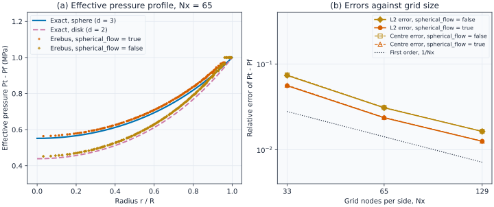
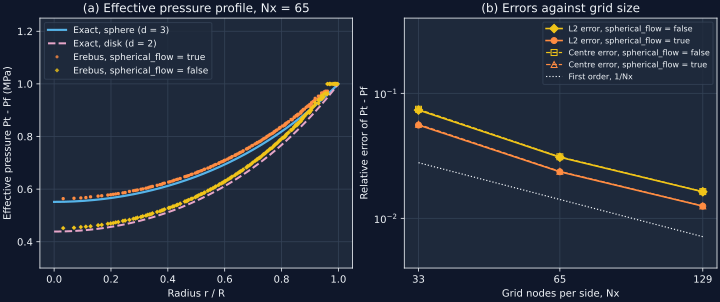

# Spherical Compaction

## What this page checks

This page checks the compaction coupling of the hydromechanical solve of `Erebus.jl`.
In a porous rock the solid matrix and the pore fluid have separate pressures: the total pressure $P_t$ and the fluid pressure $P_f$.
Their difference is the effective pressure $P_e = P_t - P_f$.
The matrix compacts or dilates at the rate $P_e / (\zeta (1 - \phi))$, where $\zeta$ is the compaction viscosity and $\phi$ the porosity.
The fluid that the matrix squeezes out flows by Darcy's law.
Validation means that we run the code on a case where we know the right answer from another source, and we check that the code gives that answer.
If this part were wrong, the pore pressure, the compaction of the rock and the fluid flow that follows from it would be wrong, and with them the venting and the fracturing that depend on the pore pressure.

The page checks 3 parts of the solve:

- the compaction term $P_e / (\zeta (1 - \phi))$ in the continuity row of the solid (the $P_t$ row);
- the same term in the continuity row of the fluid (the $P_f$ row);
- the spherical face weights of both continuity rows, which the option `geometry.spherical_flow` turns on.

The code solves a 2-D grid.
With `geometry.spherical_flow = true` the continuity rows get the face weights of a sphere, so that the 2-D grid behaves like a 3-D sphere.
The default is off, which gives a 2-D disk.

## The case

The case uses a sphere of radius $R = 50$ km in a square box of 140 km.
`Nx` is the number of grid nodes on each side of the box.
The rock has the permeability $k = 10^{-13}$ m² and the porosity $\phi = 0.2$.
The fluid has the viscosity $\mu = 10^{-3}$ Pa s.
Gravity is off, and the rock produces no fluid.

The compaction viscosity is set so that the compaction length $\delta$ (defined below) is $R / 2 = 25$ km.
This gives $\zeta = 7.8125 \times 10^{18}$ Pa s.
The code computes the compaction viscosity of a cell from its shear viscosity as `ETAPHI = etaphikoef ETAP / phi`.
The case sets `solver.etaphikoef` to $\phi / 10^{-4}$ and the shear viscosity of the rock to $10^{-4} \zeta$, so that the ratio of the shear to the compaction viscosity is $10^{-4}$.
The cells outside the sphere have a shear viscosity of $10^{12}$ Pa s and no permeable faces.

At the start the total and the fluid pressure are both $P_\mathrm{amb} + P_{e,R}$ everywhere, with $P_\mathrm{amb} = 100$ Pa and $P_{e,R} = 10^6$ Pa.
The total pressure is held at $P_\mathrm{amb} + P_{e,R}$ on the box edge.
The surface temperature is 200 K.
The ice vapour pressure at 200 K is lower than $P_\mathrm{amb}$, so the vent pressure is $P_\mathrm{vent} = P_\mathrm{amb}$.
The rock cells next to the outside vent their fluid, and the venting conductance is much larger than the rock conductance, so these cells keep $P_f = P_\mathrm{vent}$.
The effective pressure at the surface is then $P_{e,R}$.

The case builds the state with `init_simulation`, sets the grid fields directly and calls `solve_stokes_darcy!` once, on timestep 1.
The compressibilities of the rock and the fluid are 0, so the time step enters only through the vent (see "Conditions of the case").
The time step is $10^{-10}$ yr.

## The exact solution

**Why this check exists.**
The compaction term could be missing from one of the 2 continuity rows, have the wrong factor $(1 - \phi)$, or use a compaction viscosity other than $\zeta$.
The face weights of either row could have the wrong size.
Each of these faults changes the profile of the effective pressure or the solid velocity.

**What it tests.**
We compare the effective pressure $P_e$ at the grid nodes with the exact solution, for `spherical_flow = true` and for `spherical_flow = false`, at `Nx = 33`, 65 and 129.
The centre error is $P_e / P_e^\mathrm{exact} - 1$ at the node nearest the centre.
The profile error is the relative L2 error over the nodes with $r \le 0.9 R$:

$$\epsilon = \sqrt{\frac{\sum_i \left(P_{e,i} - P_{e,i}^\mathrm{exact}\right)^2}{\sum_i \left(P_{e,i}^\mathrm{exact}\right)^2}}.$$

We compare the solid velocity with the exact velocity on the faces with $0 < r \le 0.9 R$.
The grid stores the x component of the velocity on the vertical faces and the y component on the horizontal faces.
The velocity error is the relative L2 error over all stored components, as for the Darcy flux on the [Spherical Darcy Flow](spherical_darcy_flow.md) page.
We also compare the centre effective pressure of the sphere with that of the disk.

**How we know the right answer.**
The continuity rows of the solid and of the fluid are

$$\nabla \cdot \mathbf{v}_s + \frac{P_e}{\zeta (1 - \phi)} = 0, \qquad \nabla \cdot \mathbf{q} - \frac{P_e}{\zeta (1 - \phi)} = 0, \qquad \mathbf{q} = -\frac{k}{\mu} \nabla P_f.$$

When the shear viscosity is much smaller than $\zeta$, the solid offers almost no resistance to shear, and the total pressure is uniform inside the sphere.
Then $\nabla P_f = -\nabla P_e$, and the fluid row becomes

$$\delta^2 \nabla^2 P_e = P_e, \qquad \delta^2 = \frac{k \zeta (1 - \phi)}{\mu},$$

with $P_e = P_{e,R}$ at $r = R$.
The solution that stays finite at the centre is

$$P_e(r) = P_{e,R} \frac{R \sinh(r / \delta)}{r \sinh(R / \delta)}$$

for the sphere ($d = 3$, `spherical_flow = true`) and

$$P_e(r) = P_{e,R} \frac{I_0(r / \delta)}{I_0(R / \delta)}$$

for the disk ($d = 2$, `spherical_flow = false`), where $I_0$ is the modified Bessel function of the first kind of order 0.
The sum of the 2 rows gives $\nabla \cdot (\mathbf{v}_s + \mathbf{q}) = 0$, so in this radial flow the solid moves against the fluid, $\mathbf{v}_s = -\mathbf{q} = -(k / \mu) P_e'(r) \, \hat{\mathbf{r}}$.
With $R / \delta = 2$ the centre values are $P_{e,R} \cdot 2 / \sinh 2$ for the sphere and $P_{e,R} / I_0(2)$ for the disk.
Their ratio is $2 I_0(2) / \sinh 2 = 1.257057$.
The test computes $I_0$ and $I_1$ from their power series and checks them against the integral form $I_n(x) = (1 / \pi) \int_0^\pi e^{x \cos t} \cos(n t) \, dt$.

**Why it matters.**
Every run with a compacting matrix uses these 2 rows, and every run with `spherical_flow = true` uses their face weights.
This case checks them with the solver step alone, so a fault found here is a fault in the continuity rows of the hydromechanical matrix.

```@raw html
<div class="validation-fig-light">
```

```@raw html
</div>
<div class="validation-fig-dark">
```

```@raw html
</div>
```

**How to read the plot.**
Panel (a) shows the effective pressure against $r / R$ at `Nx = 65`.
The solid line is the exact solution for the sphere and the dashed line is the exact solution for the disk.
The points are grid nodes.
A pass means that the points with the option on follow the solid line and the points with the option off follow the dashed line.
Panel (b) shows the L2 profile error and the centre error against `Nx` on logarithmic axes, with a dotted line of first order.
A pass means that the errors stay below their limits and fall along the dotted line as the grid gets finer.

**Known limit.**
The circular surface is a staircase of grid cells.
The vent cells, which hold $P_f = P_\mathrm{vent}$, are the outermost rock cells, and their centres lie inside $r = R$.
The surface value $P_{e,R}$ therefore sits at a radius slightly below $R$, and the computed effective pressure inside is slightly above the exact one.
The centre error is positive, and the error falls at first order and not second order.
The order between `Nx = 65` and `Nx = 129` lies between 0.90 and 0.93 for the 3 errors and both settings.
The test asserts limits on the errors and on the order and not an exact match.

## Conditions of the case

The exact solution holds only if the case meets 4 conditions.
Each condition is a test assertion, so a change of the set-up that breaks one fails the test and not only the comparison.

- Uniform total pressure: the spread of $P_t$ over the rock cells is below $3 \times 10^{-4} P_{e,R}$ (measured $8 \times 10^{-5}$ to $9 \times 10^{-5} P_{e,R}$).
  With a shear viscosity of $10^{-3} \zeta$ the spread grows about tenfold, and the centre error at `Nx = 65` changes by 2 % of its value; the test checks that the spread stays below $3 \times 10^{-3} P_{e,R}$ and that the change stays below 10 %.
- Compaction viscosity: `ETAPHI` equals $\zeta$ within a relative $10^{-12}$ on every rock cell.
  The case gives the rock viscosity to every basic node next to a rock cell; without this, cells next to the surface get a smaller compaction viscosity.
- Vent pressure: the fluid pressure of every vent cell equals $P_\mathrm{vent}$ within $10^{-6} P_{e,R}$, and $P_\mathrm{vent} = P_\mathrm{amb}$ within a relative $10^{-12}$.
- Fluid volume: the vented fluid volume rate equals the volume rate that the compaction squeezes out, within a relative $10^{-8}$.
  The vent removes at most the fluid that a cell holds in one time step.
  With a time step of $10^{-2}$ yr this cap is reached, the vented rate no longer equals the compaction rate, and the test checks that the closure then fails.

!!! details "Test details"
    - Reference: exact solution $P_e(r)$ above, the exact solid velocity $-(k / \mu) P_e'(r) \, \hat{\mathbf{r}}$, and the centre ratio $2 I_0(2) / \sinh 2$.
    - Tolerance: centre error, L2 profile error and L2 velocity error at most 0.08, 0.034 and 0.018 for the sphere and at most 0.105, 0.044 and 0.023 for the disk at `Nx = 33`, 65 and 129; order of each error between `Nx = 65` and `Nx = 129` equal to 1 within 0.35; centre ratio equal to $2 I_0(2) / \sinh 2$ within a relative 0.012 at `Nx = 65` and 0.006 at `Nx = 129`; vented rate equal to the compaction rate within $10^{-8}$ of the rate; vent fluid pressure within $10^{-6} P_{e,R}$ of $P_\mathrm{amb}$.
    - Regression band: the allowed range around the recorded value is `PHYSICS_REGRESSION_BANDS` in `benchmarks/validation_spherical_compaction.jl`.
      It is 0.002 on each error and on each centre ratio, 0.05 on each order, $10^{-8}$ on each vented-rate closure and $10^{-6}$ on each vent pressure.
    - Test id: `centre_err_{off,on}_nx{33,65,129}`, `profile_l2_inner_{off,on}_nx{33,65,129}`, `vs_l2_inner_{off,on}_nx{33,65,129}`, `{centre,profile,vs}_order_{off,on}_65_129`, `centre_ratio_on_off_nx65`, `centre_ratio_on_off_nx129`, `vent_closure_{off,on}_nx65`, `pf_vent_dev_{off,on}_nx65`.
      `Pkg.test` runs `test/test_validation_spherical_compaction.jl` at `Nx = 33` and 65, and also compares the 6-variable and the 4-variable solver paths at `Nx = 33`.
    - Command: `julia --project=. tools/check_validation.jl --check`.

## What this case does not test

- The spherical terms of the momentum rows.
  The radial solid flow of this case reaches them, but the shear viscosity of $10^{-4} \zeta$ makes their effect small.
  With these terms switched off, the velocity error of the sphere at `Nx = 65` changes from 0.02337 to 0.02333.
- The venting conductance and its face weight: the case uses the Dirichlet limit, in which the vent cells keep $P_\mathrm{vent}$ for any large conductance.
- The poroelastic compressibilities, gravity, elasticity and plasticity: they are off.
- The porosity change in time: the case solves one step.
- How the code computes the shear viscosity, the permeability and the face resistances from the markers: the case sets the grid fields directly.

## All recorded values

The table comes from the record and must match it.
To make the figure again, run these 2 commands from the repository root:

```
julia --project=. scripts/export_validation_compaction_data.jl <data_dir>
python3 scripts/generate_validation_compaction_figures.py <data_dir>
```

The second command needs NumPy and Matplotlib.

```@raw html
<!-- VALIDATION_RECORD_START: spherical_compaction -->
```

**Validation record**: `benchmarks/records/spherical_compaction.toml` (Source commit `b80632a7`, config SHA-256 `6f5abeb4c387`)

| Case | Metric | Grid `Nx` | Measured | Reference | Tolerance | Units | Status |
| :--- | :--- | :---: | :---: | :---: | :---: | :---: | :---: |
| `centre` | Centre effective pressure relative error, 2-D disk (Nx=33) | 33 | `7.4593e-02` | `0.0000e+00` | `<= 1.05e-01` | dimensionless | **PASS** |
| `centre` | Centre effective pressure relative error, 2-D disk (Nx=65) | 65 | `3.1072e-02` | `0.0000e+00` | `<= 4.40e-02` | dimensionless | **PASS** |
| `centre` | Centre effective pressure relative error, 2-D disk (Nx=129) | 129 | `1.6355e-02` | `0.0000e+00` | `<= 2.30e-02` | dimensionless | **PASS** |
| `centre` | Centre effective pressure relative error, 3-D sphere (Nx=33) | 33 | `5.6537e-02` | `0.0000e+00` | `<= 8.00e-02` | dimensionless | **PASS** |
| `centre` | Centre effective pressure relative error, 3-D sphere (Nx=65) | 65 | `2.3769e-02` | `0.0000e+00` | `<= 3.40e-02` | dimensionless | **PASS** |
| `centre` | Centre effective pressure relative error, 3-D sphere (Nx=129) | 129 | `1.2564e-02` | `0.0000e+00` | `<= 1.80e-02` | dimensionless | **PASS** |
| `profile` | Effective pressure L2 relative error for r <= 0.9 R, 2-D disk (Nx=33) | 33 | `7.3479e-02` | `0.0000e+00` | `<= 1.05e-01` | dimensionless | **PASS** |
| `profile` | Effective pressure L2 relative error for r <= 0.9 R, 2-D disk (Nx=65) | 65 | `3.0792e-02` | `0.0000e+00` | `<= 4.40e-02` | dimensionless | **PASS** |
| `profile` | Effective pressure L2 relative error for r <= 0.9 R, 2-D disk (Nx=129) | 129 | `1.6305e-02` | `0.0000e+00` | `<= 2.30e-02` | dimensionless | **PASS** |
| `profile` | Effective pressure L2 relative error for r <= 0.9 R, 3-D sphere (Nx=33) | 33 | `5.5736e-02` | `0.0000e+00` | `<= 8.00e-02` | dimensionless | **PASS** |
| `profile` | Effective pressure L2 relative error for r <= 0.9 R, 3-D sphere (Nx=65) | 65 | `2.3557e-02` | `0.0000e+00` | `<= 3.40e-02` | dimensionless | **PASS** |
| `profile` | Effective pressure L2 relative error for r <= 0.9 R, 3-D sphere (Nx=129) | 129 | `1.2517e-02` | `0.0000e+00` | `<= 1.80e-02` | dimensionless | **PASS** |
| `velocity` | Solid velocity L2 relative vector error for r <= 0.9 R, 2-D disk (Nx=33) | 33 | `7.3639e-02` | `0.0000e+00` | `<= 1.05e-01` | dimensionless | **PASS** |
| `velocity` | Solid velocity L2 relative vector error for r <= 0.9 R, 2-D disk (Nx=65) | 65 | `3.0690e-02` | `0.0000e+00` | `<= 4.40e-02` | dimensionless | **PASS** |
| `velocity` | Solid velocity L2 relative vector error for r <= 0.9 R, 2-D disk (Nx=129) | 129 | `1.6257e-02` | `0.0000e+00` | `<= 2.30e-02` | dimensionless | **PASS** |
| `velocity` | Solid velocity L2 relative vector error for r <= 0.9 R, 3-D sphere (Nx=33) | 33 | `5.5422e-02` | `0.0000e+00` | `<= 8.00e-02` | dimensionless | **PASS** |
| `velocity` | Solid velocity L2 relative vector error for r <= 0.9 R, 3-D sphere (Nx=65) | 65 | `2.3366e-02` | `0.0000e+00` | `<= 3.40e-02` | dimensionless | **PASS** |
| `velocity` | Solid velocity L2 relative vector error for r <= 0.9 R, 3-D sphere (Nx=129) | 129 | `1.2488e-02` | `0.0000e+00` | `<= 1.80e-02` | dimensionless | **PASS** |
| `centre` | Convergence order log2(e(Nx=65) / e(Nx=129)) of the centre effective pressure error, 2-D disk | 129 | `9.2588e-01` | `1.0000e+00` | `atol=3.50e-01, rtol=0.00e+00` | dimensionless | **PASS** |
| `centre` | Convergence order log2(e(Nx=65) / e(Nx=129)) of the centre effective pressure error, 3-D sphere | 129 | `9.1977e-01` | `1.0000e+00` | `atol=3.50e-01, rtol=0.00e+00` | dimensionless | **PASS** |
| `profile` | Convergence order log2(e(Nx=65) / e(Nx=129)) of the effective pressure L2 error, 2-D disk | 129 | `9.1727e-01` | `1.0000e+00` | `atol=3.50e-01, rtol=0.00e+00` | dimensionless | **PASS** |
| `profile` | Convergence order log2(e(Nx=65) / e(Nx=129)) of the effective pressure L2 error, 3-D sphere | 129 | `9.1230e-01` | `1.0000e+00` | `atol=3.50e-01, rtol=0.00e+00` | dimensionless | **PASS** |
| `velocity` | Convergence order log2(e(Nx=65) / e(Nx=129)) of the solid velocity L2 error, 2-D disk | 129 | `9.1671e-01` | `1.0000e+00` | `atol=3.50e-01, rtol=0.00e+00` | dimensionless | **PASS** |
| `velocity` | Convergence order log2(e(Nx=65) / e(Nx=129)) of the solid velocity L2 error, 3-D sphere | 129 | `9.0383e-01` | `1.0000e+00` | `atol=3.50e-01, rtol=0.00e+00` | dimensionless | **PASS** |
| `centre` | Centre effective pressure ratio, sphere to disk (Nx=65) | 65 | `1.2478e+00` | `1.2571e+00` | `atol=0.00e+00, rtol=1.20e-02` | dimensionless | **PASS** |
| `centre` | Centre effective pressure ratio, sphere to disk (Nx=129) | 129 | `1.2523e+00` | `1.2571e+00` | `atol=0.00e+00, rtol=6.00e-03` | dimensionless | **PASS** |
| `vent` | Vented to compaction fluid volume rate, abs(ratio - 1), 2-D disk (Nx=65) | 65 | `1.1813e-12` | `0.0000e+00` | `<= 1.00e-08` | dimensionless | **PASS** |
| `vent` | Vented to compaction fluid volume rate, abs(ratio - 1), 3-D sphere (Nx=65) | 65 | `4.6551e-12` | `0.0000e+00` | `<= 1.00e-08` | dimensionless | **PASS** |
| `vent` | Largest abs(Pf - P_amb) / Pe_R over the vent cells, 2-D disk (Nx=65) | 65 | `1.1405e-08` | `0.0000e+00` | `<= 1.00e-06` | dimensionless | **PASS** |
| `vent` | Largest abs(Pf - P_amb) / Pe_R over the vent cells, 3-D sphere (Nx=65) | 65 | `8.6328e-09` | `0.0000e+00` | `<= 1.00e-06` | dimensionless | **PASS** |

```@raw html
<!-- VALIDATION_RECORD_END: spherical_compaction -->
```
