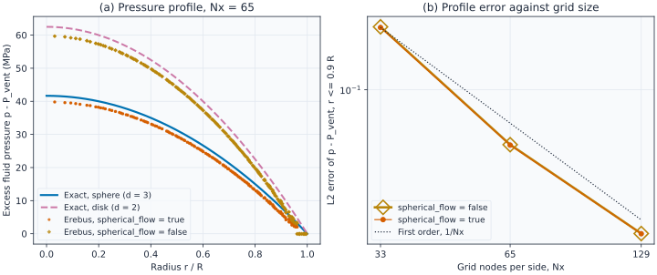
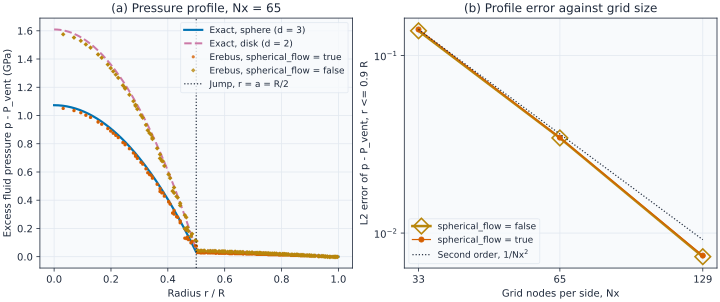
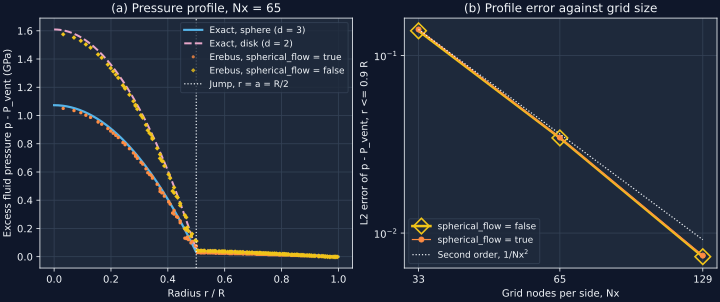

# Spherical Darcy Flow

## What this page checks

This page checks the interior Darcy solve of `Erebus.jl`, which gives the fluid pressure and the Darcy flux in a porous sphere.
It also checks the face weights of the fluid continuity rows, and that the vented rate from the venting rows equals the produced rate.
Validation means that we run the code on a case where we know the right answer from another source, and we check that the code gives that answer.
If this part were wrong, fluid pressures and fluxes would be wrong, and with them the venting, the fracturing and the loss of volatiles that depend on pressure.
Each case below gives the reason for the check, the setup, the reference, a figure and the test details.
Case 1 has a uniform permeability.
Case 2 has a core with a permeability 100 times lower than the shell.

The case uses a sphere of radius 50 km in a square box of 140 km.
`Nx` is the number of grid nodes on each side of the box.
In case 1 the rock has a uniform permeability $k = 10^{-13}$ m².
The rock has a uniform porosity of 0.2.
The fluid has a viscosity $\mu = 10^{-3}$ Pa s.
The rock is rigid, gravity is off, and every cell inside the sphere produces fluid at the same rate $S = 10^{-11}$ 1/s.
The surface temperature is 200 K and the ambient pressure is $P_\mathrm{amb} = 100$ Pa.
The ice vapour pressure at 200 K is lower than $P_\mathrm{amb}$, so the surface pressure is $P_\mathrm{vent} = P_\mathrm{amb} = 100$ Pa.
The surface is held at this pressure.
The case does not check the venting conductance (see "Known limit").

The code solves a 2-D grid.
The option `geometry.spherical_flow` gives the continuity rows of the fluid the face weights of a sphere, so that the 2-D grid behaves like a 3-D sphere.
The default is off, which gives a 2-D disk.

## The steady pressure of a sphere with a fluid source

**Why this check exists.**
The face weights could have a wrong size, or the Darcy matrix could give a wrong pressure or a wrong flux.
The pressure in the centre of the sphere would then have the wrong size.
With the option off, the centre excess pressure is 3/2 of the value of the sphere.
Fluid that is lost between the cells and the venting rows shows up as a vented rate that differs from the produced rate.

**What it tests.**
The case builds the state with `init_simulation` and sets the grid fields directly.
Faces outside $r = R$ are impermeable, and the venting conductance is much larger than the rock conductance, so that the surface pressure equals $P_\mathrm{vent} = P_\mathrm{amb}$ (the Dirichlet limit).
The case then calls `solve_stokes_darcy!` once, on timestep 1.
We compare the excess pressure $p - P_\mathrm{amb}$ at the grid nodes with the exact solution, for `spherical_flow = true` and for `spherical_flow = false`, at `Nx = 33`, 65 and 129.
The profile error is the relative L2 error over the nodes with $r \le 0.9 R$:

```math
\epsilon = \sqrt{\frac{\sum_i \left(\Delta p_i - \Delta p_i^\mathrm{exact}\right)^2}{\sum_i \left(\Delta p_i^\mathrm{exact}\right)^2}}, \qquad \Delta p = p - P_\mathrm{amb}.
```

We compare the Darcy flux with the exact flux $\mathbf{q} = S \mathbf{r} / d$ on the faces with $r \le 0.9 R$, where $\mathbf{r}$ points from the centre to the face.
The grid stores the x component of the flux on the vertical faces and the y component on the horizontal faces.
At each face the error is the stored component minus the same component of the exact flux.
The flux error is the relative L2 error over all stored x components and all stored y components:

```math
\epsilon_q = \sqrt{\frac{\sum_c \left(q_c - q_c^\mathrm{exact}\right)^2}{\sum_c \left(q_c^\mathrm{exact}\right)^2}}, \qquad q_c^\mathrm{exact} = \frac{S \, r_c}{d},
```

where $c$ runs over the stored components and $r_c$ is the coordinate of the face that the component belongs to, measured from the centre (x for an x component, y for a y component).
The error does not average the components of neighbouring faces.
We also compare the centre excess pressure with the option on and off, the vented rate with the produced rate, and the speed of the solid.

**How we know the right answer.**
Darcy's law and the balance of fluid volume give $\nabla^2 p = -\mu S / k$ inside the sphere, with $p = P_\mathrm{vent} = P_\mathrm{amb}$ at $r = R$.
The solution of this equation in $d$ dimensions is

```math
p - P_\mathrm{amb} = \frac{\mu S \left(R^2 - r^2\right)}{2 d k},
```

with $d = 3$ for `spherical_flow = true` and $d = 2$ for `spherical_flow = false`.
The flux is radial with the size $S r / d$, because all fluid that the cells inside radius $r$ produce crosses the surface of radius $r$.
Its components are $S x / d$ and $S y / d$ with $x$ and $y$ measured from the centre.
The centre values are $\mu S R^2 / (6 k)$ and $\mu S R^2 / (4 k)$, so the ratio of the sphere to the disk is exactly 2/3.
All fluid that the cells produce leaves through the surface, so the vented rate equals the produced rate.
The rock is rigid, so the solid speed is zero.

**Why it matters.**
Every run with `spherical_flow = true` uses these face weights in the fluid continuity rows.
This case checks them with the solver step alone, so a fault found here is a fault in the face weights or in the Darcy matrix.
It also shows that the vented rate from the venting rows equals the produced rate.
It does not show how the code vents fluid in general (see "Known limit").

```@raw html
<div class="validation-fig-light">
```

```@raw html
</div>
<div class="validation-fig-dark">
```

```@raw html
</div>
```

**How to read the plot.**
Panel (a) shows the excess pressure against $r / R$ at `Nx = 65`.
The solid line is the exact solution for the sphere and the dashed line is the exact solution for the disk.
The points are grid nodes.
A pass means that the points with the option on follow the solid line and the points with the option off follow the dashed line.
Panel (b) shows the L2 profile error against `Nx` on logarithmic axes, with a dotted line of first order.
A pass means that the error stays below its limit and falls along the dotted line as the grid gets finer.
The order between `Nx = 65` and `Nx = 129` is about 0.91 for both settings.

**Known limit.**
The circular surface is a staircase of grid cells.
This shifts the whole profile by a near-constant offset.
The error is therefore first order and not second order, and the test asserts limits on the L2 error and on the order and not an exact match.
The offset is nearly the same fraction of the centre value for both settings, so the centre ratio stays close to 2/3.
The vented rate does not depend on the offset.
Both are tested to a tight tolerance.
The flux error is tested against a limit at each grid.
The case uses the Dirichlet limit, in which the venting conductance is much larger than the rock conductance.
The surface pressure is then $P_\mathrm{amb}$ for any value of the venting conductance and of its face weight.
The case therefore does not check the venting conductance or its face weight.

!!! details "Test details"
    - Reference: exact solution, $\mu S (R^2 - r^2) / (2 d k)$, the exact flux $S \mathbf{r} / d$, the centre ratio 2/3, a vented rate equal to the produced rate, and a solid speed of zero.
    - Tolerance: L2 error at most 0.20 at `Nx = 33`, at most 0.08 at `Nx = 65` and at most 0.05 at `Nx = 129`; order of the error between `Nx = 65` and `Nx = 129` equal to 1 within 0.3; flux L2 error at most 0.21 at `Nx = 33`, at most 0.041 at `Nx = 65` and at most 0.019 at `Nx = 129`; centre ratio equal to 2/3 within 0.01; vented rate equal to the produced rate within $10^{-8}$ of the rate; solid speed at most $10^{-12}$ m/s.
    - Regression band: the allowed range around the recorded value is `PHYSICS_REGRESSION_BANDS` in `benchmarks/validation_spherical_darcy_flow.jl`.
      It is 0.005 on each L2 error of the pressure.
      It is 0.05 on each order.
      It is 0.008, 0.003 and 0.0015 on the flux error at `Nx = 33`, 65 and 129.
      It is 0.002 on the centre ratio.
      It is $10^{-8}$ on each vented-rate closure and $10^{-12}$ m/s on the solid speed.
    - Test id: `profile_l2_inner_off_nx33`, `profile_l2_inner_off_nx65`, `profile_l2_inner_off_nx129`, `profile_l2_inner_on_nx33`, `profile_l2_inner_on_nx65`, `profile_l2_inner_on_nx129`, `profile_order_off_65_129`, `profile_order_on_65_129`, `centre_ratio_on_off_nx65`, `flux_l2_inner_off_nx33`, `flux_l2_inner_off_nx65`, `flux_l2_inner_off_nx129`, `flux_l2_inner_on_nx33`, `flux_l2_inner_on_nx65`, `flux_l2_inner_on_nx129`, `vent_closure_off_nx65`, `vent_closure_on_nx65`, `solid_speed_max_nx65`.
      A `flux_l2_inner` value is the relative L2 vector error $\epsilon_q$.
      A `vent_closure` value is the absolute difference between the ratio of the vented to the produced rate and 1.
    - Command: `julia --project=. tools/check_validation.jl --check`.

## The steady pressure of a sphere with a low-permeability core

**Why this check exists.**
In a real body the permeability changes with depth.
Where the permeability jumps, the solver must carry the same flux through the jump, and the pressure must stay continuous.
A resistance that the solver reads from the wrong face, or a wrong face weight, gives a wrong pressure in the core or a wrong flux.

**What it tests.**
The case is case 1 with one change: the core $r < a = R/2$ has the permeability $k_\mathrm{core} = 10^{-15}$ m², and the shell $a \le r \le R$ keeps $k = 10^{-13}$ m².
The case sets the face resistances directly: the resistance $\mu / k$ of a face between 2 nodes is the mean of the 2 node values.
We compare the excess pressure with the exact solution at `Nx = 33`, 65 and 129, for both settings, with the profile error $\epsilon$ of case 1.
The flux error $\epsilon_q$ leaves out the faces at most 2 cells from $r = a$, because there the faces cut the circle $r = a$ as a staircase.
We also compare the centre excess pressure with the option on and off.
At `Nx = 33` we compare the pressure and the flux of the 6-variable and the 4-variable solver paths on all faces.

**How we know the right answer.**
The flux is the same as in case 1, $S r / d$, because it depends only on the fluid that the cells inside radius $r$ produce.
Darcy's law then gives the pressure gradient $\mu S r / (d k)$, with the $k$ of the layer.
With $p = P_\mathrm{amb}$ at $r = R$ and a continuous pressure at $r = a$, the exact solution is

```math
p - P_\mathrm{amb} =
\begin{cases}
\dfrac{\mu S \left(R^2 - r^2\right)}{2 d k}, & a \le r \le R, \\[2ex]
\dfrac{\mu S \left(R^2 - a^2\right)}{2 d k} + \dfrac{\mu S \left(a^2 - r^2\right)}{2 d k_\mathrm{core}}, & r < a.
\end{cases}
```

Both terms are proportional to $1/d$, so the ratio of the centre values of the sphere and the disk is again exactly 2/3.

**Why it matters.**
The permeability of a planetesimal changes with porosity, temperature and alteration.
This case checks that the continuity rows with the face weights of the sphere keep the exact solution when the permeability changes by a factor of 100 at a curved surface.

```@raw html
<div class="validation-fig-light">
```

```@raw html
</div>
<div class="validation-fig-dark">
```

```@raw html
</div>
```

**How to read the plot.**
Panel (a) shows the excess pressure against $r / R$ at `Nx = 65`.
The solid line is the exact solution for the sphere and the dashed line is the exact solution for the disk.
The dotted vertical line is the jump at $r = a$.
The points are grid nodes.
A pass means that the points with the option on follow the solid line and the points with the option off follow the dashed line, also in the core.
Panel (b) shows the L2 profile error against `Nx` on logarithmic axes.
A pass means that the error stays below its limit at each grid.

**Known limit.**
The jump surface $r = a$ is a staircase of grid cells, as the outer surface is.
The error therefore depends on how the grid cuts the circle $r = a$, and it does not fall at a fixed order.
With the option on it is 0.025 at `Nx = 63` and 0.034 at `Nx = 65`, so the finer grid has the larger error; the test checks this.
The test therefore asserts a limit at each grid and no order.
The flux error leaves out the faces at most 2 cells from $r = a$; the comparison of the 6-variable and the 4-variable solver paths includes these faces.
The case sets the face resistances directly, so it does not test how the code computes them from the markers.

!!! details "Test details"
    - Reference: exact solution above, the exact flux $S \mathbf{r} / d$, and the centre ratio 2/3.
    - Tolerance: L2 error at most 0.20 at `Nx = 33`, at most 0.08 at `Nx = 65` and at most 0.05 at `Nx = 129`; flux L2 error at most 0.041 at `Nx = 65` and at most 0.019 at `Nx = 129`; centre ratio equal to 2/3 within 0.01.
    - Regression band: the allowed range around the recorded value is `PHYSICS_REGRESSION_BANDS` in `benchmarks/validation_spherical_darcy_flow.jl`.
      It is 0.005 on each L2 error of the pressure.
      It is 0.003 and 0.0015 on the flux error at `Nx = 65` and 129.
      It is 0.002 on the centre ratio.
    - Test id: `profile_l2_inner_jump_off_nx33`, `profile_l2_inner_jump_off_nx65`, `profile_l2_inner_jump_off_nx129`, `profile_l2_inner_jump_on_nx33`, `profile_l2_inner_jump_on_nx65`, `profile_l2_inner_jump_on_nx129`, `centre_ratio_jump_on_off_nx65`, `flux_l2_inner_jump_off_nx65`, `flux_l2_inner_jump_off_nx129`, `flux_l2_inner_jump_on_nx65`, `flux_l2_inner_jump_on_nx129`.
    - Command: `julia --project=. tools/check_validation.jl --check`.

## All recorded values

The table comes from the record and must match it.
To make the figure again, run these 2 commands from the repository root:

```
julia --project=. scripts/export_validation_darcy_flow_data.jl <data_dir>
python3 scripts/generate_validation_darcy_flow_figures.py <data_dir>
```

The second command needs NumPy and Matplotlib.

```@raw html
<!-- VALIDATION_RECORD_START: spherical_darcy_flow -->
```

**Validation record**: `benchmarks/records/spherical_darcy_flow.toml` (Source commit `b80632a7`, config SHA-256 `1ebd6ad20a14`)

| Case | Metric | Grid `Nx` | Measured | Reference | Tolerance | Units | Status |
| :--- | :--- | :---: | :---: | :---: | :---: | :---: | :---: |
| `profile` | Excess pressure L2 relative error for r <= 0.9 R, 2-D disk (Nx=33) | 33 | `1.5610e-01` | `0.0000e+00` | `<= 2.00e-01` | dimensionless | **PASS** |
| `profile` | Excess pressure L2 relative error for r <= 0.9 R, 2-D disk (Nx=65) | 65 | `6.7716e-02` | `0.0000e+00` | `<= 8.00e-02` | dimensionless | **PASS** |
| `profile` | Excess pressure L2 relative error for r <= 0.9 R, 2-D disk (Nx=129) | 129 | `3.6074e-02` | `0.0000e+00` | `<= 5.00e-02` | dimensionless | **PASS** |
| `profile` | Excess pressure L2 relative error for r <= 0.9 R, 3-D sphere (Nx=33) | 33 | `1.5536e-01` | `0.0000e+00` | `<= 2.00e-01` | dimensionless | **PASS** |
| `profile` | Excess pressure L2 relative error for r <= 0.9 R, 3-D sphere (Nx=65) | 65 | `6.7519e-02` | `0.0000e+00` | `<= 8.00e-02` | dimensionless | **PASS** |
| `profile` | Excess pressure L2 relative error for r <= 0.9 R, 3-D sphere (Nx=129) | 129 | `3.6027e-02` | `0.0000e+00` | `<= 5.00e-02` | dimensionless | **PASS** |
| `profile` | Convergence order log2(L2(Nx=65) / L2(Nx=129)), 2-D disk | 129 | `9.0854e-01` | `1.0000e+00` | `atol=3.00e-01, rtol=0.00e+00` | dimensionless | **PASS** |
| `profile` | Convergence order log2(L2(Nx=65) / L2(Nx=129)), 3-D sphere | 129 | `9.0623e-01` | `1.0000e+00` | `atol=3.00e-01, rtol=0.00e+00` | dimensionless | **PASS** |
| `profile` | Centre excess pressure ratio, sphere to disk (Nx=65) | 65 | `6.6676e-01` | `6.6667e-01` | `atol=1.00e-02, rtol=0.00e+00` | dimensionless | **PASS** |
| `flux` | Darcy flux L2 relative vector error for r <= 0.9 R, 2-D disk (Nx=33) | 33 | `9.8930e-02` | `0.0000e+00` | `<= 2.10e-01` | dimensionless | **PASS** |
| `flux` | Darcy flux L2 relative vector error for r <= 0.9 R, 2-D disk (Nx=65) | 65 | `1.9440e-02` | `0.0000e+00` | `<= 4.10e-02` | dimensionless | **PASS** |
| `flux` | Darcy flux L2 relative vector error for r <= 0.9 R, 2-D disk (Nx=129) | 129 | `8.8214e-03` | `0.0000e+00` | `<= 1.90e-02` | dimensionless | **PASS** |
| `flux` | Darcy flux L2 relative vector error for r <= 0.9 R, 3-D sphere (Nx=33) | 33 | `1.0111e-01` | `0.0000e+00` | `<= 2.10e-01` | dimensionless | **PASS** |
| `flux` | Darcy flux L2 relative vector error for r <= 0.9 R, 3-D sphere (Nx=65) | 65 | `2.0182e-02` | `0.0000e+00` | `<= 4.10e-02` | dimensionless | **PASS** |
| `flux` | Darcy flux L2 relative vector error for r <= 0.9 R, 3-D sphere (Nx=129) | 129 | `9.2389e-03` | `0.0000e+00` | `<= 1.90e-02` | dimensionless | **PASS** |
| `closure` | Vented to produced fluid rate, abs(ratio - 1), 2-D disk (Nx=65) | 65 | `7.1170e-11` | `0.0000e+00` | `<= 1.00e-08` | dimensionless | **PASS** |
| `closure` | Vented to produced fluid rate, abs(ratio - 1), 3-D sphere (Nx=65) | 65 | `3.7067e-11` | `0.0000e+00` | `<= 1.00e-08` | dimensionless | **PASS** |
| `closure` | Largest solid velocity component, both settings (Nx=65) | 65 | `1.9465e-17` | `0.0000e+00` | `<= 1.00e-12` | m/s | **PASS** |
| `jump` | Permeability jump: excess pressure L2 relative error for r <= 0.9 R, 2-D disk (Nx=33) | 33 | `1.3780e-01` | `0.0000e+00` | `<= 2.00e-01` | dimensionless | **PASS** |
| `jump` | Permeability jump: excess pressure L2 relative error for r <= 0.9 R, 2-D disk (Nx=65) | 65 | `3.4339e-02` | `0.0000e+00` | `<= 8.00e-02` | dimensionless | **PASS** |
| `jump` | Permeability jump: excess pressure L2 relative error for r <= 0.9 R, 2-D disk (Nx=129) | 129 | `7.3619e-03` | `0.0000e+00` | `<= 5.00e-02` | dimensionless | **PASS** |
| `jump` | Permeability jump: excess pressure L2 relative error for r <= 0.9 R, 3-D sphere (Nx=33) | 33 | `1.4024e-01` | `0.0000e+00` | `<= 2.00e-01` | dimensionless | **PASS** |
| `jump` | Permeability jump: excess pressure L2 relative error for r <= 0.9 R, 3-D sphere (Nx=65) | 65 | `3.4496e-02` | `0.0000e+00` | `<= 8.00e-02` | dimensionless | **PASS** |
| `jump` | Permeability jump: excess pressure L2 relative error for r <= 0.9 R, 3-D sphere (Nx=129) | 129 | `7.4665e-03` | `0.0000e+00` | `<= 5.00e-02` | dimensionless | **PASS** |
| `jump` | Permeability jump: centre excess pressure ratio, sphere to disk (Nx=65) | 65 | `6.6690e-01` | `6.6667e-01` | `atol=1.00e-02, rtol=0.00e+00` | dimensionless | **PASS** |
| `jump` | Permeability jump: Darcy flux L2 relative vector error for r <= 0.9 R and abs(r - a) > 2 dx, 2-D disk (Nx=65) | 65 | `2.4220e-02` | `0.0000e+00` | `<= 4.10e-02` | dimensionless | **PASS** |
| `jump` | Permeability jump: Darcy flux L2 relative vector error for r <= 0.9 R and abs(r - a) > 2 dx, 2-D disk (Nx=129) | 129 | `1.2508e-02` | `0.0000e+00` | `<= 1.90e-02` | dimensionless | **PASS** |
| `jump` | Permeability jump: Darcy flux L2 relative vector error for r <= 0.9 R and abs(r - a) > 2 dx, 3-D sphere (Nx=65) | 65 | `2.4606e-02` | `0.0000e+00` | `<= 4.10e-02` | dimensionless | **PASS** |
| `jump` | Permeability jump: Darcy flux L2 relative vector error for r <= 0.9 R and abs(r - a) > 2 dx, 3-D sphere (Nx=129) | 129 | `1.2295e-02` | `0.0000e+00` | `<= 1.90e-02` | dimensionless | **PASS** |

```@raw html
<!-- VALIDATION_RECORD_END: spherical_darcy_flow -->
```
