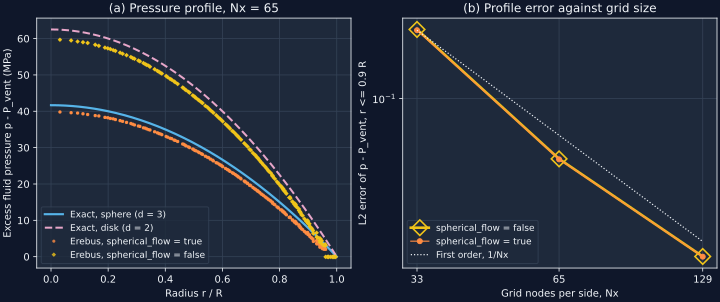

# Spherical Darcy Flow

## What this page checks

This page checks how `Erebus.jl` moves fluid through a porous sphere and how it vents fluid at the surface.
Validation means that we run the code on a case where we know the right answer from another source, and we check that the code gives that answer.
If this part were wrong, fluid pressures would be wrong, and with them the venting, the fracturing and the loss of volatiles that depend on pressure.
Each case below gives the reason for the check, the setup, the reference, a figure and the test details.

The case uses a sphere of radius 50 km in a square box of 140 km.
`Nx` is the number of grid nodes on each side of the box.
The rock has a uniform permeability $k = 10^{-13}$ m² and a uniform porosity of 0.2.
The fluid has a viscosity $\mu = 10^{-3}$ Pa s.
The rock is rigid, gravity is off, and every cell inside the sphere produces fluid at the same rate $S = 10^{-11}$ 1/s.
The surface is held at the venting pressure $P_\mathrm{vent}$ of the surface temperature of 200 K.

The code solves a 2-D grid.
The option `geometry.spherical_flow` gives the continuity rows of the fluid the face weights of a sphere, so that the 2-D grid behaves like a 3-D sphere.
The default is off, which gives a 2-D disk.

## The steady pressure of a sphere with a fluid source

**Why this check exists.**
The face weights could have a wrong size, or the venting condition could lose fluid.
The pressure in the centre of the sphere would then have the wrong size.
With the option off, the centre excess pressure is 3/2 of the value of the sphere.
A venting condition that loses fluid shows up as a vented rate that differs from the produced rate.

**What it tests.**
The case builds the state with `init_simulation` and sets the grid fields directly.
Faces outside $r = R$ are impermeable, and the venting conductance is large, so that the surface pressure equals $P_\mathrm{vent}$ (the Dirichlet limit).
The case then calls `solve_stokes_darcy!` once, on timestep 1.
We compare the excess pressure $p - P_\mathrm{vent}$ at the grid nodes with the exact solution, for `spherical_flow = true` and for `spherical_flow = false`, at `Nx = 33`, 65 and 129.
The profile error is the relative L2 error over the nodes with $r \le 0.9 R$:

$$
\epsilon = \sqrt{\frac{\sum_i \left(\Delta p_i - \Delta p_i^\mathrm{exact}\right)^2}{\sum_i \left(\Delta p_i^\mathrm{exact}\right)^2}}, \qquad \Delta p = p - P_\mathrm{vent}.
$$

We also compare the centre excess pressure with the option on and off, the vented rate with the produced rate, and the speed of the solid.

**How we know the right answer.**
Darcy's law and the balance of fluid volume give $\nabla^2 p = -\mu S / k$ inside the sphere, with $p = P_\mathrm{vent}$ at $r = R$.
The solution of this equation in $d$ dimensions is

$$
p - P_\mathrm{vent} = \frac{\mu S \left(R^2 - r^2\right)}{2 d k},
$$

with $d = 3$ for `spherical_flow = true` and $d = 2$ for `spherical_flow = false`.
The centre values are $\mu S R^2 / (6 k)$ and $\mu S R^2 / (4 k)$, so the ratio of the sphere to the disk is exactly 2/3.
All fluid that the cells produce leaves through the surface, so the vented rate equals the produced rate.
The rock is rigid, so the solid speed is zero.

**Why it matters.**
Every run with `spherical_flow = true` uses these face weights in the fluid continuity rows.
This case checks them with the solver step alone, so a fault found here is a fault in the face weights, in the venting condition or in the Darcy matrix.

```@raw html
<div class="validation-fig-light">
```

```@raw html
</div>
<div class="validation-fig-dark">
```

```@raw html
</div>
```

**How to read the plot.**
Panel (a) shows the excess pressure against $r / R$ at `Nx = 65`.
The solid line is the exact solution for the sphere and the dashed line is the exact solution for the disk.
The points are grid nodes.
A pass means that the points with the option on follow the solid line and the points with the option off follow the dashed line.
Panel (b) shows the L2 profile error against `Nx` on logarithmic axes, with a dotted line of first order.
A pass means that the error stays below its limit and falls along the dotted line as the grid gets finer.
The order between `Nx = 65` and `Nx = 129` is about 0.91 for both settings.

**Known limit.**
The circular surface is a staircase of grid cells.
This shifts the whole profile by a near-constant offset.
The error is therefore first order and not second order, and the test asserts limits on the L2 error and on the order and not an exact match.
The offset is nearly the same fraction of the centre value for both settings, so the centre ratio stays close to 2/3.
The vented rate does not depend on the offset.
Both are tested to a tight tolerance.

!!! details "Test details"
    - Reference: exact solution, $\mu S (R^2 - r^2) / (2 d k)$, the centre ratio 2/3, a vented rate equal to the produced rate, and a solid speed of zero.
    - Tolerance: L2 error at most 0.20 at `Nx = 33`, at most 0.08 at `Nx = 65` and at most 0.05 at `Nx = 129`; order of the error between `Nx = 65` and `Nx = 129` equal to 1 within 0.3; centre ratio equal to 2/3 within 0.01; vented rate equal to the produced rate within $10^{-8}$ of the rate; solid speed at most $10^{-12}$ m/s.
    - Regression band: the allowed range around the recorded value is `PHYSICS_REGRESSION_BANDS` in `benchmarks/validation_spherical_darcy_flow.jl`, which is 0.005 on each L2 error, 0.05 on each order and 0.002 on the centre ratio.
    - Test id: `profile_l2_inner_off_nx33`, `profile_l2_inner_off_nx65`, `profile_l2_inner_off_nx129`, `profile_l2_inner_on_nx33`, `profile_l2_inner_on_nx65`, `profile_l2_inner_on_nx129`, `profile_order_off_65_129`, `profile_order_on_65_129`, `centre_ratio_on_off_nx65`, `vent_closure_off_nx65`, `vent_closure_on_nx65`, `solid_speed_max_nx65`. A `vent_closure` value is the absolute difference between the ratio of the vented to the produced rate and 1.
    - Command: `julia --project=. tools/check_validation.jl --check`.

## All recorded values

The table comes from the record and must match it.
To make the figure again, run these 2 commands from the repository root:

```
julia --project=. scripts/export_validation_darcy_flow_data.jl <data_dir>
python3 scripts/generate_validation_darcy_flow_figures.py <data_dir>
```

The second command needs NumPy and Matplotlib.

```@raw html
<!-- VALIDATION_RECORD_START: spherical_darcy_flow -->
```

**Validation record**: `benchmarks/records/spherical_darcy_flow.toml` (Source commit `b80632a7`, config SHA-256 `45d1a29b0011`)

| Case | Metric | Grid `Nx` | Measured | Reference | Tolerance | Units | Status |
| :--- | :--- | :---: | :---: | :---: | :---: | :---: | :---: |
| `profile` | Excess pressure L2 relative error for r <= 0.9 R, 2-D disk (Nx=33) | 33 | `1.5610e-01` | `0.0000e+00` | `<= 2.00e-01` | dimensionless | **PASS** |
| `profile` | Excess pressure L2 relative error for r <= 0.9 R, 2-D disk (Nx=65) | 65 | `6.7716e-02` | `0.0000e+00` | `<= 8.00e-02` | dimensionless | **PASS** |
| `profile` | Excess pressure L2 relative error for r <= 0.9 R, 2-D disk (Nx=129) | 129 | `3.6074e-02` | `0.0000e+00` | `<= 5.00e-02` | dimensionless | **PASS** |
| `profile` | Excess pressure L2 relative error for r <= 0.9 R, 3-D sphere (Nx=33) | 33 | `1.5536e-01` | `0.0000e+00` | `<= 2.00e-01` | dimensionless | **PASS** |
| `profile` | Excess pressure L2 relative error for r <= 0.9 R, 3-D sphere (Nx=65) | 65 | `6.7519e-02` | `0.0000e+00` | `<= 8.00e-02` | dimensionless | **PASS** |
| `profile` | Excess pressure L2 relative error for r <= 0.9 R, 3-D sphere (Nx=129) | 129 | `3.6027e-02` | `0.0000e+00` | `<= 5.00e-02` | dimensionless | **PASS** |
| `profile` | Convergence order log2(L2(Nx=65) / L2(Nx=129)), 2-D disk | 129 | `9.0854e-01` | `1.0000e+00` | `atol=3.00e-01, rtol=0.00e+00` | dimensionless | **PASS** |
| `profile` | Convergence order log2(L2(Nx=65) / L2(Nx=129)), 3-D sphere | 129 | `9.0623e-01` | `1.0000e+00` | `atol=3.00e-01, rtol=0.00e+00` | dimensionless | **PASS** |
| `profile` | Centre excess pressure ratio, sphere to disk (Nx=65) | 65 | `6.6676e-01` | `6.6667e-01` | `atol=1.00e-02, rtol=0.00e+00` | dimensionless | **PASS** |
| `closure` | Vented to produced fluid rate, abs(ratio - 1), 2-D disk (Nx=65) | 65 | `7.1170e-11` | `0.0000e+00` | `<= 1.00e-08` | dimensionless | **PASS** |
| `closure` | Vented to produced fluid rate, abs(ratio - 1), 3-D sphere (Nx=65) | 65 | `3.7067e-11` | `0.0000e+00` | `<= 1.00e-08` | dimensionless | **PASS** |
| `closure` | Largest solid velocity component, both settings (Nx=65) | 65 | `1.9465e-17` | `0.0000e+00` | `<= 1.00e-12` | m/s | **PASS** |

```@raw html
<!-- VALIDATION_RECORD_END: spherical_darcy_flow -->
```
