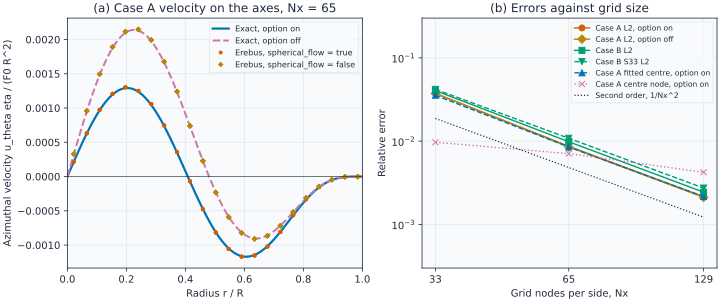
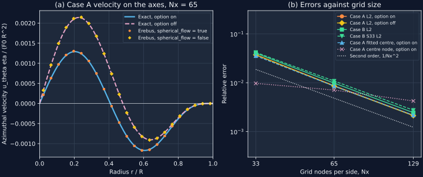
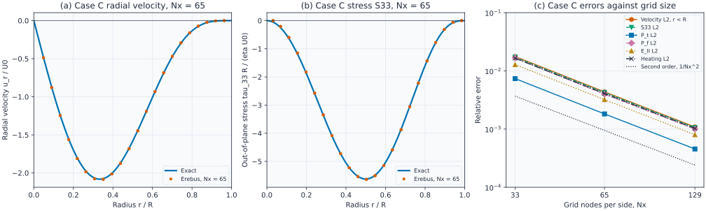
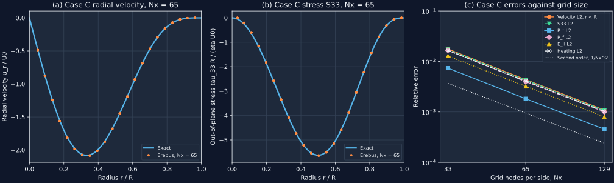

# Spherical Momentum

## What this page checks

This page checks how `Erebus.jl` computes the flow of the solid rock with the option `geometry.spherical_flow = true`.
With this option, the 2-D grid stands for a slice through a sphere and not for a flat slab.
Flow in a sphere differs from flow in a slab, so the code adds extra terms to the momentum equation: the metric terms.
Validation here means that we run the code on a case where another source gives the right answer.
The test then checks that the code gives that answer.
If the metric terms were wrong, the flow inside a planetesimal and the stresses that break its rock would be wrong.

The page checks 3 groups of terms.
A fault in any group changes the result by many times the grid error, so it shows in the result.

- The weights on the stress, which act on every flow that shears (case A).
- The out-of-plane stress $S_{33}$ and its hoop term, which act only on a flow that moves towards or away from the centre (case B).
- The volumetric trace of the stress, which acts only on a flow that compresses or dilates the rock (case C).

The page also checks the stress update that stores $S_{33}$ in `grids.S33` after the solve (cases B and C).
A fault in this update does not change the flow, but it changes the stored stress.
Case C also checks the second invariants and the heating that the code computes from $S_{33}$.

Each case below says why the check exists, what it tests, how we know the right answer and why it matters.
The box "Test details" at the end of each case gives the reference, the tolerance, the test ids and the command.

**How the option enters the momentum equation.**
The momentum equation says that the forces on each piece of rock balance: the stress, the pressure and the body force.
The momentum rows are the rows of the linear system that hold this equation.
With the option on, they solve the momentum equation of the spherical annulus (Hernlund and Tackley, 2008):

$$\frac{1}{w} \partial_j (w \tau_{ij}) - \tau_{33} \frac{\partial_i w}{w} - \partial_i P_t + f_i = 0, \qquad i, j \in \{x, y\}, \qquad w = 2r.$$

Here $\tau_{ij}$ is the deviatoric stress in Pa, $P_t$ the total pressure in Pa and $r$ the distance from the centre of the sphere in m.
The body force $f_i = \rho g_i$, in N/m³, is the density $\rho$ times the gravity $g_i$.
The weight $w$ in the first term makes the stress balance that of a sphere.
The second term is the hoop term: the out-of-plane stress $\tau_{33}$ acts on the rock where $w$ changes.
The code stores $\tau_{33}$ as $S_{33}$.
With the option off, the rows solve the 2-D equation $\partial_j \tau^\mathrm{2D}_{ij} - \partial_i P_t + f_i = 0$, with the 2-D deviatoric stress $\tau^\mathrm{2D}_{ij}$.

!!! details "The equation in full and where the code adds each term"
    The stress is the 3-D deviatoric stress $\tau_{ij} = 2 \eta (\dot\varepsilon_{ij} - \delta_{ij} \nabla_3 \cdot \mathbf{u} / 3)$, with the viscosity $\eta$ in Pa s.
    The strain rate $\dot\varepsilon_{ij}$ and the out-of-plane strain rate $\dot\varepsilon_{33} = \mathbf{u} \cdot \nabla w / w$ are in 1/s.
    The 3-D divergence of the velocity is $\nabla_3 \cdot \mathbf{u} = \partial_j u_j + \dot\varepsilon_{33}$, in 1/s.
    The equation is the momentum equation of the spherical annulus of Hernlund and Tackley (2008), written in Cartesian components (see [Discretization and Numerics](../explanations/discretization_numerics.md)).
    It is their Eqs. (2) to (7) with $d = 2$ and the bulk viscosity $k_0 = 0$ Pa s.
    With $d = 2$ the equations hold the metric of a sphere, and with $d = 1$ that of a cylinder.
    Their Eq. (2) has a radial gravity only and their Eq. (3) no body force; the force $f_i$ here takes the place of the general body force $\rho g^i$ of their Eq. (14).

    With the option off, the stress is the 2-D deviatoric stress $\tau^\mathrm{2D}_{xx} = -\tau^\mathrm{2D}_{yy} = S_{xx} = \eta (\dot\varepsilon_{xx} - \dot\varepsilon_{yy})$ and $\tau^\mathrm{2D}_{xy} = 2 \eta \dot\varepsilon_{xy}$, with the trace $\nabla_2 \cdot \mathbf{u} / 2$ in place of $\nabla_3 \cdot \mathbf{u} / 3$.

    The 2-D rows hold the 2-D terms.
    The function `_add_spherical_momentum!` in `src/numerics/stokes_darcy.jl` adds the difference, and both assembly paths of the solver call it.
    It does 4 steps:

    1. It computes $\dot\varepsilon_{33}$ at a pressure node $P$ as the weighted divergence of the continuity row minus the 2-D divergence, with the face multipliers $m_F = w_F / w_P$ of the cell faces $F$ around $P$.
    2. It computes $S_{33} = \tau_{33} = \frac{2\eta}{3} (2 \dot\varepsilon_{33} - \dot\varepsilon_{xx} - \dot\varepsilon_{yy})$.
    3. It adds $(m_F - 1)$ times the stress flux through each face, with the face multipliers $m_F = w_F / w_V$ of the control volume around each velocity node $V$ (`vx` in the x row, `vy` in the y row). This is the difference between $\frac{1}{w} \partial_j (w \tau_{ij})$ and $\partial_j \tau_{ij}$.
    4. It adds the $S_{33}$ part of the weighted divergence, with $\tau_{xx} = S_{xx} - S_{33} / 2$ and $\tau_{yy} = -S_{xx} - S_{33} / 2$, and the hoop term $\tau_{33} \partial_i w / w$, with $\partial_x w / w = (m_E - m_W) / \Delta x$ and $\partial_y w / w = (m_S - m_N) / \Delta y$.

    After the solve, `_spherical_stress_update!` in `src/numerics/plasticity.jl` writes `grids.S33` from the solved velocity.

**The test set-up.**
All cases use the same set-up, except for 2 values of case C that its section gives.

- A sphere of radius $R = 50$ km sits in the middle of a square box of 140 km.
- `Nx` is the number of basic nodes (the cell corners of the staggered grid) on each side of the box.
  It is odd, so a basic node lies on the centre.
- The shear viscosity is $\eta = 10^{20}$ Pa s in the whole box, with no air layer.
- In cases A and B the rock is nearly incompressible: the shear viscosity is $10^{-6}$ times the compaction viscosity $\zeta$, in Pa s.
- The shear modulus is $10^{35}$ Pa, so elasticity does not change the viscosity, and the stress history is 0.
- The fluid density is 0, and the case sets the body force $f = \rho g$ directly in the gravity fields `gx` and `gy`.
- In cases A and B the code holds the total pressure at the ambient pressure $P_\mathrm{amb} = 100$ Pa on the box edge.
- Every exact flow is 0 outside the sphere ($r \ge R$), so the free-slip walls and the pressure ring on the box edge see the exact solution.

The case builds the state with `init_simulation`, sets the grid fields directly and calls `solve_stokes_darcy!` once, on timestep 1.
With the force scale $F_0 = 100$ N/m³, the velocity unit of case A is $F_0 R^2 / \eta = 2.5 \times 10^{-9}$ m/s.
The largest velocity of case A is a few $10^{-12}$ m/s.

## Case A: shear flow around the centre, with and without the option

**Why this check exists.**
Each cell face $F$ has a face multiplier $m_F$, the weight $w$ at the face divided by the weight at the node.
The code adds $(m_F - 1)$ times the stress flux through each face.
These weights could be missing, have the wrong sign or use the weight of the wrong cell face.
In a flow around the centre, these weights change the balance of the shear stress by an amount of order 1.
So each of these faults changes the flow.

**What it tests.**
A body force $f_\theta$ pushes the rock around the centre.
It drives the flow $\mathbf{u} = r \Omega(r) \mathbf{e}_\theta$, with the velocity $\mathbf{u}$ in m/s and the unit vector $\mathbf{e}_\theta$ around the centre.
The rotation rate $\Omega$, in 1/s, changes with $r$.
The force is $f_\theta = F_0 \rho (1 - \rho^2)^2 (1 - 32 \rho^2 / 5 + 39 \rho^4 / 5)$, where $\rho = r / R$ is the scaled radius (not the density).
The test runs the case with the option on and with the option off, at `Nx = 33`, 65 and 129.
It measures 4 things:

- the L2 error of the velocity: the root-mean-square error over all interior velocity nodes of the box, divided by the root-mean-square of the exact velocity;
- the rotation rate at the centre, from a fit and at the centre node;
- the ratio of the L2 norms of the velocity profiles with and without the option, at `Nx = 65` and 129;
- the difference between the 2 solver paths, with the option on at `Nx = 33` only.

The 2 solver paths are the solve with 6 unknowns per node (`solver.darcy_elimination = false`) and the solve with 4 (`true`).
They must give the same $v_x$, $v_y$, $P_t$, fluid pressure and Darcy flux.

**How we know the right answer.**
For this flow, the momentum equation has an exact solution with the option on and another exact solution with the option off.
The flow and the force point only around the centre ($u_r = 0$) and do not change with the angle.
So the flow does not compress the rock, $\tau_{33} = 0$, the pressure is uniform and the only stress is the shear stress $\tau_{r\theta} = \eta r \Omega'$.
With the option on, the momentum equation above then becomes

$$\frac{1}{r^3} \frac{d}{dr} \left( r^3 \tau_{r\theta} \right) + f_\theta = 0.$$

With the option off, it becomes $\frac{1}{r^2} \frac{d}{dr} (r^2 \tau_{r\theta}) + f_\theta = 0$, which is the equation of a cylinder.
The exact solutions are

$$\Omega_\mathrm{on} = \frac{F_0 R}{\eta} \frac{(1 - \rho^2)^4 (1 - 6 \rho^2)}{100}, \qquad \Omega_\mathrm{off} = \frac{F_0 R}{\eta} \frac{(1 - \rho^2)^4 (3 - 13 \rho^2)}{200}.$$

The force makes the flow 0 at $r = R$ and outside the sphere, with the option on and off.
The test checks both formulas against their equation in exact rational arithmetic.

!!! details "How the exact solution follows, and why it is also a flow of the full sphere"
    Hernlund and Tackley (2008) give the angular part of the momentum equation of the annulus as their Eq. (3), which has no body force.
    We add an azimuthal body force $f_\theta$ as in their Eq. (14).
    Nothing changes along the angle $\theta$ around the centre, and the radial velocity is $v_r = 0$.
    The equation then reduces to the form above with $d = 2$ (the sphere, option on), and to the cylinder form with $d = 1$ (the 2-D equation of the option off for this flow).
    The force has $\int_0^R s^2 f_\theta \, ds = \int_0^R s^3 f_\theta \, ds = 0$, so $\Omega' = 0$ at $r = R$ in both forms and the flow is 0 outside.
    The test checks both formulas against their equation and the 2 moments of the force with exact rational arithmetic, and the Float64 formulas against finite differences.

    The option-on equation is also the equation of the full 3-D sphere for this flow.
    The 3-D flow $\mathbf{u} = \Omega(r) \, r \sin\vartheta \, \mathbf{e}_\varphi$, with the polar angle $\vartheta$ and the force $f_\varphi = \sin\vartheta \, f_\theta(r)$, has only 1 stress component, $\tau_{r\varphi} = \eta \, r \sin\vartheta \, \Omega'(r)$, because $\tau_{\vartheta\varphi} = \eta \sin\vartheta \, \partial_\vartheta \Omega = 0$.
    The $\varphi$ component of the stress divergence in spherical coordinates is then $\frac{1}{r^3} \partial_r (r^3 \tau_{r\varphi})$, and the factor $\sin\vartheta$ cancels against that of the force.
    So every latitude of the 3-D flow, the equator included, satisfies the option-on equation, and case A tests the slice against a flow of the full sphere.

**Why it matters.**
Every run with `spherical_flow = true` uses the weights on the stress in each momentum row.

```@raw html
<div class="validation-fig-light">
```

```@raw html
</div>
<div class="validation-fig-dark">
```

```@raw html
</div>
```

**How to read the plot.**
Panel (a) shows the velocity of case A against the scaled radius $r / R$ at `Nx = 65`, on the 2 axes through the centre.
On these axes the flow is purely azimuthal.
The solid line is the exact solution with the option on, and the dashed line is the exact solution with the option off.
The y-axis is the velocity in units of $F_0 R^2 / \eta$.
The points are the values of the code at the grid nodes.
A pass means that the points with the option on lie on the solid line.
The points with the option off must lie on the dashed line.
Panel (b) shows the errors against `Nx` on logarithmic axes, with a dotted line of second order.
A pass means that the errors stay below their limits and fall along the dotted line.
The error at the centre node only has to stay below its limit (see the known limit below).

**Known limit.**
With the option on, the error of the rotation rate at the centre node falls slowly when the grid gets finer.
It falls at order 0.45 from `Nx = 33` to 65 and at order 0.74 from 65 to 129 (the record rows `centre_node_a_on`).
Without the option, it falls at second order.
The record therefore holds this error only as an upper bound, with no order and no ratio row.
The cause is the weight $w = 2r$, which has a sharp point (a cone) at the centre.
The error stays near the centre: the L2 error over the box and the fitted rotation rate at the centre both converge at second order.

!!! details "The rotation rate at the centre, and why the centre node converges slowly"
    The rotation rate at the centre is 1/100 with the option on and 3/200 without, in units of $F_0 R / \eta$, so the exact ratio is 2/3.
    We measure it in 2 ways.
    The fit takes $\Omega = v_\theta / r$ at the velocity nodes on the 2 axes through the centre with $0.18 \le \rho \le 0.85$, and fits a polynomial of degree 5 in $\rho^2$ by least squares.
    The exact $\Omega$ has degree 5 in $\rho^2$, so the fit has no bias.
    The fitted centre value converges at order 2.06 from `Nx = 33` to 65 with the option on and off, and the ratio of the fitted values is 2/3 within 0.08 % at `Nx = 65`.
    The centre node value is half the vorticity at the basic node on the centre.

    Within a few cells of the centre, the truncation error of the weighted divergence does not fall with the grid spacing, as the docstring of `flow_metric_face_weights` states.
    A flow with $\Omega(0) \ne 0$ is a rigid rotation near the centre, which has no strain in the continuum.
    On the grid, this rotation has the out-of-plane strain rate $\dot\varepsilon_{33} = \pm 0.011 \, \Omega$ at the 8 pressure nodes at $r = \sqrt{2.5} \, \Delta x \approx 1.58 \Delta x$, the same on every grid.
    Away from the centre, this strain rate falls at second order.
    Its sign changes from one of these nodes to the next around the centre, as $\sin 4\theta$ does, so the 8 values sum to 0.
    The continuity rows and the momentum rows use this discrete $\dot\varepsilon_{33}$ in the solve, and the stress update uses the same discrete $\dot\varepsilon_{33}$ when it writes $S_{33}$ into `grids.S33` after the solve.
    With the option on, case A has a total pressure error of about 1100 Pa next to the centre that does not fall with the grid, against a stress scale $F_0 R = 5 \times 10^6$ Pa.

    Case A0 shows the cause.
    It has $\Omega = -\frac{F_0 R}{\eta} \frac{\rho^2 (1 - \rho^2)^4}{10}$ with the force $f_\theta = F_0 \rho (1 - \rho^2)^2 (1 - 46 \rho^2 / 5 + 13 \rho^4)$ of the option-on equation, so $\Omega(0) = 0$.
    The test checks its formula in the same way as case A.
    Case A0 converges at second order in the L2 error, in the largest velocity error and in the largest pressure error.
    Case A0 runs in the test only, at `Nx = 33` and 65, and has no record row.

!!! details "Test details"
    - Reference: the exact solutions of case A with and without the option; the exact centre rotation ratio 2/3; the exact ratio of the profile L2 norms, $\sqrt{\int_0^1 \rho \, u_\mathrm{on}^2 \, d\rho / \int_0^1 \rho \, u_\mathrm{off}^2 \, d\rho} = \sqrt{8 / 11} \approx 0.853$ from the formulas in rational arithmetic, compared with the discrete ratio over the velocity nodes with $r < R$; equal fields of the 6-variable and the 4-variable solver paths.
    - Tolerance:
        - each error: at most about 1.4 times its recorded value (the table at the end of the page);
        - each order between `Nx = 65` and `Nx = 129`: 2 within 0.35;
        - the fitted centre ratio: 2/3 within a relative $8 \times 10^{-4}$ at `Nx = 65` and $2.5 \times 10^{-4}$ at `Nx = 129`;
        - the profile norm ratio: $\sqrt{8 / 11}$ within a relative $7.5 \times 10^{-4}$ and $2.1 \times 10^{-4}$;
        - the difference of the 2 solver paths: at most $10^{-7}$, with the pressure differences scaled by $F_0 R$ and the Darcy flux differences by $F_0 R^2 / \eta$.
    - Regression band: the allowed range around the recorded value is `PHYSICS_REGRESSION_BANDS` in `benchmarks/validation_spherical_momentum.jl`.
      It is $2 \times 10^{-3}$, $5 \times 10^{-4}$ and $1.5 \times 10^{-4}$ on each error at `Nx = 33`, 65 and 129, 0.05 on each order, $2 \times 10^{-4}$ and $10^{-4}$ on each ratio at `Nx = 65` and 129, and $10^{-7}$ on the solver path difference.
      Measured against the exact flow with the option on, the run with the option off has the L2 error 0.63 at `Nx = 33`; the test checks that this run leaves the bands of the option-on rows by more than twice the band.
    - Test id: `l2_a_{on,off}_nx{33,65,129}`, `centre_fit_a_{on,off}_nx{33,65,129}`, `centre_node_a_on_nx{33,65,129}`, `l2_order_a_{on,off}_65_129`, `centre_fit_order_a_{on,off}_65_129`, `centre_fit_ratio_nx{65,129}`, `profile_ratio_nx{65,129}`, `elim_a_nx33`.
      `Pkg.test` runs `test/test_validation_spherical_momentum.jl` at `Nx = 33` and 65 and pins the L2 error of case A with the option at `Nx = 65`, 8.6724558541e-3, to a relative $10^{-6}$.
    - Command: `julia --project=. tools/check_validation.jl --check`.

## Case B: flow towards and away from the centre, and the out-of-plane stress

**Why this check exists.**
In case A the out-of-plane stress $S_{33}$ and its hoop term are 0, so case A cannot find a fault in them.
Several factors in these terms could be wrong.
These are the $2/3$ of $S_{33}$, the 2 of the out-of-plane strain rate $\dot\varepsilon_{33}$, the $1/2$ of the hoop term and the $1/2$ of the $S_{33}$ flux.
The stress update could also store a wrong `grids.S33`.

**What it tests.**
Case B is a manufactured flow: we choose the flow first, and then compute the body force that makes it an exact solution.
The flow has a radial part, so the rock moves towards and away from the centre.
The flow does not compress the rock, and its out-of-plane stress is $\tau_{33} = 2 \eta u_r / r$, with the radial velocity $u_r$.
The flow and its first 4 derivatives are 0 at $r = R$.
The test runs the case with the option on, at `Nx = 33`, 65 and 129, and compares:

- the velocity with the exact flow, over the whole box and over the nodes with $r < R$;
- `grids.S33` with the exact $\tau_{33}$, over the pressure nodes with $r < R$;
- the velocity, the pressures and the Darcy flux of the 2 solver paths, at `Nx = 33` only.

Case B has no exact solution with the option off.

**How we know the right answer.**
The flow is a formula, so its exact stress divergence follows by differentiation.
The body force is minus this stress divergence, computed from the exact polynomials in rational arithmetic and not from the code.
The test computes the force 2 more times.
The first time uses finite differences of the exact velocity in the slice equation in Cartesian components.
The second time uses finite differences in Eqs. (2) to (7) of Hernlund and Tackley (2008) with $d = 2$ in polar coordinates.
Both agree with the force to a relative $10^{-6}$, and the 2-D form with $d = 1$ does not agree.
Case B therefore checks the slice against the documented equation of the spherical annulus, and not against the full 3-D equations of a sphere.

!!! details "The flow of case B in full"
    The flow uses $X = (x - x_c) / R$, $Y = (y - y_c) / R$ and the dimensionless potential $\psi = X Y (1 - \rho^2)^6$.
    The velocity is $r \mathbf{u} = \nabla \times (r^3 \psi \, \mathbf{e}_z)$ in units of $U_0 = 10^{-9}$ m/s:

    $$u_x = 3 Y \psi + \rho^2 \partial_Y \psi, \qquad u_y = -(3 X \psi + \rho^2 \partial_X \psi).$$

    It has $\partial_j (r u_j) = 0$, so the 3-D divergence of the slice is 0, and $\tau_{33}$ is of order $\eta U_0 / R$.
    The body force is $f = -D(\mathbf{u})$, with $D$ the stress divergence of the option-on equation.
    The force is a polynomial in $X$ and $Y$ plus a remainder of degree 3 divided by $\rho^2$.
    This remainder is at most a constant times $\rho$, so the force is 0 at the centre.

**Why it matters.**
Every flow with a radial part, such as the compaction of a planetesimal interior or a plume, uses the $S_{33}$ terms.

**How to read the plot.**
Panel (b) of the figure in case A also shows case B: the velocity L2 error (squares) and the $S_{33}$ L2 error (downward triangles).
A pass means that both errors stay below their limits and fall along the dotted line of second order.

!!! details "Test details"
    - Reference: the manufactured flow of case B, with its force from the polynomials of the option-on equation; $\tau_{33} = 2 \eta u_r / r$; equal fields of the 6-variable and the 4-variable solver paths.
    - Tolerance:
        - each error: at most about 1.4 times its recorded value (the table at the end of the page);
        - each order between `Nx = 65` and `Nx = 129`: 2 within 0.35;
        - the difference of the 2 solver paths: at most $10^{-7}$, with the pressure differences scaled by $\eta U_0 / R$ and the Darcy flux differences by $U_0$.
    - Regression band: as for case A.
    - Test id: `l2_b_nx{33,65,129}`, `l2_inside_b_nx{33,65,129}`, `s33_b_nx{33,65,129}`, `l2_order_b_65_129`, `l2_inside_order_b_65_129`, `s33_order_b_65_129`, `elim_b_nx33`.
    - Command: `julia --project=. tools/check_validation.jl --check`.

## Case C: compaction towards the centre, and the volumetric trace of the stress

**Why this check exists.**
The 3-D deviatoric stress holds the volumetric trace $-\frac{2}{3} \eta \nabla_3 \cdot \mathbf{u}$, with the 3-D divergence $\nabla_3 \cdot \mathbf{u}$ of the velocity in 1/s.
Cases A and B have $\nabla_3 \cdot \mathbf{u} = 0$, so a fault in the trace changes their flow far less than the grid error does.
Case C fails when one of these terms is missing or has a wrong factor:

- the trace in $S_{33}$ of the momentum rows, in the $S_{33}$ flux or in the hoop term;
- the factor 2 of $\dot\varepsilon_{33}$ in $S_{33}$, in the momentum rows and in the stress update;
- the trace in the stress update that writes `grids.S33` and the second invariant `grids.EII`;
- the out-of-plane part $\frac{3}{4} S_{33}^2$ of the second invariant `grids.SII`;
- the out-of-plane heating $\frac{3}{4} S_{33}^2 / \eta$ in `compute_shear_heating!`;
- the compaction term of the fluid continuity row;
- the Darcy flux that the solver writes into `grids.qxD` and `grids.qyD`.

**What it tests.**
Case C is a manufactured flow of a compressible rock.
We choose the flow and the 2 pressures, and then compute the body force that makes them an exact solution.
The rock moves towards the centre with the radial velocity $u_r = -10 \, U_0 \, \rho (1 - \rho^2)^4$, with $U_0 = 10^{-9}$ m/s and the scaled radius $\rho = r / R$.
The flow compresses the rock near the centre and dilates it in the outer shell.
So $\nabla_3 \cdot \mathbf{u}$ is of order $U_0 / R$, and the trace is of the same order as the rest of the stress.
The pore fluid flows the other way, with the Darcy flux $\mathbf{q} = -\mathbf{u}$ in m/s, so the rock and its fluid together keep their volume.
The porosity, the volume fraction of the pores, is $\phi = 0.2$.
The code computes the compaction viscosity $\zeta$ as $\eta$ times `solver.etaphikoef` divided by $\phi$.
The case sets `solver.etaphikoef` $= \phi$, so $\zeta = \eta$.
It holds both pressures at the ambient pressure $P_\mathrm{amb} = 10^7$ Pa on the box edge.
This value keeps the total pressure positive everywhere.
The test runs the case with the option on at `Nx = 33`, 65 and 129, and compares these fields with their exact values:

- the velocity, over the whole box and over the nodes with $r < R$;
- the Darcy flux `grids.qxD` and `grids.qyD` with $-\mathbf{u}$, in the test at `Nx = 33` and 65, without a record row;
- `grids.S33` with the exact $\tau_{33}$;
- the total pressure $P_t$ and the fluid pressure $P_f$, both in Pa;
- `grids.EII`, the second invariant of the strain rate in 1/s, and `grids.SII`, the second invariant of the stress in Pa;
- the heating `grids.HS`, in W/m³, that `compute_shear_heating!` computes with `S33 = grids.S33`, as the thermal step does with the option on;
- the velocity, both pressures and the Darcy flux of the 2 solver paths, at `Nx = 33` only.

Each error at the pressure nodes is a relative L2 error over the nodes with $r < R$.
It divides the L2 norm of the difference by the L2 norm of the exact field there.
For the 2 pressures the exact field is $P - P_\mathrm{amb}$.
The test also bounds the errors of $S_{33}$, $P_t$ and $P_f$ at the pressure nodes with $r \ge R$, where the exact fields are 0.

**How we know the right answer.**
For a flow that points only towards the centre, the momentum equation of the slice is the radial momentum equation of a 3-D sphere:

$$\partial_r \sigma_{rr} + \frac{2 (\sigma_{rr} - \sigma_{\theta\theta})}{r} + f_r = 0.$$

Here $\sigma_{rr} = \tau_{rr} - P_t$ is the radial total stress in Pa.
The out-of-plane total stress is $\sigma_{\theta\theta} = \tau_{\theta\theta} - P_t$, in Pa.
The radial body force $f_r$ is in N/m³.
The deviatoric stresses are $\tau_{rr} = 2 \eta (\partial_r u_r - \nabla_3 \cdot \mathbf{u} / 3)$ and $\tau_{\theta\theta} = \tau_{33} = 2 \eta (u_r / r - \nabla_3 \cdot \mathbf{u} / 3)$, with $\nabla_3 \cdot \mathbf{u} = \partial_r u_r + 2 u_r / r$.
This $\tau_{\theta\theta}$ is Eq. (6) of Hernlund and Tackley (2008) with $d = 2$ and the bulk viscosity $k_0 = 0$ Pa s.
The test computes $f_r$ from these equations by finite differences in $r$ in 256-bit arithmetic.
It agrees with the force of the case to a relative $10^{-6}$ on the x axis and on the diagonal.
The same equations without the trace need a force that differs by more than 10 % of the largest force.
Case C therefore checks the slice against the 3-D equations of a sphere, and not only against the documented slice equation.

!!! details "The exact fields of case C"
    The velocity is $\mathbf{u} = U_0 R \nabla \Phi$ with the potential $\Phi = (1 - \rho^2)^5$.
    The solid continuity row holds $\nabla_3 \cdot \mathbf{u} + (P_t - P_f) / Z = 0$, with $Z = \zeta (1 - \phi)$ in Pa s.
    So $P_t = P_f - Z \nabla_3 \cdot \mathbf{u}$.
    The Darcy rows hold $\mathbf{q} = -(k / \mu) \nabla P_f$, with the permeability $k = 10^{-13}$ m², the fluid viscosity $\mu = 10^{-3}$ Pa s and no fluid density.
    The fluid pressure $P_f - P_\mathrm{amb} = (\mu U_0 R / k) \Phi$ gives $\mathbf{q} = -\mathbf{u}$.
    The fluid continuity row holds $\nabla_3 \cdot \mathbf{q} - (P_t - P_f) / Z = 0$, which then follows from the solid continuity.
    The test checks the 3 rows with finite differences of the exact fields.

    At the centre the rock compacts in all 3 directions alike, with $\nabla_3 \cdot \mathbf{u} = -30 \, U_0 / R$ and $\tau_{33} = 0$.
    There $P_t - P_\mathrm{amb} = 24.25 \, \eta U_0 / R$, about 48.5 MPa, and $P_f - P_\mathrm{amb} = 0.25 \, \eta U_0 / R$.
    In the outer shell the rock dilates, so $P_t < P_\mathrm{amb}$ there.
    With $P_\mathrm{amb} = 100$ Pa the total pressure there would be a tension of more than 1 MPa.

    The stress update defines the second invariant of the strain rate as $E_{II} = \sqrt{E_{xx}^2 + E_{xy}^2 + \frac{3}{4} \dot\varepsilon'^2_{33}}$, in 1/s.
    Here $E_{xx} = (\dot\varepsilon_{xx} - \dot\varepsilon_{yy}) / 2$ and $E_{xy} = \dot\varepsilon_{xy}$ are the 2-D deviatoric strain rates.
    The deviatoric out-of-plane strain rate is $\dot\varepsilon'_{33} = \dot\varepsilon_{33} - \nabla_3 \cdot \mathbf{u} / 3$.
    For case C, $E_{II} = \frac{80}{\sqrt{3}} \frac{U_0}{R} \rho^2 (1 - \rho^2)^3$, which is 0 at the centre.
    The deviatoric strain rates of the sphere are $\dot\varepsilon'_{rr} = \partial_r u_r - \nabla_3 \cdot \mathbf{u} / 3$ and $\dot\varepsilon'_{\theta\theta} = u_r / r - \nabla_3 \cdot \mathbf{u} / 3$.
    The test checks $E_{II}$ against $\sqrt{(\dot\varepsilon'^2_{rr} + 2 \dot\varepsilon'^2_{\theta\theta}) / 2}$.
    In the viscous limit $S_{II} = 2 \eta E_{II}$.
    The heating is $H_S = 4 \eta E_{II}^2 + Z (\nabla_3 \cdot \mathbf{u})^2 + (\mu / k) |\mathbf{q}|^2$: the deviatoric, the compaction and the Darcy part.

    The case builds the fields as polynomials in $X = (x - x_c) / R$ and $Y = (y - y_c) / R$ with exact rational coefficients.
    The case divides $u_r / r$, $\tau_{33}$ and the hoop numerator of the force by $\rho^2$ exactly, so every field is finite at the centre.
    The force there is 0.
    Every field is 0 for $r \ge R$, and the force is 0 on $r = R$.

**Why it matters.**
Every run with `spherical_flow = true` in which the rock compacts or dilates uses the trace.
The compaction of a porous planetesimal interior and the flow of its pore fluid are such runs.

```@raw html
<div class="validation-fig-light">
```

```@raw html
</div>
<div class="validation-fig-dark">
```

```@raw html
</div>
```

**How to read the plot.**
Panel (a) shows the radial velocity $u_r$ against the scaled radius $r / R$ at `Nx = 65`, in units of $U_0$.
The points are the velocity nodes on the row and the column half a cell next to the axes through the centre.
Panel (b) shows `grids.S33` on the pressure nodes of the same row and column, in units of $\eta U_0 / R$.
In both panels the line is the exact solution and the points are the values of the code.
A pass means that the points lie on the line.
Panel (c) shows the errors of case C against `Nx` on logarithmic axes, with a dotted line of second order.
A pass means that the errors stay below their limits and fall along the dotted line.

**Known limit.**
A missing trace changes the flow of this case by less than 1/3, not by an amount of order 1.
The size depends on where the trace is missing, so we describe 2 faults.

The first fault drops the trace from every stress component.
For a flow without rotation, this fault changes the coefficient of $\nabla (\nabla_3 \cdot \mathbf{u})$ in the momentum equation from $Z + 4 \eta / 3$ to $Z + 2 \eta$.
Here $Z = \zeta (1 - \phi)$, in Pa s, is $0.8 \, \eta$ in this case.
So the fault changes the flow by about $(2/3) / (Z / \eta + 2)$.
This fraction is 5/21, about 0.24, for this case and at most 1/3 for any $\eta / \zeta$.
These values follow from the equation alone.
We quote no run for this fault.

The second fault drops the trace from $S_{33}$ of the momentum rows only.
The code adds the trace to the in-plane stress through $S_{33}$ alone, with $\tau_{xx} = S_{xx} - S_{33} / 2$.
Here $S_{xx} = \eta (\dot\varepsilon_{xx} - \dot\varepsilon_{yy})$, in Pa, is the deviatoric normal stress of the 2-D rows.
Without the trace in $S_{33}$, the in-plane trace is 1.5 times too large and the out-of-plane trace is 0.
A run by hand with this fault at `Nx = 65` has the velocity error 0.10, 24 times the grid error.
The same run by hand has the error 0.22 in $P_t$ and the error 0.22 in $S_{33}$.
A run by hand at `Nx = 65` with the trace dropped from the stress update has the $S_{33}$ error 1.5.

The largest $S_{33}$ errors sit near the centre.
At `Nx = 33` the 32 pressure nodes within 3 cells of the centre carry 0.57 of the squared $S_{33}$ error inside $R$.
At `Nx = 65` the same 32 nodes carry 0.22.
The number of these nodes stays 32 on every grid, so their share falls when the grid is refined.

The case has a uniform viscosity, a square grid, a shear modulus of $10^{35}$ Pa and no stress history `S330`.
It tests only $\eta / \zeta = 1$.

!!! details "Test details"
    - Reference:
        - the exact fields of case C, from polynomials with exact rational coefficients;
        - the force, checked against the radial momentum equation of a 3-D sphere;
        - equal fields of the 6-variable and the 4-variable solver paths.
    - Tolerance:
        - each error: at most about 1.4 times its recorded value (the table at the end of the page);
        - each order between `Nx = 65` and `Nx = 129`: 2 within 0.35;
        - the Darcy flux against $-\mathbf{u}$ in the test: at most 0.025 at `Nx = 33` and 0.0060 at `Nx = 65`, with the order 2 within 0.35;
        - the difference of the 2 solver paths: at most $10^{-7}$, with both pressure differences scaled by $\eta U_0 / R$ and the Darcy flux differences by $U_0$.
    - Regression band: as for case A, except the $P_t$ errors, with $10^{-3}$, $2.5 \times 10^{-4}$ and $7.5 \times 10^{-5}$ at `Nx = 33`, 65 and 129.
    - Test id: `l2_c_nx{33,65,129}`, `l2_inside_c_nx{33,65,129}`, `s33_c_nx{33,65,129}`, `pt_c_nx{33,65,129}`, `pf_c_nx{33,65,129}`, `eii_c_nx{33,65,129}`, `sii_c_nx{33,65,129}`, `hs_c_nx{33,65,129}`, the order of each as `l2_order_c_65_129` to `hs_order_c_65_129`, and `elim_c_nx33`.
      `Pkg.test` pins the velocity error of case C for $r < R$ at `Nx = 65`, 4.3581222816e-3, to a relative $10^{-6}$.
      It pins the other 7 errors of case C at `Nx = 65` to a relative $10^{-5}$.
      The test `Thermal step adds the S33 heating with the option on` in `test/test_spherical_momentum.jl` checks 2 things.
      First, the thermal step passes `grids.S33` to `compute_shear_heating!` with the option on and not with it off.
      Second, the extra heating raises the temperature of the step by the heating times $\Delta t$ over the heat capacity per volume `grids.RHOCP`.
      The test `Plastic yield check reads S33 at the basic nodes` checks that the yield check uses $S_{33}$ when it gets it.
      The test `Plastic pass of the solve reads S33 only with the option on` checks that the solve passes $S_{33}$ to the yield check with the option on and not with it off.
    - Command: `julia --project=. tools/check_validation.jl --check`.

## Conditions of the cases

The cases rest on 8 conditions, and the test asserts each of them.

!!! details "The 8 conditions that the test asserts"
    The exact solutions and the solve rest on 8 conditions.
    Each condition is a test assertion, so a change of the set-up that breaks one fails the test.

    - C1, compaction viscosity: after the solve, $\eta / \zeta$ has its value on every interior pressure node to a relative $10^{-12}$.
      The value is $10^{-6}$ in cases A and B and 1 in case C.
      The exact flows of cases A and B have $\nabla_3 \cdot \mathbf{u} = 0$ and $P_t = P_f = P_\mathrm{amb}$.
      So they solve the continuum equations for any $\zeta > 0$.
      For these cases C1 makes the solve a nearly incompressible Stokes problem.
      The exact fields of case C hold for $\zeta = \eta$ only.
    - C2, viscous limit: on every basic and pressure node, the shear modulus times the time step $\Delta t$ is positive.
      It is also at least $10^6$ times the viscosity.
    - C3, body force: the solve leaves `gx` and `gy` unchanged.
    - C4, force moments: the moments $\int s^2 f_\theta$ and $\int s^3 f_\theta$ of the case A force are 0 in exact rational arithmetic.
    - C5, compact flow: the exact velocity of every case is 0 on $r = R$, checked in rational arithmetic at rational points of the circle and to round-off in Float64.
    - C6, one solve: the time step after the solve equals $\Delta t$ to a relative $10^{-12}$, with one plastic pass that converges.
      The strengths are $10^{20}$ Pa with no friction, and the test checks that no node yields.
    - C7, no fluid body force: the fluid density `RHOFX` and `RHOFY` is at most $10^{-30}$ kg/m³ before and after the solve.
      With a fluid density, the Darcy flux of case C would not be $-\mathbf{u}$.
    - C8, anchor rings: after the solve, $P_t$ and $P_f$ equal $P_\mathrm{amb}$ on the anchor rings to a relative $10^{-9}$.
      The anchor rings are the pressure nodes next to the box edge, where the solver sets both pressures to `geometry.psurface`.

## What these cases do not test

- The volumetric trace $\nabla_3 \cdot \mathbf{u} / 3$ in a flow that also rotates or shears.
  Cases A and B have $\nabla_3 \cdot \mathbf{u} = 0$, so they do not test the trace.
  Case C tests the trace, in a flow that points only towards the centre.
- Elasticity and the stress history `SXX0`, `SXY0` and `S330`: the shear modulus is $10^{35}$ Pa and the history is 0.
  3 tests in `test/test_spherical_momentum.jl` cover them.
  Their names are `Out-of-plane stress history in the momentum right-hand side`, `Stress history of all components in both momentum rows` and `Pressure stays unweighted and the visco-elastic factor scales the stress`.
- A variable viscosity `ETA` and `ETAP`, grid spacings $\Delta x \ne \Delta y$ and a centre between the grid nodes.
  The case has a uniform viscosity, a square grid and the centre on a basic node.
  The operator tests of `test/test_spherical_momentum.jl` use a variable viscosity, $\Delta x \ne \Delta y$ and a centre between the nodes.
- A compressible rock with $\eta / \zeta \ne 1$: case C has $\eta / \zeta = 1$ only.
- Gravity of the planet, buoyancy, a fluid density, plasticity and the time loop.
  The cases set the force directly, have no fluid density and solve once.
  Case C has a Darcy flow of the pore fluid, without a fluid body force.
- How the code computes the viscosity and the force from the markers, the material points that carry the rock properties.
  The case sets the grid fields directly.

## All recorded values

The table comes from the record and must match it.
To make the figure again, run these 2 commands from the repository root:

```
julia --project=. scripts/export_validation_momentum_data.jl <data_dir>
python3 scripts/generate_validation_momentum_figures.py <data_dir>
```

The second command needs NumPy and Matplotlib.

```@raw html
<!-- VALIDATION_RECORD_START: spherical_momentum -->
```

**Validation record**: `benchmarks/records/spherical_momentum.toml` (Source commit `ddcd7259`, config SHA-256 `0e373ee6716e`)

| Case | Metric | Grid `Nx` | Measured | Reference | Tolerance | Units | Status |
| :--- | :--- | :---: | :---: | :---: | :---: | :---: | :---: |
| `A` | Velocity L2 relative error over the box, case A, option on (Nx=33) | 33 | `3.7452e-02` | `0.0000e+00` | `<= 5.30e-02` | dimensionless | **PASS** |
| `A` | Velocity L2 relative error over the box, case A, option on (Nx=65) | 65 | `8.6725e-03` | `0.0000e+00` | `<= 1.22e-02` | dimensionless | **PASS** |
| `A` | Velocity L2 relative error over the box, case A, option on (Nx=129) | 129 | `2.1555e-03` | `0.0000e+00` | `<= 3.10e-03` | dimensionless | **PASS** |
| `A` | Velocity L2 relative error over the box, case A, option off (Nx=33) | 33 | `3.7361e-02` | `0.0000e+00` | `<= 5.30e-02` | dimensionless | **PASS** |
| `A` | Velocity L2 relative error over the box, case A, option off (Nx=65) | 65 | `8.5455e-03` | `0.0000e+00` | `<= 1.20e-02` | dimensionless | **PASS** |
| `A` | Velocity L2 relative error over the box, case A, option off (Nx=129) | 129 | `2.1173e-03` | `0.0000e+00` | `<= 3.00e-03` | dimensionless | **PASS** |
| `B` | Velocity L2 relative error over the box, case B, option on (Nx=33) | 33 | `4.0409e-02` | `0.0000e+00` | `<= 5.70e-02` | dimensionless | **PASS** |
| `B` | Velocity L2 relative error over the box, case B, option on (Nx=65) | 65 | `9.8283e-03` | `0.0000e+00` | `<= 1.38e-02` | dimensionless | **PASS** |
| `B` | Velocity L2 relative error over the box, case B, option on (Nx=129) | 129 | `2.4411e-03` | `0.0000e+00` | `<= 3.50e-03` | dimensionless | **PASS** |
| `B` | Velocity L2 relative error from the nodes with r < R, case B, option on (Nx=33) | 33 | `4.0340e-02` | `0.0000e+00` | `<= 5.70e-02` | dimensionless | **PASS** |
| `B` | Velocity L2 relative error from the nodes with r < R, case B, option on (Nx=65) | 65 | `9.8063e-03` | `0.0000e+00` | `<= 1.38e-02` | dimensionless | **PASS** |
| `B` | Velocity L2 relative error from the nodes with r < R, case B, option on (Nx=129) | 129 | `2.4355e-03` | `0.0000e+00` | `<= 3.50e-03` | dimensionless | **PASS** |
| `B` | S33 L2 relative error against tau_33 = 2 eta u_r / r for r < R, case B, option on (Nx=33) | 33 | `4.1855e-02` | `0.0000e+00` | `<= 5.90e-02` | dimensionless | **PASS** |
| `B` | S33 L2 relative error against tau_33 = 2 eta u_r / r for r < R, case B, option on (Nx=65) | 65 | `1.0839e-02` | `0.0000e+00` | `<= 1.52e-02` | dimensionless | **PASS** |
| `B` | S33 L2 relative error against tau_33 = 2 eta u_r / r for r < R, case B, option on (Nx=129) | 129 | `2.7375e-03` | `0.0000e+00` | `<= 3.90e-03` | dimensionless | **PASS** |
| `A` | abs(Omega_fit(0) / Omega(0) - 1), fit of degree 5 in rho^2 for 0.18 <= rho <= 0.85, case A, option on (Nx=33) | 33 | `3.5554e-02` | `0.0000e+00` | `<= 5.00e-02` | dimensionless | **PASS** |
| `A` | abs(Omega_fit(0) / Omega(0) - 1), fit of degree 5 in rho^2 for 0.18 <= rho <= 0.85, case A, option on (Nx=65) | 65 | `8.5180e-03` | `0.0000e+00` | `<= 1.20e-02` | dimensionless | **PASS** |
| `A` | abs(Omega_fit(0) / Omega(0) - 1), fit of degree 5 in rho^2 for 0.18 <= rho <= 0.85, case A, option on (Nx=129) | 129 | `2.1618e-03` | `0.0000e+00` | `<= 3.10e-03` | dimensionless | **PASS** |
| `A` | abs(Omega_fit(0) / Omega(0) - 1), fit of degree 5 in rho^2 for 0.18 <= rho <= 0.85, case A, option off (Nx=33) | 33 | `3.3180e-02` | `0.0000e+00` | `<= 4.70e-02` | dimensionless | **PASS** |
| `A` | abs(Omega_fit(0) / Omega(0) - 1), fit of degree 5 in rho^2 for 0.18 <= rho <= 0.85, case A, option off (Nx=65) | 65 | `7.9723e-03` | `0.0000e+00` | `<= 1.12e-02` | dimensionless | **PASS** |
| `A` | abs(Omega_fit(0) / Omega(0) - 1), fit of degree 5 in rho^2 for 0.18 <= rho <= 0.85, case A, option off (Nx=129) | 129 | `1.9917e-03` | `0.0000e+00` | `<= 2.80e-03` | dimensionless | **PASS** |
| `A` | abs(Omega_node / Omega(0) - 1) at the centre basic node, case A, option on (Nx=33) | 33 | `9.7009e-03` | `0.0000e+00` | `<= 1.36e-02` | dimensionless | **PASS** |
| `A` | abs(Omega_node / Omega(0) - 1) at the centre basic node, case A, option on (Nx=65) | 65 | `7.0838e-03` | `0.0000e+00` | `<= 1.00e-02` | dimensionless | **PASS** |
| `A` | abs(Omega_node / Omega(0) - 1) at the centre basic node, case A, option on (Nx=129) | 129 | `4.2314e-03` | `0.0000e+00` | `<= 6.00e-03` | dimensionless | **PASS** |
| `C` | Velocity L2 relative error over the box, case C, option on (Nx=33) | 33 | `1.7621e-02` | `0.0000e+00` | `<= 2.50e-02` | dimensionless | **PASS** |
| `C` | Velocity L2 relative error over the box, case C, option on (Nx=65) | 65 | `4.3593e-03` | `0.0000e+00` | `<= 6.20e-03` | dimensionless | **PASS** |
| `C` | Velocity L2 relative error over the box, case C, option on (Nx=129) | 129 | `1.0883e-03` | `0.0000e+00` | `<= 1.60e-03` | dimensionless | **PASS** |
| `C` | Velocity L2 relative error from the nodes with r < R, case C, option on (Nx=33) | 33 | `1.7616e-02` | `0.0000e+00` | `<= 2.50e-02` | dimensionless | **PASS** |
| `C` | Velocity L2 relative error from the nodes with r < R, case C, option on (Nx=65) | 65 | `4.3581e-03` | `0.0000e+00` | `<= 6.20e-03` | dimensionless | **PASS** |
| `C` | Velocity L2 relative error from the nodes with r < R, case C, option on (Nx=129) | 129 | `1.0881e-03` | `0.0000e+00` | `<= 1.60e-03` | dimensionless | **PASS** |
| `C` | S33 L2 relative error against tau_33 = 2 eta (u_r / r - div3 / 3) for r < R, case C, option on (Nx=33) | 33 | `1.7184e-02` | `0.0000e+00` | `<= 2.50e-02` | dimensionless | **PASS** |
| `C` | S33 L2 relative error against tau_33 = 2 eta (u_r / r - div3 / 3) for r < R, case C, option on (Nx=65) | 65 | `4.2575e-03` | `0.0000e+00` | `<= 6.00e-03` | dimensionless | **PASS** |
| `C` | S33 L2 relative error against tau_33 = 2 eta (u_r / r - div3 / 3) for r < R, case C, option on (Nx=129) | 129 | `1.0629e-03` | `0.0000e+00` | `<= 1.50e-03` | dimensionless | **PASS** |
| `C` | Total pressure L2 error over the L2 norm of P_t - P_amb for r < R, case C, option on (Nx=33) | 33 | `7.3627e-03` | `0.0000e+00` | `<= 1.10e-02` | dimensionless | **PASS** |
| `C` | Total pressure L2 error over the L2 norm of P_t - P_amb for r < R, case C, option on (Nx=65) | 65 | `1.8200e-03` | `0.0000e+00` | `<= 2.60e-03` | dimensionless | **PASS** |
| `C` | Total pressure L2 error over the L2 norm of P_t - P_amb for r < R, case C, option on (Nx=129) | 129 | `4.5474e-04` | `0.0000e+00` | `<= 6.40e-04` | dimensionless | **PASS** |
| `C` | Fluid pressure L2 error over the L2 norm of P_f - P_amb for r < R, case C, option on (Nx=33) | 33 | `1.6640e-02` | `0.0000e+00` | `<= 2.40e-02` | dimensionless | **PASS** |
| `C` | Fluid pressure L2 error over the L2 norm of P_f - P_amb for r < R, case C, option on (Nx=65) | 65 | `3.9680e-03` | `0.0000e+00` | `<= 5.60e-03` | dimensionless | **PASS** |
| `C` | Fluid pressure L2 error over the L2 norm of P_f - P_amb for r < R, case C, option on (Nx=129) | 129 | `1.0029e-03` | `0.0000e+00` | `<= 1.50e-03` | dimensionless | **PASS** |
| `C` | EII L2 relative error against the exact second strain rate invariant for r < R, case C, option on (Nx=33) | 33 | `1.2803e-02` | `0.0000e+00` | `<= 1.80e-02` | dimensionless | **PASS** |
| `C` | EII L2 relative error against the exact second strain rate invariant for r < R, case C, option on (Nx=65) | 65 | `3.2081e-03` | `0.0000e+00` | `<= 4.50e-03` | dimensionless | **PASS** |
| `C` | EII L2 relative error against the exact second strain rate invariant for r < R, case C, option on (Nx=129) | 129 | `7.9977e-04` | `0.0000e+00` | `<= 1.20e-03` | dimensionless | **PASS** |
| `C` | SII L2 relative error against 2 eta E_II for r < R, case C, option on (Nx=33) | 33 | `1.2803e-02` | `0.0000e+00` | `<= 1.80e-02` | dimensionless | **PASS** |
| `C` | SII L2 relative error against 2 eta E_II for r < R, case C, option on (Nx=65) | 65 | `3.2081e-03` | `0.0000e+00` | `<= 4.50e-03` | dimensionless | **PASS** |
| `C` | SII L2 relative error against 2 eta E_II for r < R, case C, option on (Nx=129) | 129 | `7.9977e-04` | `0.0000e+00` | `<= 1.20e-03` | dimensionless | **PASS** |
| `C` | HS L2 relative error against the exact deviatoric, compaction and Darcy heating for r < R, case C, option on (Nx=33) | 33 | `1.6480e-02` | `0.0000e+00` | `<= 2.40e-02` | dimensionless | **PASS** |
| `C` | HS L2 relative error against the exact deviatoric, compaction and Darcy heating for r < R, case C, option on (Nx=65) | 65 | `4.0821e-03` | `0.0000e+00` | `<= 5.80e-03` | dimensionless | **PASS** |
| `C` | HS L2 relative error against the exact deviatoric, compaction and Darcy heating for r < R, case C, option on (Nx=129) | 129 | `1.0232e-03` | `0.0000e+00` | `<= 1.50e-03` | dimensionless | **PASS** |
| `A` | Convergence order log2(e(Nx=65) / e(Nx=129)) of the velocity L2 error, case A, option on | 129 | `2.0084e+00` | `2.0000e+00` | `atol=3.50e-01, rtol=0.00e+00` | dimensionless | **PASS** |
| `A` | Convergence order log2(e(Nx=65) / e(Nx=129)) of the velocity L2 error, case A, option off | 129 | `2.0129e+00` | `2.0000e+00` | `atol=3.50e-01, rtol=0.00e+00` | dimensionless | **PASS** |
| `B` | Convergence order log2(e(Nx=65) / e(Nx=129)) of the velocity L2 error, case B, option on | 129 | `2.0094e+00` | `2.0000e+00` | `atol=3.50e-01, rtol=0.00e+00` | dimensionless | **PASS** |
| `B` | Convergence order log2(e(Nx=65) / e(Nx=129)) of the velocity L2 error for r < R, case B, option on | 129 | `2.0095e+00` | `2.0000e+00` | `atol=3.50e-01, rtol=0.00e+00` | dimensionless | **PASS** |
| `B` | Convergence order log2(e(Nx=65) / e(Nx=129)) of the S33 L2 error, case B, option on | 129 | `1.9853e+00` | `2.0000e+00` | `atol=3.50e-01, rtol=0.00e+00` | dimensionless | **PASS** |
| `A` | Convergence order log2(e(Nx=65) / e(Nx=129)) of the fitted centre rotation error, case A, option on | 129 | `1.9783e+00` | `2.0000e+00` | `atol=3.50e-01, rtol=0.00e+00` | dimensionless | **PASS** |
| `A` | Convergence order log2(e(Nx=65) / e(Nx=129)) of the fitted centre rotation error, case A, option off | 129 | `2.0010e+00` | `2.0000e+00` | `atol=3.50e-01, rtol=0.00e+00` | dimensionless | **PASS** |
| `C` | Convergence order log2(e(Nx=65) / e(Nx=129)) of the velocity L2 error, case C, option on | 129 | `2.0020e+00` | `2.0000e+00` | `atol=3.50e-01, rtol=0.00e+00` | dimensionless | **PASS** |
| `C` | Convergence order log2(e(Nx=65) / e(Nx=129)) of the velocity L2 error for r < R, case C, option on | 129 | `2.0019e+00` | `2.0000e+00` | `atol=3.50e-01, rtol=0.00e+00` | dimensionless | **PASS** |
| `C` | Convergence order log2(e(Nx=65) / e(Nx=129)) of the S33 L2 error, case C, option on | 129 | `2.0020e+00` | `2.0000e+00` | `atol=3.50e-01, rtol=0.00e+00` | dimensionless | **PASS** |
| `C` | Convergence order log2(e(Nx=65) / e(Nx=129)) of the total pressure L2 error, case C, option on | 129 | `2.0009e+00` | `2.0000e+00` | `atol=3.50e-01, rtol=0.00e+00` | dimensionless | **PASS** |
| `C` | Convergence order log2(e(Nx=65) / e(Nx=129)) of the fluid pressure L2 error, case C, option on | 129 | `1.9842e+00` | `2.0000e+00` | `atol=3.50e-01, rtol=0.00e+00` | dimensionless | **PASS** |
| `C` | Convergence order log2(e(Nx=65) / e(Nx=129)) of the EII L2 error, case C, option on | 129 | `2.0041e+00` | `2.0000e+00` | `atol=3.50e-01, rtol=0.00e+00` | dimensionless | **PASS** |
| `C` | Convergence order log2(e(Nx=65) / e(Nx=129)) of the SII L2 error, case C, option on | 129 | `2.0041e+00` | `2.0000e+00` | `atol=3.50e-01, rtol=0.00e+00` | dimensionless | **PASS** |
| `C` | Convergence order log2(e(Nx=65) / e(Nx=129)) of the HS L2 error, case C, option on | 129 | `1.9963e+00` | `2.0000e+00` | `atol=3.50e-01, rtol=0.00e+00` | dimensionless | **PASS** |
| `A` | Fitted centre rotation ratio, option on to off, case A (Nx=65) | 65 | `6.6703e-01` | `6.6667e-01` | `atol=0.00e+00, rtol=8.00e-04` | dimensionless | **PASS** |
| `A` | Fitted centre rotation ratio, option on to off, case A (Nx=129) | 129 | `6.6678e-01` | `6.6667e-01` | `atol=0.00e+00, rtol=2.50e-04` | dimensionless | **PASS** |
| `A` | Velocity L2 norm ratio over r < R, option on to off, case A (Nx=65) | 65 | `8.5235e-01` | `8.5280e-01` | `atol=0.00e+00, rtol=7.50e-04` | dimensionless | **PASS** |
| `A` | Velocity L2 norm ratio over r < R, option on to off, case A (Nx=129) | 129 | `8.5268e-01` | `8.5280e-01` | `atol=0.00e+00, rtol=2.10e-04` | dimensionless | **PASS** |
| `solver` | Largest relative difference of vx, vy, pr, pf, qxD, qyD between the 6- and 4-variable paths, case A, option on (Nx=33) | 33 | `5.4788e-10` | `0.0000e+00` | `<= 1.00e-07` | dimensionless | **PASS** |
| `solver` | Largest relative difference of vx, vy, pr, pf, qxD, qyD between the 6- and 4-variable paths, case B, option on (Nx=33) | 33 | `4.2119e-09` | `0.0000e+00` | `<= 1.00e-07` | dimensionless | **PASS** |
| `solver` | Largest relative difference of vx, vy, pr, pf, qxD, qyD between the 6- and 4-variable paths, case C, option on (Nx=33) | 33 | `5.1368e-13` | `0.0000e+00` | `<= 1.00e-07` | dimensionless | **PASS** |

```@raw html
<!-- VALIDATION_RECORD_END: spherical_momentum -->
```
