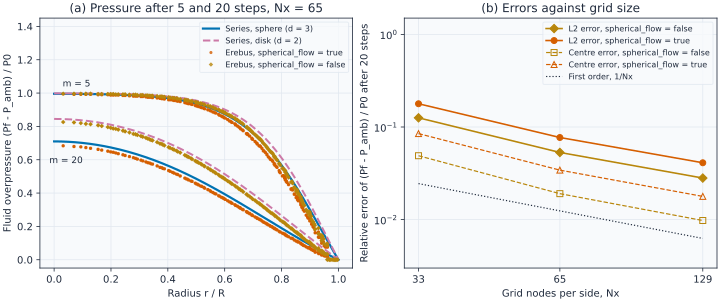
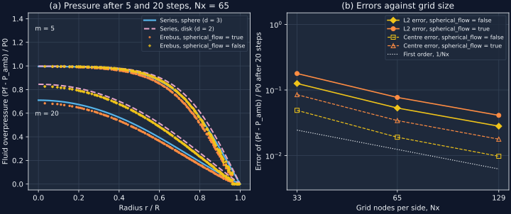

# Spherical Pressure Diffusion

## What this page checks

This page checks the poroelastic storage terms of the hydromechanical solve of `Erebus.jl` in a time-dependent problem.
When the pore fluid pressure $P_f$ of a porous rock changes, the fluid and the solid grains compress or expand, and the pore space opens or closes.
The amount of fluid that a unit volume of rock takes up per unit change of $P_f$ is the storage coefficient $S$.
With the storage the pore pressure does not settle at once: it diffuses, at the rate $D = k / (\mu S)$.
Validation means that we run the code on a case where we know the right answer from another source, and we check that the code gives that answer.
If these terms were wrong, the time that a pore overpressure needs to drain from a planetesimal would be wrong, and with it the venting rate and the pore pressure at which the rock fractures.

The page checks 3 parts of the solve:

- the compressibility terms of the continuity rows of the solid (the $P_t$ row) and of the fluid (the $P_f$ row) in a rigid matrix: the Biot-Willis coefficient $K_{BW}$ of the $P_t$ row through $P_t - P_t^0 = K_{BW} (P_f - P_f^0)$, and the full storage coefficient $S = \beta_d K_{BW} (1 / B - K_{BW})$ of the $P_f$ row with the drained compressibility $\beta_d$, $K_{BW}$ and the Skempton coefficient $B$, while the prefactor $\beta_d / \Delta t$ of the storage term of the $P_t$ row cancels and is not tested;
- the right-hand sides of both rows, which carry the pressures of the previous time step;
- the spherical face weights of the $P_f$ row, which the option `geometry.spherical_flow` turns on, in a transient problem.

The other validation cases run with all compressibilities 0 or on the first time step, where the solver sets them to 0.
This case runs from the second time step on, so the compressibilities enter both rows.

## The case

The case uses a sphere of radius $R = 50$ km in a square box of 140 km.
`Nx` is the number of grid nodes on each side of the box.
The rock has the permeability $k = 10^{-13}$ m² and the porosity $\phi = 0.2$.
The fluid has the viscosity $\mu = 10^{-3}$ Pa s.
The pore compressibility is $\beta_\phi = 10^{-10}$ Pa⁻¹, the solid compressibility $\beta_s = 10^{-10}$ Pa⁻¹ and the fluid compressibility $\beta_f = 4.5 \times 10^{-10}$ Pa⁻¹.
Gravity is off, and the rock produces no fluid.

The matrix is rigid.
Every node of the grid, inside and outside the sphere, has the shear viscosity $10^{28}$ Pa s, so the compaction viscosity is of the same size.
The shear modulus is $10^{35}$ Pa, so the elastic term of the momentum rows leaves the viscosity unchanged.
The faces of the outside cells are impermeable.

At the start the total and the fluid pressure are $P_\mathrm{amb} + P_0$ inside the sphere and $P_\mathrm{amb}$ outside, with $P_\mathrm{amb} = 100$ Pa and $P_0 = 10^4$ Pa.
The total pressure is held at $P_\mathrm{amb}$ on the box edge.
The surface temperature is 200 K.
The ice vapour pressure at 200 K is lower than $P_\mathrm{amb}$, so the vent pressure is $P_\mathrm{vent} = P_\mathrm{amb}$.
The rock cells next to the outside vent their fluid with the vent permeability $10^{-11}$ m², and they keep $P_f$ close to $P_\mathrm{vent}$.

The case builds the state with `init_simulation`, sets the grid fields directly and calls `solve_stokes_darcy!` 20 times on timestep 2.
After each step the pressures of the previous step, `pr0` and `pf0`, take the solved pressures.
The time step is $\Delta t = 1.625 \times 10^7$ s, so the 20 steps reach the nondimensional time $\tau = D t / R^2 = 0.1$.

## The storage coefficient

The $P_t$ row and the $P_f$ row of an inside cell are

$$\nabla \cdot \mathbf{v}_s + \frac{P_t - P_f}{\zeta (1 - \phi)} + \frac{\beta_d}{\Delta t} \left[ (P_t - P_t^0) - K_{BW} (P_f - P_f^0) \right] = 0,$$

$$\nabla \cdot \mathbf{q} - \frac{P_t - P_f}{\zeta (1 - \phi)} - \frac{\beta_d K_{BW}}{\Delta t} \left[ (P_t - P_t^0) - \frac{P_f - P_f^0}{B} \right] = 0,$$

with the Darcy flux $\mathbf{q} = -(k / \mu) \nabla P_f$, the compaction viscosity $\zeta$ and the pressures $P_t^0$, $P_f^0$ of the previous step.
The coefficients are the drained compressibility $\beta_d$, the Biot-Willis coefficient $K_{BW}$ and the Skempton coefficient $B$:

$$\beta_d = \frac{\beta_\phi + \beta_s}{1 - \phi}, \qquad K_{BW} = 1 - \frac{\beta_s}{\beta_d}, \qquad \frac{1}{B} = 1 + \frac{\phi (\beta_f - \beta_s)}{\beta_d - \beta_s}.$$

In a rigid matrix $\nabla \cdot \mathbf{v}_s$ and $1 / \zeta$ go to 0.
The $P_t$ row then gives $P_t - P_t^0 = K_{BW} (P_f - P_f^0)$ for any nonzero prefactor $\beta_d / \Delta t$, so this prefactor drops out.
With this relation the $P_f$ row becomes

$$S \frac{P_f - P_f^0}{\Delta t} = \nabla \cdot \left( \frac{k}{\mu} \nabla P_f \right), \qquad S = \beta_d K_{BW} \left( \frac{1}{B} - K_{BW} \right).$$

With $\beta_d K_{BW} = \beta_d - \beta_s$ the storage coefficient is

$$S = \phi \beta_f + (1 - \phi) \frac{\beta_\phi \beta_s}{\beta_\phi + \beta_s}, \qquad K_{BW} = \frac{\beta_\phi + \phi \beta_s}{\beta_\phi + \beta_s}.$$

The case has $S = 1.3 \times 10^{-10}$ Pa⁻¹ and $K_{BW} = 0.6$.
The solver clamps $\beta_\phi$ and $\beta_s$ to non-negative values, the porosity to $[\phi_\mathrm{min}, \phi_\mathrm{max}]$ and $K_{BW}$ and $B$ to $[0, 1]$.
With $\beta_\phi \ge 0$, $\beta_s \ge 0$, $\beta_\phi + \beta_s > 0$, $\beta_f \ge \beta_s$ and $\phi_\mathrm{min} < \phi < \phi_\mathrm{max}$ no clamp acts.
The test checks the formula of $S$ against the coefficients of the 2 rows.

## The exact solution

**Why this check exists.**
The compressibility terms could be missing from one of the 2 rows, use the wrong coefficient ($B$ or $K_{BW}$ set to 1, or $\beta_d$ without the factor $1 / (1 - \phi)$ in $K_{BW}$ or in the $P_f$ row), or drop the pressures of the previous step from the right-hand side.
The face weights of the $P_f$ row could have the wrong size.
Each of these faults changes the storage coefficient or the shape of the pressure profile, and with it the pressure that remains after 20 steps.

**What it tests.**
We compare the nondimensional fluid overpressure $p = (P_f - P_\mathrm{amb}) / P_0$ at the grid nodes with the exact solution after 5 and 20 steps, for `spherical_flow = true` and for `spherical_flow = false`, at `Nx = 33`, 65 and 129.
The centre error is $|p / p^\mathrm{exact} - 1|$ at the node nearest the centre.
The profile error is the relative L2 error over the nodes with $x = r / R \le 0.9$, with the weight $w_i = x_i$ for the sphere and $w_i = 1$ for the disk:

$$\epsilon = \sqrt{\frac{\sum_i w_i \left(p_i - p_i^\mathrm{exact}\right)^2}{\sum_i w_i \left(p_i^\mathrm{exact}\right)^2}}.$$

We also compare the centre pressure of the sphere with that of the disk, the total pressure with $K_{BW}$ times the fluid pressure change, and the fluid pressure of 2 runs with different $\beta_s$.

**How we know the right answer.**
The equation of the previous section, with $p = 1$ inside at $\tau = 0$ and $p = 0$ at $x = 1$, has a solution as a sum of modes.
Each mode decays by the factor $(1 + \lambda_n \Delta\tau)^{-1}$ per backward-Euler step, with $\Delta\tau = 0.005$.
After $m$ steps the sphere ($d = 3$, `spherical_flow = true`) has

$$p(x, m) = 2 \sum_{n \ge 1} (-1)^{n+1} \frac{\sin(n \pi x)}{n \pi x} \left(1 + n^2 \pi^2 \Delta\tau\right)^{-m}$$

and the disk ($d = 2$, `spherical_flow = false`) has

$$p(x, m) = 2 \sum_{n \ge 1} \frac{J_0(j_n x)}{j_n J_1(j_n)} \left(1 + j_n^2 \Delta\tau\right)^{-m},$$

where $J_0$ and $J_1$ are the Bessel functions of the first kind and $j_n$ are the zeros of $J_0$.
The case compares with this backward-Euler form, because the solver steps in time by backward Euler.
The continuous solution, with the factor $e^{-\lambda_n m \Delta\tau}$, gives at the centre 0.70710 for the sphere and 0.84836 for the disk at $\tau = 0.1$; the backward-Euler form gives 0.70998 and 0.84486, 0.4 % more for the sphere.
The sums stop at the first mode whose factor is below $10^{-14}$.
With $\Delta\tau = 0.005$ the disk table of 200 modes reaches that bound from 5 steps on and the sphere table of 4000 modes from 3 steps on; with fewer steps the code throws an error.
The case records 5 and 20 steps.
The test computes $J_0$ and $J_1$ from their integral forms and checks them against tabulated values, and checks both sums against a 1-D radial backward-Euler finite-volume solve with 4000 cells to $10^{-4}$.
The sphere drains faster than the disk.
At the centre node of `Nx = 65` the exact ratio of the 2 centre values after 20 steps is 0.8401398, and at `Nx = 129` it is 0.8403029.

**Why it matters.**
Every run with compressible rock and fluid uses these terms from its second time step on, and every run with `spherical_flow = true` uses the face weights of the $P_f$ row.
This case checks them with the solver step alone, so a fault found here is a fault in the continuity rows of the hydromechanical matrix.

```@raw html
<div class="validation-fig-light">
```

```@raw html
</div>
<div class="validation-fig-dark">
```

```@raw html
</div>
```

**How to read the plot.**
Panel (a) shows the fluid overpressure against $r / R$ at `Nx = 65` after 5 and after 20 steps.
The solid lines are the exact solution for the sphere and the dashed lines the exact solution for the disk.
The points are grid nodes.
A pass means that the points with the option on follow the solid lines and the points with the option off follow the dashed lines.
Panel (b) shows the centre error and the L2 profile error after 20 steps against `Nx` on logarithmic axes, with a dotted line of first order.
A pass means that the errors stay below their limits and fall along the dotted line as the grid gets finer.

**Known limit.**
The circular surface is a staircase of grid cells.
The vent cells, which hold $P_f$ close to $P_\mathrm{vent}$, are the outermost rock cells, and their centres lie inside $r = R$.
The fluid therefore drains through a sphere slightly smaller than $R$, and the computed pressure inside is slightly below the exact one.
The centre error has a negative sign, and the error falls at first order and not second order.
At `Nx = 65` the centre value after 20 steps is 0.68482 for the sphere and 0.82793 for the disk.
The order between `Nx = 65` and `Nx = 129` lies between 0.90 and 0.97 for both errors and both settings.
The test asserts limits on the errors and on the order and not an exact match.

## Conditions of the case

The exact solution holds only if the case meets 5 conditions.
Each condition is a test assertion, so a change of the set-up that breaks one fails the test and not only the comparison.

- Compressibilities on: the solver sets the compressibilities to 0 on timestep 1, so every solve of the case runs on timestep 2.
- No vent drain cap: the vent removes at most the fluid that a cell holds in one time step, $(\phi - \phi_\mathrm{min}) / \Delta t$ per unit volume and time.
  For every vent cell of every grid, with both values of $\beta_s$, the vent conductance summed over the vent faces of the cell times $P_0 \Delta t$ is at most a tenth of $\phi - \phi_\mathrm{min}$, so the cap does not act.
- Fixed time step: the time step after each solve equals $\Delta t$ to a relative $10^{-12}$.
- Rigid matrix: after the first solve of each run of the test, on every interior cell, the compaction term $1 / (\zeta (1 - \phi))$ is at most $10^{-6}$ of the storage term $\beta_d / \Delta t$, with $\beta_d$ from the pore compressibility and the porosity of the solved fields and the solid compressibility of the solve; on every node the shear viscosity is at least $10^{27}$ Pa s and the shear modulus times $\Delta t$ is at least $10^6$ times the viscosity.
  The largest solid velocity over the 20 steps stays below $10^{-15}$ m/s.
- Domain of the storage formula: $\beta_\phi \ge 0$, $\beta_s \ge 0$, $\beta_\phi + \beta_s > 0$, $\beta_f \ge \beta_s$, and the porosity of every grid cell lies within $(\phi_\mathrm{min}, \phi_\mathrm{max})$.

Two further checks test the storage terms directly.
The total pressure follows $P_t - P_t^0 = K_{BW} (P_f - P_f^0)$ with $K_{BW}$ from the formula above, within $10^{-9} P_0$ on every rock cell.
A run with $\beta_s = 10^{-11}$ Pa⁻¹ has $S = 9.7273 \times 10^{-11}$ Pa⁻¹ and a shorter time step for the same $\tau$; its nondimensional fluid pressure equals that of the case to $10^{-9}$ on every rock cell.
This holds only when the solver diffuses with the storage coefficient $S$ of the formula.

!!! details "Test details"
    - Reference: the backward-Euler series $p(x, m)$ above after 5 and 20 steps; the centre ratio of the series at the centre node of the grid; $P_t - P_t^0 = K_{BW} (P_f - P_f^0)$; equal nondimensional pressure for the 2 values of $\beta_s$; equal fields of the 6-variable and the 4-variable solver paths.
    - Tolerance: the centre error after 5 steps at most 0.0064, 0.0018 and 0.00079 for the sphere and 0.0027, 0.00073 and 0.00032 for the disk at `Nx = 33`, 65 and 129; the centre error after 20 steps at most 0.12, 0.048 and 0.025 for the sphere and 0.069, 0.027 and 0.014 for the disk; the L2 profile error after 20 steps at most 0.25, 0.108 and 0.058 for the sphere and 0.18, 0.075 and 0.04 for the disk; order of each error between `Nx = 65` and `Nx = 129` equal to 1 within 0.35; centre ratio equal to the series ratio within a relative 0.022 at `Nx = 65` and 0.012 at `Nx = 129`; the total pressure check and the $\beta_s$ check at most $10^{-9}$; the difference of the 2 solver paths at most $10^{-10}$; the fluid pressure of every vent cell within $9 \times 10^{-4} P_0$ (sphere) and $1.4 \times 10^{-3} P_0$ (disk) of $P_\mathrm{amb}$, and an infinite deviation when a vent cell does not vent; the vented fluid volume rate equal to the rate of fluid released from storage within $10^{-8}$ of the rate; solid velocity at most $10^{-15}$ m/s.
    - Regression band: the allowed range around the recorded value is `PHYSICS_REGRESSION_BANDS` in `benchmarks/validation_spherical_pressure_diffusion.jl`.
      It is $9 \times 10^{-5}$ on each centre error after 5 steps, 0.002 on each other error and on each centre ratio, 0.05 on each order, $10^{-9}$ on the total pressure and $\beta_s$ checks, $10^{-10}$ on the solver path difference, $10^{-4}$ on each vent pressure, $10^{-8}$ on each vented-rate closure and $10^{-15}$ m/s on the solid velocity.
      The test makes the storage coefficient 2 % too large or too small with $\beta_f$ moved by $\pm 0.02 S / \phi$ at the time step of the case, so that $\beta_d$, $K_{BW}$ and $\Delta t$ keep their values.
      This moves the centre error after 5 steps at `Nx = 65` by $1.99 \times 10^{-4}$ (too large) and $2.21 \times 10^{-4}$ (too small) for the disk and by $4.90 \times 10^{-4}$ and $5.41 \times 10^{-4}$ for the sphere.
      At `Nx = 33` the shifts are $3.00 \times 10^{-4}$ and $3.30 \times 10^{-4}$ for the disk and $7.01 \times 10^{-4}$ and $7.67 \times 10^{-4}$ for the sphere.
      Each shift is at least twice the band, so the defect leaves it.
    - Test id: `centre_err_m5_{off,on}_nx{33,65,129}`, `centre_err_m20_{off,on}_nx{33,65,129}`, `l2_m20_{off,on}_nx{33,65,129}`, `{centre,l2}_order_m20_{off,on}_65_129`, `centre_ratio_m20_nx65`, `centre_ratio_m20_nx129`, `pt_kbw_{off,on}_nx{33,65,129}`, `s_invariance_{off,on}_nx33`, `elim_{off,on}_nx33`, `vent_dev_{off,on}_nx65`, `vent_closure_{off,on}_nx65`, `v_max_{off,on}_nx65`.
      `Pkg.test` runs `test/test_validation_spherical_pressure_diffusion.jl` at `Nx = 33` and 65 and pins the centre value after 20 steps at `Nx = 65` to a relative $10^{-6}$.
    - Command: `julia --project=. tools/check_validation.jl --check`.

## What this case does not test

- The deformation of the matrix: it is rigid, so the compaction and the elastic terms of the solid do not enter, and neither do the momentum rows.
- The prefactor $\beta_d / \Delta t$ of the storage term of the $P_t$ row: with $\nabla \cdot \mathbf{v}_s$ and $1 / \zeta$ at 0 the row gives $P_t - P_t^0 = K_{BW} (P_f - P_f^0)$ for any nonzero prefactor, so the case checks $K_{BW}$ in this row and the full $S$ of the $P_f$ row, but a wrong prefactor of the $P_t$ row passes.
- The accuracy of the reference after fewer than 5 steps for the disk and fewer than 3 steps for the sphere: the series needs more modes than its tables hold.
- The venting conductance and its face weight: the vent cells keep $P_f$ within $2 \times 10^{-3} P_0$ of $P_\mathrm{vent}$, close to the Dirichlet limit.
- Gravity, buoyancy, reactions and hydrofracture: they are off.
- The change of porosity, permeability and time step during a run: the case keeps them fixed.
- How the code computes the compressibilities, the viscosity and the face resistances from the markers: the case sets the grid fields directly.

## All recorded values

The table comes from the record and must match it.
To make the figure again, run these 2 commands from the repository root:

```
julia --project=. scripts/export_validation_pressure_diffusion_data.jl <data_dir>
python3 scripts/generate_validation_pressure_diffusion_figures.py <data_dir>
```

The second command needs NumPy and Matplotlib.

```@raw html
<!-- VALIDATION_RECORD_START: spherical_pressure_diffusion -->
```

**Validation record**: `benchmarks/records/spherical_pressure_diffusion.toml` (Source commit `b80632a7`, config SHA-256 `23a36fb69593`)

| Case | Metric | Grid `Nx` | Measured | Reference | Tolerance | Units | Status |
| :--- | :--- | :---: | :---: | :---: | :---: | :---: | :---: |
| `centre` | abs(p / p_BE - 1) at the centre cell, m = 5, 2-D disk (Nx=33) | 33 | `1.9195e-03` | `0.0000e+00` | `<= 2.70e-03` | dimensionless | **PASS** |
| `centre` | abs(p / p_BE - 1) at the centre cell, m = 5, 2-D disk (Nx=65) | 65 | `5.2119e-04` | `0.0000e+00` | `<= 7.30e-04` | dimensionless | **PASS** |
| `centre` | abs(p / p_BE - 1) at the centre cell, m = 5, 2-D disk (Nx=129) | 129 | `2.2501e-04` | `0.0000e+00` | `<= 3.20e-04` | dimensionless | **PASS** |
| `centre` | abs(p / p_BE - 1) at the centre cell, m = 5, 3-D sphere (Nx=33) | 33 | `4.5435e-03` | `0.0000e+00` | `<= 6.40e-03` | dimensionless | **PASS** |
| `centre` | abs(p / p_BE - 1) at the centre cell, m = 5, 3-D sphere (Nx=65) | 65 | `1.2889e-03` | `0.0000e+00` | `<= 1.80e-03` | dimensionless | **PASS** |
| `centre` | abs(p / p_BE - 1) at the centre cell, m = 5, 3-D sphere (Nx=129) | 129 | `5.6372e-04` | `0.0000e+00` | `<= 7.90e-04` | dimensionless | **PASS** |
| `centre` | abs(p / p_BE - 1) at the centre cell, m = 20, 2-D disk (Nx=33) | 33 | `4.8973e-02` | `0.0000e+00` | `<= 6.90e-02` | dimensionless | **PASS** |
| `centre` | abs(p / p_BE - 1) at the centre cell, m = 20, 2-D disk (Nx=65) | 65 | `1.9073e-02` | `0.0000e+00` | `<= 2.70e-02` | dimensionless | **PASS** |
| `centre` | abs(p / p_BE - 1) at the centre cell, m = 20, 2-D disk (Nx=129) | 129 | `9.7819e-03` | `0.0000e+00` | `<= 1.40e-02` | dimensionless | **PASS** |
| `centre` | abs(p / p_BE - 1) at the centre cell, m = 20, 3-D sphere (Nx=33) | 33 | `8.4887e-02` | `0.0000e+00` | `<= 1.20e-01` | dimensionless | **PASS** |
| `centre` | abs(p / p_BE - 1) at the centre cell, m = 20, 3-D sphere (Nx=65) | 65 | `3.4244e-02` | `0.0000e+00` | `<= 4.80e-02` | dimensionless | **PASS** |
| `centre` | abs(p / p_BE - 1) at the centre cell, m = 20, 3-D sphere (Nx=129) | 129 | `1.7818e-02` | `0.0000e+00` | `<= 2.50e-02` | dimensionless | **PASS** |
| `profile` | Fluid overpressure L2 relative error for r <= 0.9 R, m = 20, 2-D disk (Nx=33) | 33 | `1.2568e-01` | `0.0000e+00` | `<= 1.80e-01` | dimensionless | **PASS** |
| `profile` | Fluid overpressure L2 relative error for r <= 0.9 R, m = 20, 2-D disk (Nx=65) | 65 | `5.3113e-02` | `0.0000e+00` | `<= 7.50e-02` | dimensionless | **PASS** |
| `profile` | Fluid overpressure L2 relative error for r <= 0.9 R, m = 20, 2-D disk (Nx=129) | 129 | `2.8102e-02` | `0.0000e+00` | `<= 4.00e-02` | dimensionless | **PASS** |
| `profile` | Fluid overpressure L2 relative error for r <= 0.9 R, m = 20, 3-D sphere (Nx=33) | 33 | `1.7827e-01` | `0.0000e+00` | `<= 2.50e-01` | dimensionless | **PASS** |
| `profile` | Fluid overpressure L2 relative error for r <= 0.9 R, m = 20, 3-D sphere (Nx=65) | 65 | `7.7035e-02` | `0.0000e+00` | `<= 1.08e-01` | dimensionless | **PASS** |
| `profile` | Fluid overpressure L2 relative error for r <= 0.9 R, m = 20, 3-D sphere (Nx=129) | 129 | `4.1104e-02` | `0.0000e+00` | `<= 5.80e-02` | dimensionless | **PASS** |
| `centre` | Convergence order log2(e(Nx=65) / e(Nx=129)) of the centre error at m = 20, 2-D disk | 129 | `9.6338e-01` | `1.0000e+00` | `atol=3.50e-01, rtol=0.00e+00` | dimensionless | **PASS** |
| `centre` | Convergence order log2(e(Nx=65) / e(Nx=129)) of the centre error at m = 20, 3-D sphere | 129 | `9.4252e-01` | `1.0000e+00` | `atol=3.50e-01, rtol=0.00e+00` | dimensionless | **PASS** |
| `profile` | Convergence order log2(e(Nx=65) / e(Nx=129)) of the L2 profile error at m = 20, 2-D disk | 129 | `9.1838e-01` | `1.0000e+00` | `atol=3.50e-01, rtol=0.00e+00` | dimensionless | **PASS** |
| `profile` | Convergence order log2(e(Nx=65) / e(Nx=129)) of the L2 profile error at m = 20, 3-D sphere | 129 | `9.0622e-01` | `1.0000e+00` | `atol=3.50e-01, rtol=0.00e+00` | dimensionless | **PASS** |
| `centre` | Centre fluid overpressure ratio, sphere to disk, m = 20 (Nx=65) | 65 | `8.2715e-01` | `8.4014e-01` | `atol=0.00e+00, rtol=2.20e-02` | dimensionless | **PASS** |
| `centre` | Centre fluid overpressure ratio, sphere to disk, m = 20 (Nx=129) | 129 | `8.3348e-01` | `8.4030e-01` | `atol=0.00e+00, rtol=1.20e-02` | dimensionless | **PASS** |
| `storage` | Largest abs((Pt - Pt0) - kbw (Pf - Pf0)) / P0 over the rock, m = 20, 2-D disk (Nx=33) | 33 | `8.9603e-11` | `0.0000e+00` | `<= 1.00e-09` | dimensionless | **PASS** |
| `storage` | Largest abs((Pt - Pt0) - kbw (Pf - Pf0)) / P0 over the rock, m = 20, 2-D disk (Nx=65) | 65 | `8.8816e-11` | `0.0000e+00` | `<= 1.00e-09` | dimensionless | **PASS** |
| `storage` | Largest abs((Pt - Pt0) - kbw (Pf - Pf0)) / P0 over the rock, m = 20, 2-D disk (Nx=129) | 129 | `8.8640e-11` | `0.0000e+00` | `<= 1.00e-09` | dimensionless | **PASS** |
| `storage` | Largest abs((Pt - Pt0) - kbw (Pf - Pf0)) / P0 over the rock, m = 20, 3-D sphere (Nx=33) | 33 | `7.7037e-11` | `0.0000e+00` | `<= 1.00e-09` | dimensionless | **PASS** |
| `storage` | Largest abs((Pt - Pt0) - kbw (Pf - Pf0)) / P0 over the rock, m = 20, 3-D sphere (Nx=65) | 65 | `7.7076e-11` | `0.0000e+00` | `<= 1.00e-09` | dimensionless | **PASS** |
| `storage` | Largest abs((Pt - Pt0) - kbw (Pf - Pf0)) / P0 over the rock, m = 20, 3-D sphere (Nx=129) | 129 | `7.7140e-11` | `0.0000e+00` | `<= 1.00e-09` | dimensionless | **PASS** |
| `storage` | Largest difference of (Pf - P_amb) / P0 between bs = 1e-10 and 1e-11 Pa^-1, m = 20, 2-D disk (Nx=33) | 33 | `5.1890e-11` | `0.0000e+00` | `<= 1.00e-09` | dimensionless | **PASS** |
| `storage` | Largest difference of (Pf - P_amb) / P0 between bs = 1e-10 and 1e-11 Pa^-1, m = 20, 3-D sphere (Nx=33) | 33 | `3.2258e-11` | `0.0000e+00` | `<= 1.00e-09` | dimensionless | **PASS** |
| `solver` | Largest relative difference of pf, pr, qxD, qyD between the 6- and 4-variable paths, m = 20, 2-D disk (Nx=33) | 33 | `2.5557e-14` | `0.0000e+00` | `<= 1.00e-10` | dimensionless | **PASS** |
| `solver` | Largest relative difference of pf, pr, qxD, qyD between the 6- and 4-variable paths, m = 20, 3-D sphere (Nx=33) | 33 | `2.3359e-14` | `0.0000e+00` | `<= 1.00e-10` | dimensionless | **PASS** |
| `vent` | Largest abs(Pf - P_amb) / P0 over the vent cells, m = 20, 2-D disk (Nx=65) | 65 | `1.0070e-03` | `0.0000e+00` | `<= 1.40e-03` | dimensionless | **PASS** |
| `vent` | Largest abs(Pf - P_amb) / P0 over the vent cells, m = 20, 3-D sphere (Nx=65) | 65 | `6.4047e-04` | `0.0000e+00` | `<= 9.00e-04` | dimensionless | **PASS** |
| `vent` | Vented to stored fluid volume rate, abs(ratio - 1), m = 20, 2-D disk (Nx=65) | 65 | `2.0527e-10` | `0.0000e+00` | `<= 1.00e-08` | dimensionless | **PASS** |
| `vent` | Vented to stored fluid volume rate, abs(ratio - 1), m = 20, 3-D sphere (Nx=65) | 65 | `1.5960e-10` | `0.0000e+00` | `<= 1.00e-08` | dimensionless | **PASS** |
| `rigid` | Largest solid velocity component [m/s] over the 20 steps, 2-D disk (Nx=65) | 65 | `1.2859e-20` | `0.0000e+00` | `<= 1.00e-15` | m/s | **PASS** |
| `rigid` | Largest solid velocity component [m/s] over the 20 steps, 3-D sphere (Nx=65) | 65 | `7.7990e-21` | `0.0000e+00` | `<= 1.00e-15` | m/s | **PASS** |

```@raw html
<!-- VALIDATION_RECORD_END: spherical_pressure_diffusion -->
```
