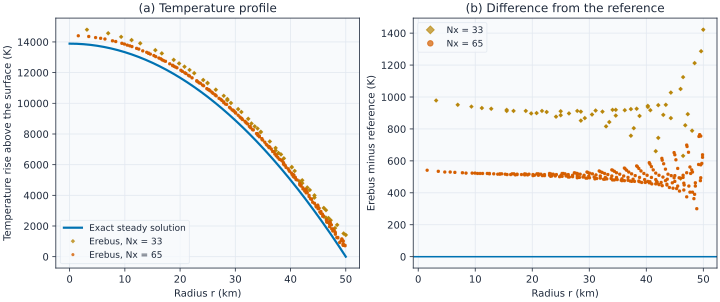
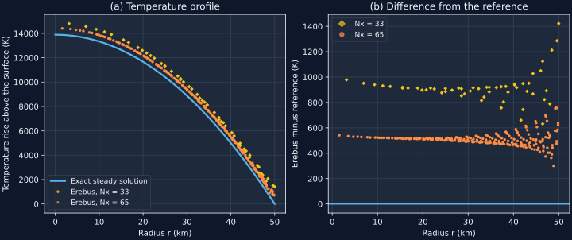
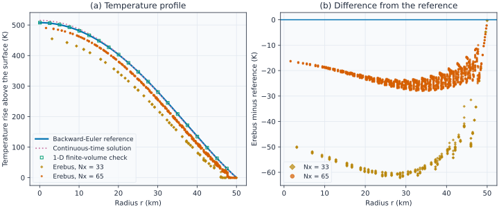
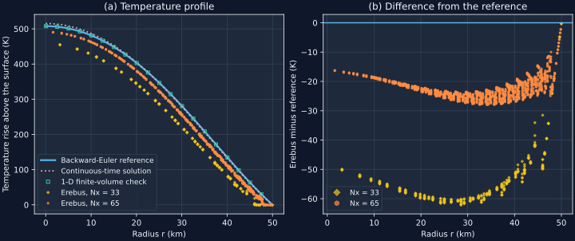
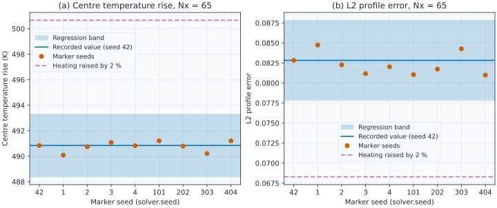
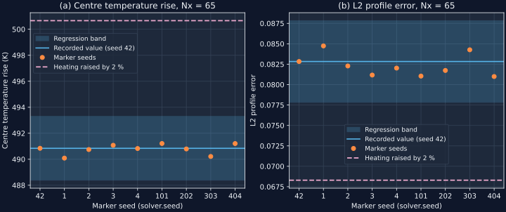

# Spherical Heat Conduction

## What this page checks

This page checks how `Erebus.jl` moves heat through a sphere and how it adds radiogenic heat in the time loop. Validation means that we run the code on a case where we know the right answer from another source, and we check that the code gives that answer. If this part were wrong, interior temperatures would be wrong, and with them the melting, the hydrothermal circulation and the core formation that depend on temperature. Each case below gives the reason for the check, the setup, the reference, a figure and the test details.

All cases use a sphere of radius 50 km with a fixed surface temperature of 170 K. `Nx` is the number of grid intervals on each side of the square box. The rock has a uniform conductivity of 3 W/(m K). Melting, fluid flow and reactions are off, so that heat conduction and the heat source are the only processes.

The code solves a 2-D grid. A geometry term in the heat equation makes the 2-D grid behave like a 3-D sphere. This term is `Q_metric`, and the option `geometry.spherical_metric` switches it on. The default is on. Setting it to false gives a 2-D disk.

## The steady temperature of a heated sphere

**Why this check exists.** The geometry term could have a wrong sign or a wrong size. The centre of the sphere would then have the wrong temperature. Without the term, it would be 50 % too hot.

**What it tests.** A constant heat source $H = 10^{-4}$ W/m³ heats the sphere, and we solve for the temperature that no longer changes. The solve repeats 50 times, because the geometry term uses the temperature of the last repeat. This case calls the heat solver and not the time loop. We compare the temperature rise $\Delta T(r)$ above the surface with the exact solution. We also compare the centre rise in the sphere with the centre rise in a 2-D disk.

**How we know the right answer.** The steady heat equation in a sphere has the exact solution $\Delta T(r) = H (R^2 - r^2) / (6 k)$, where $R$ is the radius and $k$ the conductivity. A 2-D disk has $H (R^2 - r^2) / (4 k)$, so the ratio of the centre rises is exactly 2/3.

**Why it matters.** Every spherical run uses this geometry term. This case checks it alone, so a fault found here is a fault in the geometry term or in the matrix of the heat solver.

```@raw html
<div class="validation-fig-light">
```

```@raw html
</div>
<div class="validation-fig-dark">
```

```@raw html
</div>
```

**How to read the plot.** Panel (a) shows the temperature rise against radius. The line is the exact solution and the points are grid nodes. Panel (b) shows Erebus minus the exact solution. A pass means that the points approach the line as the grid gets finer. The difference falls by about half from `Nx = 33` to `Nx = 65`. The rise is large because this source is a test value, and melting is off.

**Known limit.** The sphere edge falls between grid nodes, so the surface follows a staircase. This causes the scatter near 50 km and most of the remaining difference. The test therefore asserts a limit on the L2 profile error, which is the root-mean-square difference divided by the root-mean-square rise, and not an exact match.

!!! details "Test details"
    - Reference: exact steady solution, $H (R^2 - r^2) / (6 k)$, and the centre ratio 2/3.
    - Tolerance: centre ratio to 2/3 by 0.01 or 1.5 %, whichever is larger; L2 error at most 0.15 at `Nx = 33` and at most 0.08 at `Nx = 65`; energy residual at most $10^{-11}$.
    - Test id: `steady_center_dT_ratio_3d_2d_nx33`, `steady_center_dT_ratio_3d_2d_nx65`, `steady_profile_l2_rel_error_nx33`, `steady_profile_l2_rel_error_nx65`, `steady_energy_conservation_residual_nx65`. The energy residual is the mismatch between the heat added and the heat stored in one solve.
    - Command: `julia --project=. tools/check_validation.jl --check`.

## The temperature of a sphere heated by decaying aluminium

**Why this check exists.** The time loop could deposit the wrong amount of decay heat in a step, or use a wrong step in the heat solve. Peak temperatures would then be wrong, also where each function passes its own test. For example, heat taken at the start of each step instead of over the step gives a centre rise of 619 K in place of 491 K here.

**What it tests.** The sphere starts at the surface temperature, 2 Myr after the formation of the first solids, and $^{26}$Al heats it for 20 steps of 0.5 Myr. We compare the temperature rise after 10 Myr with a reference at the same time step.

**How we know the right answer.** The reference is a sum over the cooling modes of the sphere, the patterns of temperature that fade away at a fixed rate. It uses the same time stepping as the code, backward Euler, where each step solves for the temperature at the end of the step. It also uses the exact heat of each step, $Q(t_0) (1 - e^{-\Delta t / \tau}) / (\Delta t / \tau)$, with $\tau$ the mean lifetime. A separate 1-D finite-volume solver with 500 radial shells gives the same centre temperature, to $10^{-5}$ of the rise. We compare with the time-discrete reference and not with the continuous solution, because a step of 0.5 Myr has its own time error. The figure shows the continuous solution for context.

**Why it matters.** This case runs the complete `simulation_loop`. It tests the heating step, the projection from markers (the moving points that carry material properties) to the grid, the heat solve and the geometry term together.

```@raw html
<div class="validation-fig-light">
```

```@raw html
</div>
<div class="validation-fig-dark">
```

```@raw html
</div>
```

**How to read the plot.** Panel (a) shows the temperature rise against radius. The solid line is the reference, which the test asserts. The squares are the 1-D solver. The dotted line is the continuous solution, which only gives context. Panel (b) shows Erebus minus the reference. A pass means that the points approach zero as the grid gets finer.

**Known limit.** At `Nx = 65` the centre is 16 K below the reference, about 3 % of the rise. This difference is mostly spatial: it is 50 K at `Nx = 33`, and the L2 error at `Nx = 65` is 0.42 times the error at `Nx = 33`. A 5 times smaller time step moves it to 24 K, so a smaller step alone does not remove it. Near the edge, nodes inside the radius can stay at the surface temperature, because they lie on the staircase.

!!! details "Test details"
    - Reference: `analytical_T_BE` and `solve_1d_spherical_fv` in `benchmarks/validation_spherical_conduction.jl`.
    - Tolerance: centre rise to the reference by 25 K or 5 %, whichever is larger, at `Nx = 65`; L2 error at most 0.10; L2 ratio `Nx = 65` to `Nx = 33` at most 0.60; temperature of the outer air shell (the cold layer around the sphere) to 170 K by 0.01 K; the 2 references to $10^{-5}$.
    - Test id: `transient_center_dT_nx65`, `transient_profile_l2_rel_error_nx65`, `transient_profile_l2_convergence_ratio_65_33`, `transient_max_air_shell_temperature_nx65`, `transient_be_vs_1dfv_rel_diff`.
    - Command: `julia --project=. tools/check_validation.jl --check`.

## A small change in heating against the recorded result

**Why this check exists.** The reference check above allows 5 %, because of the spatial difference. The simulation already sits below the reference, so an excess of heat of up to about 9 % would pass its centre check. An excess of 2 % fails this tighter check, and so does a change of the step average to a midpoint rule, a 1 % heating error at this step size.

**What it tests.** We compare the result with the recorded value of the same case. The allowed range around the recorded value is the regression band. It is 0.5 % on the centre rise and 0.005 on the L2 error.

**How we know the right answer.** The recorded value is not an independent answer. It is the result that the reference check accepted. So this check finds a change, and the check above decides if the result is right.

**Why it matters.** The markers start with a random jitter, set by `solver.seed`, and the random stream can change between Julia versions. The bands must stay wider than this jitter, or a harmless change would fail them. We therefore measured the spread over 8 other seeds. The largest shift is 0.76 K on the centre rise and 0.0019 on the L2 error.

```@raw html
<div class="validation-fig-light">
```

```@raw html
</div>
<div class="validation-fig-dark">
```

```@raw html
</div>
```

**How to read the plot.** The shaded area is the band around the recorded value, the solid line. The points are runs that differ only in the marker seed, and a pass means that they stay inside the band. The dashed line is a run with 2 % more heating, which must lie outside the band. In panel (b) this run has a smaller error, because more heat moves the temperature toward the reference, but it still leaves the band.

**Known limit.** A heating error below about 0.5 % stays inside the bands. On the Julia version of the record, the exact compare still catches it, with a tolerance of $10^{-6}$. On other Julia versions the exact compare is skipped, and the bands and the reference tolerances still run.

!!! details "Test details"
    - Reference: the recorded values in `benchmarks/records/spherical_conduction.toml`.
    - Tolerance: `PHYSICS_REGRESSION_BANDS` and `REPLAY_RTOL` in `benchmarks/validation_spherical_conduction.jl`.
    - Test id: `"Spherical Conduction Validation"` in `test/test_validation_spherical_conduction.jl`.
    - Command: `julia --project=. tools/check_validation.jl --check`.

## All recorded values

The table comes from the record and must match it. To make the figures again, run these 2 commands from the repository root:

```
julia --project=. scripts/export_validation_conduction_data.jl <data_dir>
python3 scripts/generate_validation_conduction_figures.py <data_dir>
```

The second command needs NumPy and Matplotlib.

```@raw html
<!-- VALIDATION_RECORD_START: spherical_conduction -->
```

**Validation record**: `benchmarks/records/spherical_conduction.toml` (Source commit `c7218e9e`, config SHA-256 `d87bff19da90`)

| Case | Metric | Grid `Nx` | Measured | Reference | Tolerance | Units | Status |
| :--- | :--- | :---: | :---: | :---: | :---: | :---: | :---: |
| `steady` | Steady 3D-to-2D centre warming ratio (Nx=33) | 33 | `6.7242e-01` | `6.6667e-01` | `atol=1.00e-02, rtol=1.50e-02` | dimensionless | **PASS** |
| `steady` | Steady 3D-to-2D centre warming ratio (Nx=65) | 65 | `6.6856e-01` | `6.6667e-01` | `atol=1.00e-02, rtol=1.50e-02` | dimensionless | **PASS** |
| `steady` | Steady radial profile L2 relative error (r <= R, Nx=33) | 33 | `1.1413e-01` | `0.0000e+00` | `<= 1.50e-01` | dimensionless | **PASS** |
| `steady` | Steady radial profile L2 relative error (r <= R, Nx=65) | 65 | `6.4513e-02` | `0.0000e+00` | `<= 8.00e-02` | dimensionless | **PASS** |
| `steady` | Steady discrete energy conservation residual (Nx=65) | 65 | `3.7796e-14` | `0.0000e+00` | `<= 1.00e-11` | dimensionless | **PASS** |
| `transient` | Step-averaged analytical BE series vs 1D spherical FV relative difference | 1D | `3.9330e-08` | `0.0000e+00` | `<= 1.00e-05` | dimensionless | **PASS** |
| `transient` | Transient centre temperature rise dT(r_min) vs step-averaged BE reference (Nx=65) | 65 | `4.9084e+02` | `5.0708e+02` | `atol=2.50e+01, rtol=5.00e-02` | K | **PASS** |
| `transient` | Transient radial profile L2 relative error vs step-averaged BE reference (r <= R, Nx=65) | 65 | `8.2867e-02` | `0.0000e+00` | `<= 1.00e-01` | dimensionless | **PASS** |
| `transient` | Transient radial profile L2 convergence ratio L2(Nx=65) / L2(Nx=33) | 65 | `4.2047e-01` | `0.0000e+00` | `<= 6.00e-01` | dimensionless | **PASS** |
| `transient` | Maximum sticky-air temperature in r >= R + dx (Nx=65) | 65 | `1.7000e+02` | `1.7000e+02` | `atol=1.00e-02, rtol=0.00e+00` | K | **PASS** |

```@raw html
<!-- VALIDATION_RECORD_END: spherical_conduction -->
```
