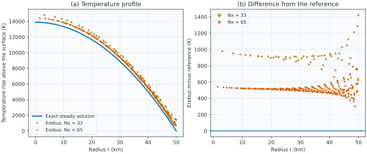
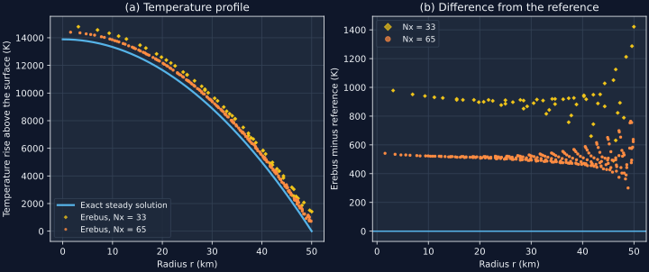
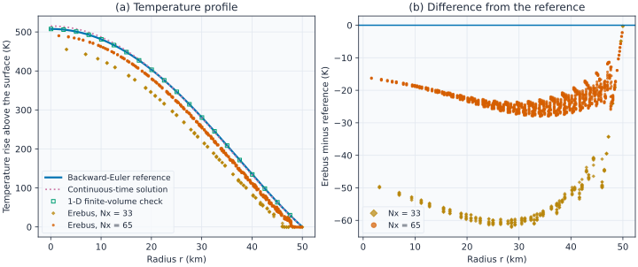
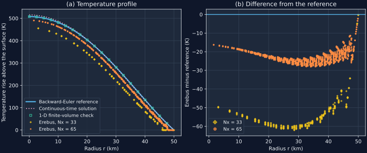
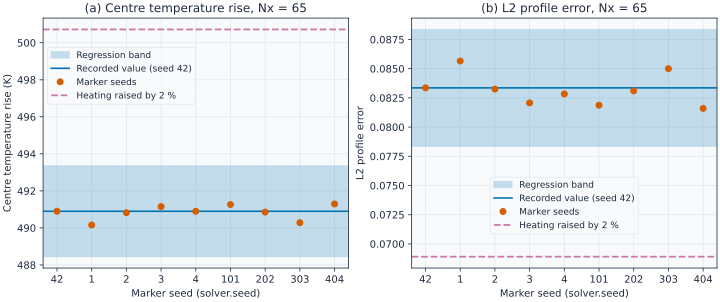
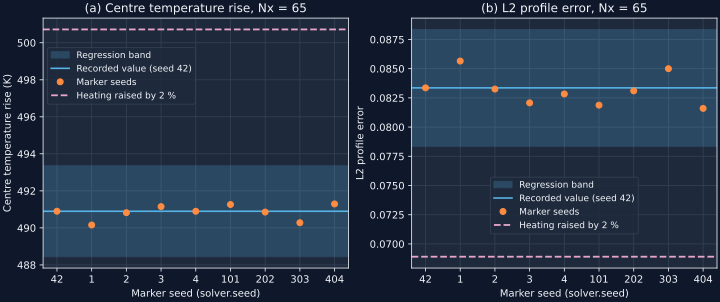

# Spherical Heat Conduction

## What this page checks

This page checks how `Erebus.jl` moves heat through a sphere.
It also checks how the time loop adds radiogenic heat, the heat that radioactive decay releases in the rock.
Validation here means that we run the code on a case where we know the right answer from another source.
The test then checks that the code gives that answer.
If this part were wrong, the interior temperatures would be wrong.
The melting, the hydrothermal circulation and the core formation that depend on temperature would then be wrong too.

The page checks 3 things:

- the geometry term that makes the 2-D grid behave like a sphere, with a constant heat source and the heat solver alone;
- the decay heat of aluminium in the complete time loop;
- a small change in heating, against the recorded result of the time-loop case.

Each case below says why the check exists, what it tests, how we know the right answer and why it matters.
The box "Test details" at the end of each case gives the reference, the tolerance, the test ids and the command.

**How the geometry term enters the heat equation.**
The code solves the heat equation on a 2-D grid.
A geometry term in the heat equation makes the 2-D grid behave like a 3-D sphere:

$$\rho c_p \frac{\partial T}{\partial t} = -\nabla_\mathrm{2D} \cdot \mathbf{q} + Q_\mathrm{metric} + Q_\mathrm{sources}, \qquad \mathbf{q} = -k \nabla T.$$

Here $T$ is the temperature in K and $t$ the time in s.
The density is $\rho$ in kg/m³, and $c_p$ is the specific heat capacity in J/(kg K).
The heat flux $\mathbf{q}$, in W/m², follows from the thermal conductivity $k$, in W/(m K).
The operator $\nabla_\mathrm{2D} \cdot$ is the divergence in the 2 grid directions $x$ and $y$.
The term $Q_\mathrm{sources}$, in W/m³, holds the heat sources, such as radiogenic heat.
The geometry term $Q_\mathrm{metric}$, in W/m³, is `Q_metric` in the code.
The option `geometry.spherical_metric` switches it on.
The default is on.
Setting it to false gives a 2-D disk.

!!! details "Where the geometry term comes from and how the code computes it"
    In a sphere, the heat flux divergence is $\frac{1}{r^2} \partial_r (r^2 q_r) = \partial_r q_r + 2 q_r / r$.
    Here $r$ is the distance from the centre in m, $q_r$ the radial heat flux in W/m², and $\partial_r = \partial / \partial r$.
    On the 2-D grid, the divergence of a radial flux is $\partial_r q_r + q_r / r$.
    The sphere has the extra term $q_r / r$ in the divergence.
    $Q_\mathrm{metric}$ is minus this term, $-q_r / r = (k / r) \, \partial T / \partial r$:

    $$Q_\mathrm{metric} = \frac{k}{r_\mathrm{eff}^2} \left[ (x - x_c) \frac{\partial T}{\partial x} + (y - y_c) \frac{\partial T}{\partial y} \right].$$

    Here $x$ and $y$ are the grid coordinates in m, and $(x_c, y_c)$ is the centre of the sphere in m.
    The distance $r_\mathrm{eff} = \sqrt{(x - x_c)^2 + (y - y_c)^2 + \epsilon_r^2}$, in m, is the distance from the centre with a small regularization $\epsilon_r$ in m.
    The regularization is $\epsilon_r$ = `geometry.metric_regularization_cells` times the smaller grid spacing $\min(\Delta x, \Delta y)$.
    Here $\Delta x$ and $\Delta y$ are the grid spacings in m.
    The function `compute_spherical_metric_heat_source!` in `src/physics/materials_metric.jl` computes $Q_\mathrm{metric}$ on the pressure nodes inside the sphere and sets it to 0 outside.
    It uses the mean of $k \, \partial T / \partial x$ on the 2 neighbouring faces in x, and the same in y, with the face conductivities `KX` and `KY`.
    The derivation is in [Governing Equations](../explanations/governing_equations.md).

**The test set-up.**

- All cases use a sphere of radius $R = 50$ km with a fixed surface temperature of 170 K.
- `Nx` is the number of grid nodes on each side of the square box.
- The rock has a uniform conductivity $k = 3$ W/(m K).
- Melting, fluid flow and reactions are off, so that heat conduction and the heat source are the only processes.

## The steady temperature of a heated sphere

**Why this check exists.**
The geometry term could have a wrong sign or a wrong size.
The centre of the sphere would then have the wrong temperature.
Without the term, it would be 50 % too hot.

**What it tests.**
A constant heat source $H = 10^{-4}$ W/m³ heats the sphere.
We solve for the steady temperature, the temperature that no longer changes.
The solve repeats 50 times, because the geometry term uses the temperature of the last repeat.
This case calls the heat solver and not the time loop.
We compare the temperature rise $\Delta T(r)$ above the surface with the exact solution, where $r$ is the distance from the centre in m.
The L2 profile error is the root-mean-square difference divided by the root-mean-square rise.
We also compare the centre rise in the sphere with the centre rise in a 2-D disk.

**How we know the right answer.**
The steady heat equation in a sphere has the exact solution $\Delta T(r) = H (R^2 - r^2) / (6 k)$.
A 2-D disk has $H (R^2 - r^2) / (4 k)$, so the ratio of the centre rises is exactly 2/3.

**Why it matters.**
Every spherical run uses this geometry term.
This case checks it alone, so a fault found here is a fault in the geometry term or in the matrix of the heat solver.

```@raw html
<div class="validation-fig-light">
```

```@raw html
</div>
<div class="validation-fig-dark">
```

```@raw html
</div>
```

**How to read the plot.**
Panel (a) shows the temperature rise above the surface, in K, against the radius $r$ in km.
The line is the exact solution and the points are grid nodes at `Nx = 33` and `Nx = 65`.
Panel (b) shows Erebus minus the exact solution, in K, against the radius.
A pass means that the points approach the line as the grid gets finer.
The difference falls by about half from `Nx = 33` to `Nx = 65`.
The rise is large because this source is a test value, and melting is off.

**Known limit.**
The sphere edge falls between grid nodes, so the surface follows a staircase.
This causes the scatter near 50 km and most of the remaining difference.
The test therefore asserts a limit on the L2 profile error and not an exact match.

!!! details "Test details"
    - Reference: exact steady solution, $H (R^2 - r^2) / (6 k)$, and the centre ratio 2/3.
    - Tolerance:
        - the centre ratio: 2/3 within 0.01 or 1.5 %, whichever is larger;
        - the L2 error: at most 0.15 at `Nx = 33` and at most 0.08 at `Nx = 65`;
        - the energy residual: at most $10^{-11}$.
    - Test id: `steady_center_dT_ratio_3d_2d_nx33`, `steady_center_dT_ratio_3d_2d_nx65`, `steady_profile_l2_rel_error_nx33`, `steady_profile_l2_rel_error_nx65`, `steady_energy_conservation_residual_nx65`.
      The energy residual is the mismatch between the heat added and the heat stored in one solve.
    - Command: `julia --project=. tools/check_validation.jl --check`.

## The temperature of a sphere heated by decaying aluminium

**Why this check exists.**
The time loop could deposit the wrong amount of decay heat in a step.
It could also use a wrong step in the heat solve.
Peak temperatures would then be wrong, also where each function passes its own test.
For example, heat taken at the start of each step instead of over the step gives the wrong centre rise.
It gives 619 K in place of 491 K here.

**What it tests.**
The sphere starts at the surface temperature, 2 Myr after the formation of the first solids.
The isotope $^{26}$Al (aluminium-26) heats it for 20 steps of 0.5 Myr.
We compare the temperature rise after 10 Myr with a reference at the same time step.

**How we know the right answer.**
The reference is a sum over the cooling modes of the sphere.
A cooling mode is a pattern of temperature that fades away at a fixed rate.
The reference uses the same time stepping as the code, backward Euler, where each step solves for the temperature at the end of the step.
It also uses the exact mean heating rate of each step, $Q(t_0) (1 - e^{-\Delta t / \tau}) / (\Delta t / \tau)$.
Here $Q(t_0)$ is the decay heating rate in W/m³ at the start $t_0$ of the step.
The step is $\Delta t$ in s, and $\tau$ is the mean lifetime of $^{26}$Al in s.
A separate 1-D finite-volume solver with 500 radial shells gives the same centre temperature, to $10^{-5}$ of the rise.
We compare with the time-discrete reference and not with the continuous solution, because a step of 0.5 Myr has its own time error.
The figure shows the continuous solution for context.

**Why it matters.**
This case runs the complete `simulation_loop`.
It tests the heating step, the projection from markers to the grid, the heat solve and the geometry term together.
Markers are the moving points that carry the material properties.

```@raw html
<div class="validation-fig-light">
```

```@raw html
</div>
<div class="validation-fig-dark">
```

```@raw html
</div>
```

**How to read the plot.**
Panel (a) shows the temperature rise above the surface, in K, against the radius $r$ in km.
The solid line is the reference, which the test asserts.
The squares are the 1-D solver.
The dotted line is the continuous solution, which only gives context.
The small points are the grid nodes of Erebus.
Panel (b) shows Erebus minus the reference, in K, against the radius.
A pass means that the points approach zero as the grid gets finer.

**Known limit.**
At `Nx = 65` the centre is 16 K below the reference, about 3 % of the rise.
This difference is mostly spatial.
It is 50 K at `Nx = 33`.
The L2 error at `Nx = 65` is 0.42 times the error at `Nx = 33`.
At `Nx = 65`, a 5 times smaller time step moves the centre difference to 24 K below the reference.
So a smaller step alone does not remove it.
Near the edge, nodes inside the radius can stay at the surface temperature, because they lie on the staircase.

!!! details "Test details"
    - Reference: `analytical_T_BE` and `solve_1d_spherical_fv` in `benchmarks/validation_spherical_conduction.jl`.
    - Tolerance:
        - the centre rise: the reference within 25 K or 5 %, whichever is larger, at `Nx = 65`;
        - the L2 error: at most 0.10;
        - the L2 ratio `Nx = 65` to `Nx = 33`: at most 0.60;
        - the temperature of the outer air shell (the cold layer around the sphere): 170 K within 0.01 K;
        - the 2 references: agree to $10^{-5}$.
    - Test id: `transient_center_dT_nx65`, `transient_profile_l2_rel_error_nx65`, `transient_profile_l2_convergence_ratio_65_33`, `transient_max_air_shell_temperature_nx65`, `transient_be_vs_1dfv_rel_diff`.
    - Command: `julia --project=. tools/check_validation.jl --check`.

## A small change in heating against the recorded result

**Why this check exists.**
The reference check above allows 5 %, because of the spatial difference.
The simulation already sits below the reference, so an excess of heat of up to about 9 % would pass its centre check.
An excess of 2 % fails this tighter check.
A change of the step average to a midpoint rule, a 1 % heating error at this step size, also fails it.

**What it tests.**
We compare the result with the recorded value of the same case.
The allowed range around the recorded value is the regression band.
It is 0.5 % on the centre rise and 0.005 on the L2 error.

**How we know the right answer.**
The recorded value is not an independent answer.
It is the result that the reference check accepted.
So this check finds a change, and the check above decides if the result is right.

**Why it matters.**
The markers start with a random jitter, set by `solver.seed`.
The random stream can change between Julia versions.
The bands must stay wider than this jitter, or a harmless change would fail them.
We therefore measured the spread over 8 other seeds.
The largest shift is 0.76 K on the centre rise and 0.0019 on the L2 error.

```@raw html
<div class="validation-fig-light">
```

```@raw html
</div>
<div class="validation-fig-dark">
```

```@raw html
</div>
```

**How to read the plot.**
Panel (a) shows the centre temperature rise in K, and panel (b) the L2 profile error, both at `Nx = 65`.
The x-axis of both panels is the marker seed, `solver.seed`.
The solid line is the recorded value, and the shaded area is the band around it.
The points are runs that differ only in the marker seed.
A pass means that the points stay inside the band.
The dashed line is a run with 2 % more heating, which must lie outside the band.
In panel (b) this run has a smaller error, because more heat moves the temperature toward the reference.
It still leaves the band.

**Known limit.**
A heating error below about 0.5 % stays inside the bands.
On the Julia version of the record, the exact compare still catches it, with a tolerance of $10^{-6}$.
On other Julia versions the exact compare is skipped, and the bands and the reference tolerances still run.

!!! details "Test details"
    - Reference: the recorded values in `benchmarks/records/spherical_conduction.toml`.
    - Tolerance: `PHYSICS_REGRESSION_BANDS` and `REPLAY_RTOL` in `benchmarks/validation_spherical_conduction.jl`.
    - Test id: `"Spherical Conduction Validation"` in `test/test_validation_spherical_conduction.jl`.
    - Command: `julia --project=. tools/check_validation.jl --check`.

## All recorded values

The table comes from the record and must match it.
To make the figures again, run these 2 commands from the repository root:

```
julia --project=. scripts/export_validation_conduction_data.jl <data_dir>
python3 scripts/generate_validation_conduction_figures.py <data_dir>
```

The second command needs NumPy and Matplotlib.

```@raw html
<!-- VALIDATION_RECORD_START: spherical_conduction -->
```

**Validation record**: `benchmarks/records/spherical_conduction.toml` (Source commit `79b0b41c`, config SHA-256 `d87bff19da90`)

| Case | Metric | Grid `Nx` | Measured | Reference | Tolerance | Units | Status |
| :--- | :--- | :---: | :---: | :---: | :---: | :---: | :---: |
| `steady` | Steady 3D-to-2D centre warming ratio (Nx=33) | 33 | `6.7242e-01` | `6.6667e-01` | `atol=1.00e-02, rtol=1.50e-02` | dimensionless | **PASS** |
| `steady` | Steady 3D-to-2D centre warming ratio (Nx=65) | 65 | `6.6856e-01` | `6.6667e-01` | `atol=1.00e-02, rtol=1.50e-02` | dimensionless | **PASS** |
| `steady` | Steady radial profile L2 relative error (r <= R, Nx=33) | 33 | `1.1413e-01` | `0.0000e+00` | `<= 1.50e-01` | dimensionless | **PASS** |
| `steady` | Steady radial profile L2 relative error (r <= R, Nx=65) | 65 | `6.4513e-02` | `0.0000e+00` | `<= 8.00e-02` | dimensionless | **PASS** |
| `steady` | Steady discrete energy conservation residual (Nx=65) | 65 | `3.7796e-14` | `0.0000e+00` | `<= 1.00e-11` | dimensionless | **PASS** |
| `transient` | Step-averaged analytical BE series vs 1D spherical FV relative difference | 1D | `3.9330e-08` | `0.0000e+00` | `<= 1.00e-05` | dimensionless | **PASS** |
| `transient` | Transient centre temperature rise dT(r_min) vs step-averaged BE reference (Nx=65) | 65 | `4.9084e+02` | `5.0708e+02` | `atol=2.50e+01, rtol=5.00e-02` | K | **PASS** |
| `transient` | Transient radial profile L2 relative error vs step-averaged BE reference (r <= R, Nx=65) | 65 | `8.2867e-02` | `0.0000e+00` | `<= 1.00e-01` | dimensionless | **PASS** |
| `transient` | Transient radial profile L2 convergence ratio L2(Nx=65) / L2(Nx=33) | 65 | `4.2047e-01` | `0.0000e+00` | `<= 6.00e-01` | dimensionless | **PASS** |
| `transient` | Maximum sticky-air temperature in r >= R + dx (Nx=65) | 65 | `1.7000e+02` | `1.7000e+02` | `atol=1.00e-02, rtol=0.00e+00` | K | **PASS** |

```@raw html
<!-- VALIDATION_RECORD_END: spherical_conduction -->
```
